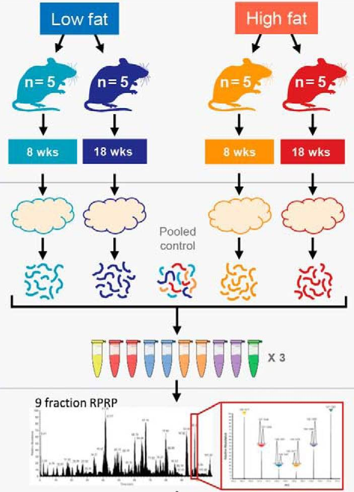

```{r echo = FALSE}
source("R/knitr_setup.R")
```

Solution of the TMT exercise in the design tutorial.

# Load packages

```{r}
library("msqrob2")
library("dplyr")
library("ggplot2")
library("patchwork")
library("BiocParallel")
register(SerialParam())
```

# Experimental context

The data used in this exercise has been published by @Plubell2017-th
(PXD005953). The objective of the experiment was to explore the impact
of low-fat and high-fat diets on the proteomic content of adipose
tissue in mice. It also assesses whether the duration of the diet may
impact the results. The authors assigned twenty mice into four groups
(5 mice per group) based on their diet, either low-fat (LF) or
high-fat (HF), and the duration of the diet, which was classified as
short (8 weeks) or long (18 weeks). Samples from the epididymal
adipose tissue were extracted from each mice. The samples were then
randomly distributed across three TMT 10-plex mixtures for analysis.
In each mixture, two reference labels were used, each containing
pooled samples that included a range of peptides from all the samples.
Not all labels were used, leading to an unbalanced design. Each TMT
10-plex mixture was fractionated into nine parts, resulting in a total
of 27 MS runs.

```{r, echo = FALSE, fig.cap="Overview of the experimental design. Taken from Plubell et al. 2017."}

```

# Data 

The data were reanalyzed by @Huang2020-lu and have been deposited in
the `MSV000084264` MASSiVE repository, but we will retrieve the
timestamped data from our [Zenodo
repository](https://zenodo.org/records/14767905). We need 2 files: the
Skyline identification and quantification table generated by the
authors and the sample annotation files.

```{r}
library("BiocFileCache")
bfc <- BiocFileCache()
psmFile <- bfcrpath(bfc, "https://zenodo.org/records/14767905/files/mouse_psms.txt?download=1")
annotFile <- bfcrpath(bfc, "https://zenodo.org/records/14767905/files/mouse_annotations.csv?download=1")
```

Let's prepare the data. We will also subset
the data set to reduce computational costs. We here randomly sample
500 proteins from the experiment.


```{r}
## Reading data
psms <- read.delim(psmFile)
coldata <- read.csv(annotFile)
coldata$Duration <- gsub("_.*", "", coldata$Condition) ## 1.
coldata$Diet <- gsub(".*_", "", coldata$Condition) ## 2.
colnames(coldata)[1] <- "Label" ## 3.
## Subsetting data
proteinIds <- unique(psms$Protein.Accessions)
set.seed(1234)
psms <- psms[psms$Protein.Accessions %in% sample(proteinIds, 500), ]
## Converting data
coldata$runCol <- coldata$Run
coldata$quantCols <- paste0("Abundance..", coldata$Label)
mouse <- readQFeatures(psms, colData = coldata,
                       quantCols = unique(coldata$quantCols),
                       runCol = "Spectrum.File", name = "psms")
names(mouse) <- sub("^.*(Mouse.*ACN).*raw", "\\1", names(mouse))
```

# Data preprocessing

We use the same data processing workflow as for the spike-in study in the [TMT lecture](tmtMixedModel.html): median of ratios
normalisation and maxLFQ summarisation, both performed run by run.

```{r}
inputNames <- names(mouse)
logNames <- paste0(inputNames, "_log")
normNames <- paste0(inputNames, "_norm")
summNames <- paste0(inputNames, "_proteins")
## Encode missing values
mouse <- zeroIsNA(mouse, inputNames)
## Log transformation
mouse <- logTransform(mouse, inputNames, name = logNames, base = 2)
## Sample filtering
mouse <- subsetByColData(
    mouse, mouse$Condition != "Norm" & mouse$Condition != "Long_M"
)
## PSM filtering
mouse <- filterFeatures(
    mouse, ~ Protein.Accessions != "" & ## Remove failed protein inference
        !grepl(";", Protein.Accessions)) ## Remove protein groups
for (i in logNames) { ## Remove duplicated PSMs
    rowdata <- rowData(mouse[[i]])
    rowdata$ionID <- paste0(rowdata$Annotated.Sequence, rowdata$Charge)
    rowdata$rowSums <- rowSums(assay(mouse[[i]]), na.rm = TRUE)
    rowdata <- data.frame(rowdata) |>
        group_by(ionID) |>
        mutate(psmRank = rank(-rowSums))
    rowData(mouse[[i]]) <- DataFrame(rowdata)
}
mouse <- filterFeatures(mouse, ~ psmRank == 1, keep = TRUE)
mouse <- filterNA(mouse, logNames, pNA = 0.7) ## Remove highly missing PSMs
## Normalisation: median of ratios, run by run
for (k in seq_along(logNames)) {
    mouse <- sweep(
        mouse,
        MARGIN = 2,
        STATS = nfLogMedianOfRatios(mouse, i = logNames[k]),
        i = logNames[k],
        name = normNames[k]
    )
}
## Protein summarisation: maxLFQ, run by run
mouse <- aggregateFeatures(
    mouse, i = normNames, name = summNames,
    fcol = "Protein.Accessions",
    fun = function(X) iq::maxLFQ(X)$estimate
)
## Join sets
mouse <- joinAssays(mouse, summNames, "proteins")
```

# Data exploration and modelling


Let's explore the data.

```{r}
library("scater")
se <- getWithColData(mouse, "proteins") |> 
  as("SingleCellExperiment") |> 
  runMDS(exprs_values = 1)
```

We plot the MDS and colour each sample based on different potential
sources of variation.

```{r}
plotMDS(se, colour_by = "Run") + ggtitle("Coloured by Run") +
  scale_colour_manual(values = rainbow(27)) +
  plotMDS(se, colour_by = "Fraction") + ggtitle("Coloured by Fraction") +
  plotMDS(se, colour_by = "BioReplicate") + ggtitle("Coloured by BioReplicate") +
  plotMDS(se, colour_by = "Mixture") + ggtitle("Coloured by Mixture") +
  plotMDS(se, colour_by = "Diet") + ggtitle("Coloured by Diet") +
  plotMDS(se, colour_by = "Duration") + ggtitle("Coloured by Duration") &
  theme(legend.position = "none") 
```

The data exploration leads to several observations: 

- The strongest source of variation is associated with the MS 
  acquisition run. 
- Part of this run effect is influenced by which fraction it contains
  since samples from the same fraction tend to be closer than samples from different
  fractions. 
- It is difficult to identify an effect of mouse (biological
  replicate) because every run contains distinct mice. However, this
  does not exclude an effect of mice which has been identified as a
  potential source of variation and hence should still be modelled.
- There is potentially also an effect of TMT mixture since samples
  from the same mixtures tend to cluster together (in the center of
  the plot). However, this effect are more subtle to detect and
  difficult to disentangle from the run and fraction effects.
- Although again very subtle, we can see within each run that samples
  from the mice with the same diet tends to group together. However,
  these effects are overwhelmed by the run effects. An effect of
  duration is to subtle to pinpoint from the current data exploration.

Data modelling disentangles the different sources of variation, given
they are properly defined in the model. 

Proteomics data contain several sources of variation that need to be
accounted for by the model:

1. **Treatment of interest**: we model the source of variation induced
   by the experimental treatment of interest as a **fixed effect**.
   Fixed effects are effect that are considered non-random, i.e. the
   treatment effect is assumed to be the same and reproducible across
   repeated experiments, but it is unknown and has to be estimated. We
   will include `Diet` as a fixed effect that models the fact that a
   change in diet type can induce changes in protein abundance.
   Similarly, we also include `Duration` as a fixed effect to model
   the change in protein abundance induces by the diet duration.
   Finally, we will also include an interaction between the two
   variables allowing that the changes in protein abundance induced by
   diet type can be different whether the mice were fed for a short or
   long duration.

2. **Biological replicate effect**: the experiment involves biological
   replication as the adipose tissue extracts were sampled from 20
   mice (5 mice per Diet x Duration combination). Replicate-specific
   effects occurs due to uncontrollable factors, such as social
   behavior, feeding behavior, physical activity, occasional
   injury,... Two mice will never provide exactly the same sample material,
   even were they genetically identical and manipulated identically.
   These effects are typically modelled as random effects which are
   considered as a random sample from the population of all possible
   mice and are assumed to be i.i.d normally distributed with mean 0
   and constant variance, $b_\text{mouse} \sim
   N(0,\sigma^2_\text{mouse})$. The use of random effects thus
   models the correlation in the data, explicitly. We expect that
   intensities from the same mouse are more alike than intensities
   between mice. Note that every mouse corresponds to one sample, i.e.
   one label in one mixture, that has been measured in 9 runs (one for
   each fraction). The mouse effect thus plays the same role as the
   sample effect `(1 | Mixture:Label)` in the spike-in study: without
   it, the 9 runs of a mouse would be treated as independent samples.

```{r}
length(unique(mouse$BioReplicate))
```

3. **Labelling effects**: the 20 mouse adipose tissue samples have been
   labelled using 18-plex TMT. We can expect that samples measured
   within the same TMT label may be more similar than samples
   measured within different TMT labels. Since these effects may not
   be reproducible from one experiment to another, for instance
   because each TMT kit may potentially contain different impurity
   ratios, we can account for this correlation using a random effect
   for TMT label.

```{r}
length(unique(mouse$Label))
```

4. **Mixture effects**: the 20 mouse samples were assigned to one out
   of 3 mixtures. Again, we expect protein intensities from the same
   mixture will be more alike than those of different mixtures. Hence,
   we will add a random effect for mixture.

```{r}
table(mouse$Mixture)
```

5. **Run effects**: protein intensities that are measured within the 
   same run will be more similar than protein intensities between
   runs. We will use a random effect for run to explicitly model this
   correlation in the data. Note that each sample has been acquired in
   9 fractions, each fraction being measured in a separate run.
   Accounting for the effects of run will also absorb the effects of
   fraction.

```{r}
length(unique(mouse$Run))
```

We will model the main effects for `Diet` and `Duration`, and a
`Diet:Duration` interaction, to account for proteins for which the
`Diet` effect changes according to `Duration`, and vice versa, which
can be written as `Diet + Duration + Diet:Duration`, shortened into
`Diet * Duration` (recall the heart example in a previous course).
Adding the technical sources of variation, the model becomes.

```{r}
model <- ~ Diet * Duration + ## (1) fixed effect for Diet and Duration with interaction
  (1 | BioReplicate) +  ## (2) random effect for biological replicate (mouse)      
  (1 | Label) + ## (3) random effect for label
  (1 | Mixture) + ## (4) random effect for mixture
  (1 | Run) ## (5) random effect for MS run
```

We estimate the model with `msqrob()`.

```{r run_msqrob_ion}
mouse <- msqrob(mouse, i = "proteins", formula = model)
```

**Difference between low fat and high fat diet after short duration**

We need to convert this question in a combination of the model
parameters. We guide the contrast definition using the
`ExploreModelMatrix` package. Since we are not interested in technical
effects, we will only focus on the variables of interest, here `Diet *
Duration`.

```{r}
library("ExploreModelMatrix")
vd <- VisualizeDesign(
    sampleData =  colData(mouse),
    designFormula = ~ Diet * Duration,
    textSizeFitted = 4
)
vd$plotlist[[1]]
```

Assessing the difference between low-fat and high-fat diets for short
duration boils down to assessing the difference between the `Short_LF` and
`Short_HF`. The mean for the short low-fat diet group is defined by
`(Intercept) + DietLF + DurationShort + DietLF:DurationShort`. The
mean for the short high-fat diet group is defined by `(Intercept) +
DurationShort`. The difference between the two results in the
contrast below:

```{r}
(L <- makeContrast(
    "DietLF + DietLF:DurationShort = 0",
    parameterNames = c("DietLF", "DietLF:DurationShort")
))
mouse <- hypothesisTest(mouse, i = "proteins", L)
```

Let us retrieve the result table from the `rowData`. Note that the
model column is named after the column names of the contrast matrix `L`.

```{r}
inference <- rowData(mouse[["proteins"]])[[colnames(L)]]
head(inference)
```

The table contains the hypothesis testing results for every protein.

We can use the table above directly to build a volcano plot using
`ggplot2` functionality.

```{r}
ggplot(inference) +
    aes(x = logFC, y = -log10(pval)) +
    geom_hline(yintercept = -log10(inference$pval[which.min(abs(inference$adjPval - 0.05))] )) +
    geom_point() +
    ggtitle("Statistical inference on differences between LF and HF (short duration)",
            paste("Hypothesis test:", colnames(L), "= 0"))
```

In this example (remember this is a subset of the complete data set),
only a few proteins pass the significance threshold of 5% FDR. 

**Difference between low fat and high fat diet after long duration**

Following the same approach as above, the hypothesis test becomes: 

```{r}
L <- makeContrast("DietLF = 0", parameterNames = "DietLF")
mouse <- hypothesisTest(mouse, i = "proteins", L)
inference <- rowData(mouse[["proteins"]])[[colnames(L)]]
head(inference)
```

And we plot the results.

```{r}
ggplot(inference) +
    aes(x = logFC, y = -log10(pval)) +
    geom_hline(yintercept = -log10(inference$pval[which.min(abs(inference$adjPval - 0.05))] )) +
    geom_point() +
    ggtitle("Statistical inference on differences between LF and HF (long duration)",
            paste("Hypothesis test:", colnames(L), "= 0"))
```

Again, only a few proteins come out differentially abundant between
the two diets, but after a long diet duration.

**Average difference between low fat and high fat diet**

One may want to identify the set of proteins that are systematically
differentially abundant between diets, irrespective of the duration.
To answer this question, we want to infer on the average difference
between group `LF` and group `HF`. The average low-fat diet is defined
by `((Intercept) + DietLF + DurationShort + DietLF:DurationShort +
(Intercept) + DietLF)/2`. The average high-fat diet group is defined
by `((Intercept) + DurationShort + (Intercept))/2`. The difference
between the two results in the hypothesis test below:

```{r}
L <- makeContrast(
    "DietLF + (DietLF:DurationShort)/2 = 0",
    parameterNames = c("DietLF", "DietLF:DurationShort")
)
mouse <- hypothesisTest(mouse, i = "proteins", L)
inference <- rowData(mouse[["proteins"]])[[colnames(L)]]
head(inference)
```

And we plot the results.

```{r}
ggplot(inference) +
    aes(x = logFC, y = -log10(pval)) +
    geom_hline(yintercept = -log10(inference$pval[which.min(abs(inference$adjPval - 0.05))] )) +
    geom_point() +
    ggtitle("Statistical inference on average difference between LF and HF",
            paste("Hypothesis test:", colnames(L), "= 0"))
```

**Interaction: does the diet effect change according to duration?**

We will now explore whether the effect of diet on protein abundance
may be affected by duration, i.e. we want to infer on the difference
of differences. The difference between hypothesis 1 and 2 is `(DietLF
+ DietLF:DurationShort) - (DietLF)` and results in the hypothesis
below:

We can proceed with the same statistical pipeline.

```{r}
L <- makeContrast(
    "DietLF:DurationShort = 0",
    parameterNames = "DietLF:DurationShort"
)
mouse <- hypothesisTest(mouse, i = "proteins", L)
inference <- rowData(mouse[["proteins"]])[[colnames(L)]]
head(inference)
```

And we plot the results.

```{r}
ggplot(inference) +
    aes(x = logFC, y = -log10(pval)) +
    geom_hline(yintercept = -log10(inference$pval[which.min(abs(inference$adjPval - 0.05))] )) +
    geom_point() +
    ggtitle("Statistical inference on the effect of duration on the differences between diets",
            paste("Hypothesis test:", colnames(L), "= 0"))
```


# Session Info

```{r}
sessionInfo()
```

# References
