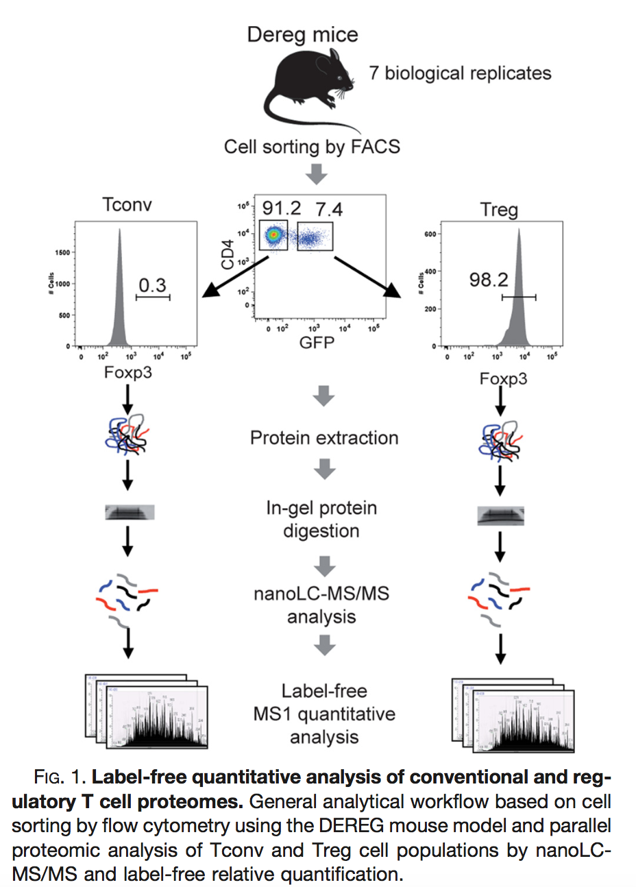
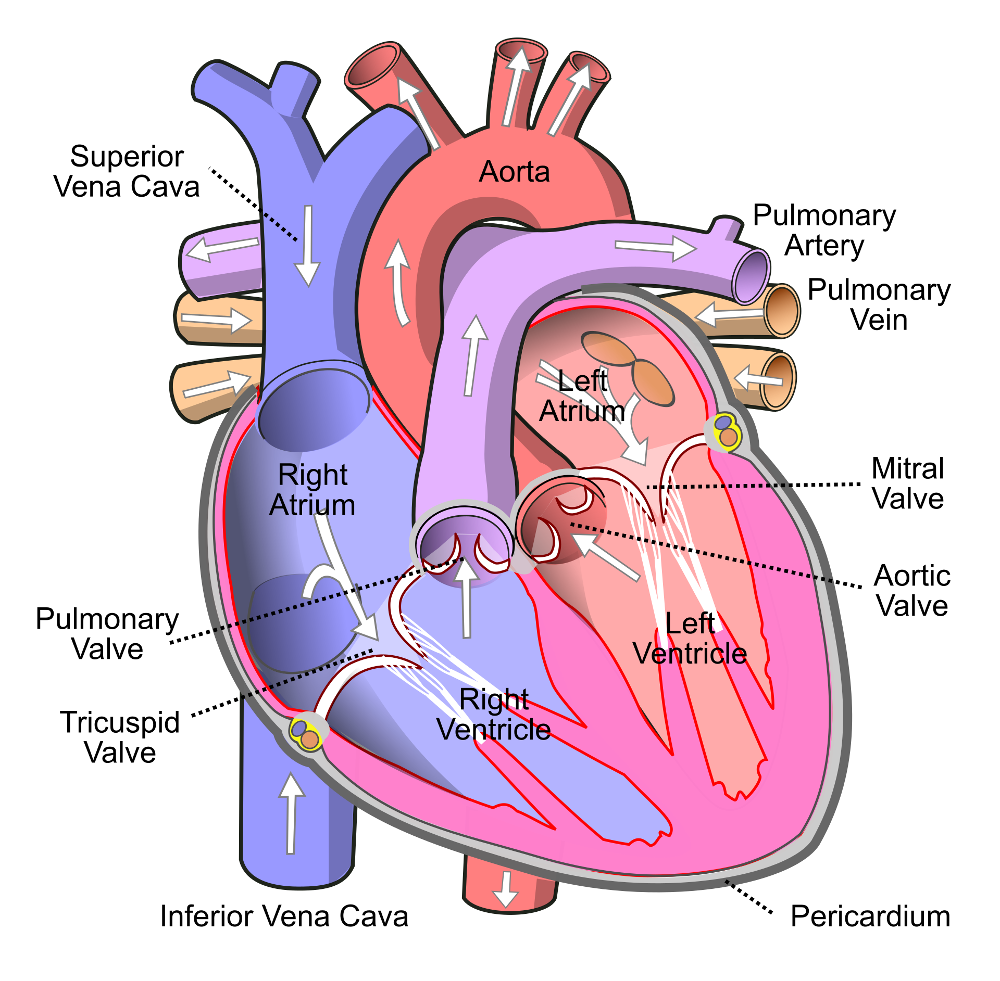

The result of a quantitative analysis is a list of peptide and/or protein abundances for every protein in different samples, or abundance ratios between the samples. In this chapter we will extend our generic workflow for differential analysis of quantitative datasets with more complex experimental designs.

We will start with assessing the impact of sample size. Then we will introduce the concept of blocking and we will continue with the analysis of a subset of the mouse diet data. Then, we will analyse an experiment with technical repeats, which requires mixed models to account for pseudo-replication. Finally, we will analyse a TMT experiment with multiple mixtures and runs.

# Breast cancer example

Eighteen Estrogen Receptor Positive Breast cancer tissues from patients treated with tamoxifen upon recurrence have been assessed in a proteomics study. Nine patients had a good outcome (or) and the other nine had a poor outcome (pd).
The proteomes have been assessed using an LTQ-Orbitrap in data dependent acquisition (DDA) mode and the Thermo output .RAW files were searched with MaxQuant (version 1.4.1.2) against the human proteome database (FASTA version 2012-09, human canonical proteome). 

The raw data can be found in the folder dda/cancer after downloading and unzipping 
all data locally. [Download data](https://github.com/statOmics/msqrob2data/archive/refs/heads/main.zip)

Preprocessed data are also already stored as QFeatures objects. They can be loaded in R using readRDS or directly with the launchMsqrob2ModelingApp(). So you only have to read the data and you can start with section 5 Data exploration in the basic script or in the  GUI. 

```{r eval=FALSE}
qf <- readRDS(url("https://github.com/statOmics/PDA-DIA/raw/refs/heads/main/data/cancer3x3.rds","rb"))
```

Three QFeatures objects are available (you can simply modify the url above replacing the filename):

1. For a 3 vs 3 comparison: cancer3x3.rds
2. For a 6 vs 6 comparison: cancer6x6.rds
3. For a 9 vs 9 comparison: cancer9x9.rds

So you can skip the preprocessing to save some time. This can be done in a GUI that starts from a QFeatures object stored in `rds` format: `launchMsqrob2ModelingApp()`. Alternatively you can do the full data processing by adjusting the script [cptac Rmarkdown script](./cptac.html) or performing the analysis using the [msqrob2GUI](./staes248-GUI.html). 


# Blocking: Mouse T-cell example

[@DuguetEtAl2017] compared the proteomes of mouse regulatory T cells (Treg) and conventional T cells (Tconv) in order to discover differentially regulated proteins between these two cell populations. For each biological repeat the proteomes were extracted for both Treg and Tconv cell pools, which were purified by flow cytometry. The data in dda/mouseTcell
 are a subset of the data [PXD004436](https://www.ebi.ac.uk/pride/archive/projects/PXD004436) on PRIDE.



The proteomes have been assessed using data dependent acquisition (DDA) mode. 

Three subsets of the data are available:

- peptidesCRD.txt: contains data of Tconv cells for 4 bio-repeats and Treg cells for 4 bio-repeats
- peptidesRCB.txt: contains data for 4 bio-repeats only, but for each bio-repeat the Treg and Tconv proteome is profiled.   
- peptides.txt: contains data of Treg and Tconv cells for 7 bio-repeats

Users using R-scripts can import the data using following links:

```
https://github.com/statOmics/msqrob2data/raw/refs/heads/main/dda/mouseTcell/peptidesCRD.txt
https://github.com/statOmics/msqrob2data/raw/refs/heads/main/dda/mouseTcell/peptidesRCB.txt
https://github.com/statOmics/msqrob2data/raw/refs/heads/main/dda/mouseTcell/peptides.txt
```

Users with the GUI can find the datasets in directory dda/mouseTcell after
downloading and unzipping the data ([Download data](https://github.com/statOmics/msqrob2data/archive/refs/heads/main.zip)).

1. How would you analyse the CRD data?

2. How would you analyse the RCB data?

3. Try to explain the difference in the number of proteins that can be discovered with both designs?

# Block design with multiple factors: Heart example 



Researchers have assessed the proteome in different regions of the heart for 3 patients (identifiers 3, 4, and 8). For each patient they sampled the left atrium (LA), right atrium (RA), left ventricle (LV) and the right ventricle (RV). The data are a small subset of the public dataset  [PXD006675](https://www.ebi.ac.uk/pride/archive/projects/PXD006675) on PRIDE.

Users using R-scripts can import the data using following links:
```
https://github.com/statOmics/msqrob2data/raw/refs/heads/main/dda/heart/peptides.txt
```

Users with the GUI can find the datasets in directory dda/heart after
downloading and unzipping the data ([Download data](https://github.com/statOmics/msqrob2data/archive/refs/heads/main.zip)).


Suppose that researchers are mainly interested in comparing the ventricular to the atrial proteome.
Particularly, they would like to compare the left atrium to the left ventricle, the right atrium to the right ventricle, the average ventricular vs atrial proteome and if ventricular vs atrial proteome shifts differ between left and right heart regions.

1. Adjust the script [cptac Rmarkdown script](./cptac.html) or perform the analysis using the [msqrob2GUI](./staes248-GUI.html). 

2. Redo the analysis but use median normalisation: `diff.median`, what do you observe? Explain

# Pseudo-replication: Francisella example

[@Ramond2015-rz] compared the proteome of wild type Francisella tularensis (WT) to ArgP-gene deleted F. tularensis (knock-out, D8). Bacterial cultures were grown in biological triplicate for each genotype and each bio-repeat was run in technical triplicate (3 MS-runs) on a nanoRSLC-Q Exactive PLUS instrument, resulting in 2 genotypes $\times$ 3 bio-repeats $\times$ 3 technical repeats = 18 runs. The proteomes have been assessed using data dependent acquisition (DDA) mode and the data were searched with MaxQuant. The data are available on PRIDE: [PXD001584](https://www.ebi.ac.uk/pride/archive/projects/PXD001584).

Users using R-scripts can import the data and the annotation file with the design (variables `genotype` and `biorep`) using following links:

```
https://github.com/statOmics/msqrob2data/raw/refs/heads/main/dda/francisellaFull/peptides.txt
https://github.com/statOmics/msqrob2data/raw/refs/heads/main/dda/francisellaFull/francisella_annotation.csv
```

Users with the GUI can find the datasets in directory dda/francisellaFull after
downloading and unzipping the data ([Download data](https://github.com/statOmics/msqrob2data/archive/refs/heads/main.zip)).

1. Make an MDS plot of the preprocessed protein-level data and colour the samples according to genotype and label them according to bio-repeat. What do you observe?


2. In the original paper, the authors analysed the data as if each MS-run was an independent sample. Perform this analysis by adjusting the script [cptac Rmarkdown script](./cptac.html). How many proteins are found to be differentially abundant between the genotypes?

3. Can you correct for bio-repeat using a randomized complete block analysis as in the mouse T-cell example? Hint: visualise the design with `ExploreModelMatrix::VisualizeDesign(colData(qf), ~ genotype + biorep)`.

4. Consider the fish tank example from the course notes and our discussion on experimental and observational units. Can you port this to the Francisella experiment? What are experimental and observational units here? What does this imply for the analysis?

5. Can you redo the analysis with a correct model? How many proteins are now found to be differentially abundant? Explain the difference with the analysis of question 2.

6. Write down the variance-covariance matrix of the protein intensities that is implied by the mixed model.

# Mixed models for TMT: mouse diet example

@Plubell2017-th (PXD005953) explored the impact of low-fat and high-fat diets on the proteome of adipose tissue in mice, and whether the duration of the diet affects the results.
Twenty mice were assigned to four groups (5 mice per group) based on their diet, either low-fat (LF) or high-fat (HF), and the duration of the diet, short (8 weeks) or long (18 weeks).
Samples from the epididymal adipose tissue were extracted from each mouse and randomly distributed across three TMT 10-plex mixtures.
In each mixture, two reference labels were used, each containing a pool of all the samples.
Not all labels were used, leading to an unbalanced design.
Each TMT 10-plex mixture was fractionated into nine parts, resulting in a total of 27 MS runs.


The data were reanalysed by @Huang2020-lu. Users using R-scripts can import the PSM table generated by Skyline and the sample annotation file using the following links:

```
https://zenodo.org/records/14767905/files/mouse_psms.txt?download=1
https://zenodo.org/records/14767905/files/mouse_annotations.csv?download=1
```

To reduce the computational cost, you can randomly sample 500 proteins from the PSM table.

1. Import and preprocess the data following the spike-in study in the [TMT lecture](./tmtMixedModel.html). Remove the reference samples (`Condition` equal to `Norm`) and the samples with `Condition` equal to `Long_M`. Why do the normalisation and the summarisation have to be performed run by run?

2. Make MDS plots of the protein-level data and colour the samples according to run, fraction, mixture, mouse (`BioReplicate`), diet and duration. What do you observe?

3. What are the experimental units and the observational units in this experiment? In how many runs is every mouse sample measured, and what does this imply for the analysis?

4. Build a model that accounts for all sources of variation in the experiment. Which effects do you model as fixed effects and which as random effects? Use `Diet` and `Duration` as the experimental variables of interest.

5. Use `msqrob2` to answer the following questions, and report the results with a volcano plot and a table of the differentially abundant proteins. Hint: `ExploreModelMatrix::VisualizeDesign()` helps you to define the contrasts.

    - What is the difference in protein abundance between the low-fat and the high-fat diet after a short duration?
    - What is the difference in protein abundance between the low-fat and the high-fat diet after a long duration?
    - What is the average difference in protein abundance between the low-fat and the high-fat diet?
    - Does the diet effect change according to the duration?
