```{r echo = FALSE}
source("R/knitr_setup.R")
```

```{r, warning=FALSE, message=FALSE}
library(tidyverse)
library(SummarizedExperiment)
library(edgeR)
library(BiocFileCache)
library(tximeta)
library(org.Hs.eg.db)
library(ExploreModelMatrix)
library(macrophage)
library(patchwork)
```

In the first module of the course we studied the proteome: the concentrations of proteins in biological samples.
In this module we move to the transcriptome: the concentrations of messenger RNA (mRNA) molecules, which may be translated into proteins, but may also have functions on their own.

This chapter covers three parts:

1. How RNA-seq data are generated: from RNA molecules in a sample to a table of counts.
2. How we model count data: from the Poisson distribution for technical replicates to the negative binomial and quasi-likelihood models for biological replicates.
3. A complete differential expression workflow in R on the macrophage data set.

The statistical background of the methods (generalised linear models, quasi-likelihood, normalisation and filtering) and the analysis at the transcript level are covered in the [technical details chapter](05-rnaseq-technical.html).

# The study of gene expression

```{r echo=FALSE, out.width="80%", fig.cap="Central paradigm of biology: a gene, a specific region in the DNA, is first transcribed into RNA and then translated into a protein. For RNA genes the RNA molecule itself is the end product, which is referred to as non-coding RNA (ncRNA) (Source: Wikipedia)."}
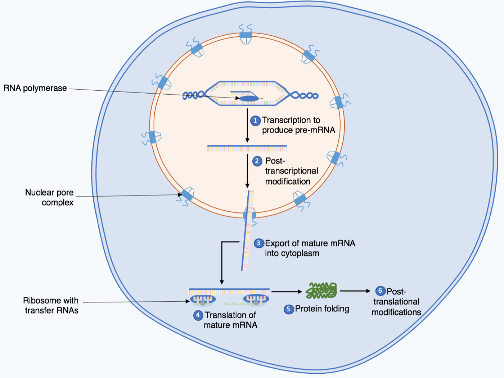
```

- The proteome is only part of the picture: transcription is regulated and the mRNA concentrations of a gene reflect its activity in a sample.
- mRNA is much easier to measure at scale than proteins: sequencing gives a readout for (almost) all genes at once.

## Alternative splicing

```{r echo=FALSE, out.width="70%", fig.cap="Alternative splicing allows a single gene in eukaryotes to code for multiple proteins. Particular exons of a gene may be included or excluded from the premature messenger RNA, so that exons are joined in different combinations, leading to different mRNA molecules (isoforms or transcripts). The proteins translated from alternatively spliced mRNAs differ in their amino acid sequence and, often, in their function (Source: Wikipedia)."}
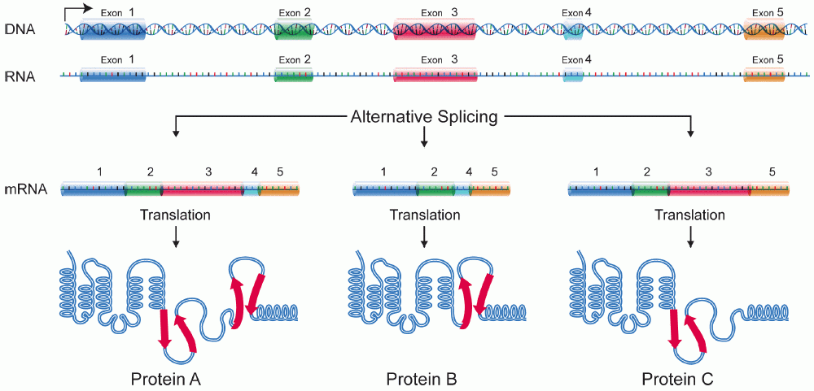
```

- A gene can thus produce several **transcripts** (isoforms).
- We can quantify expression at the gene level, by combining all transcripts of a gene, or at the transcript level.
- Changes in the relative abundance of the transcripts of a gene (**differential transcript usage**) are discussed in the [technical details chapter](05-rnaseq-technical.html).

# Sequencing technology

- mRNA is typically measured by sequencing.
- The technology evolves at an incredible speed: the output of so-called next generation sequencing machines has more than doubled every year, while the cost per gigabase keeps dropping.
- The large majority of RNA-seq data are generated by sequencing-by-synthesis on machines produced by Illumina.
- Long-read technologies from Pacific Biosciences and Oxford Nanopore sequence full-length molecules. They are increasingly used for transcript discovery and isoform quantification, but short reads remain the standard for gene expression studies because of their higher throughput and lower cost per read.

```{r echo=FALSE, out.width="70%", fig.cap="The data output revolution of sequencing machines (Source: Illumina)."}
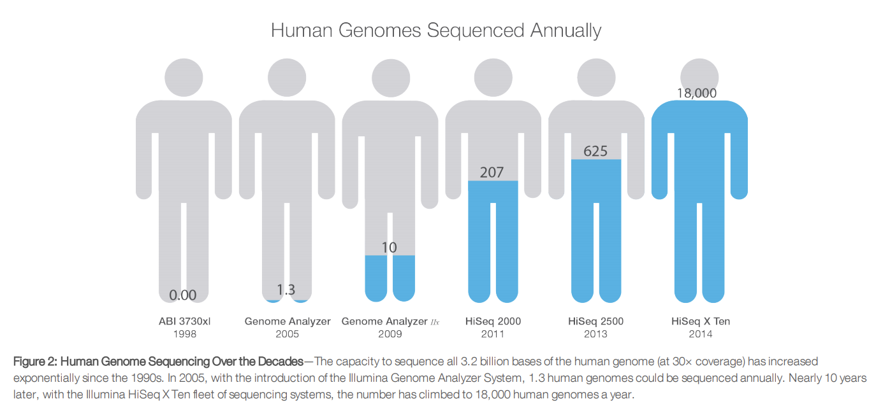
```

## From sample to data analysis

```{r echo=FALSE, out.width="90%", fig.cap="The RNA-seq workflow (adapted from Van den Berge et al., 2019)."}
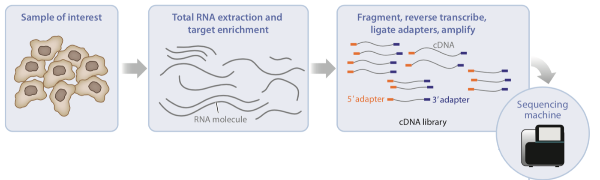
```

Library preparation consists of the following steps [@VandenBerge2019-review]:

1. **Collect the samples of interest.** Several types of input samples are amenable to sequencing, such as fresh frozen tissue or FFPE preserved samples.
2. **Capture the mRNA molecules.** The cells are lysed and the RNA is extracted. mRNA is mostly captured by
    - poly-A selection, which selects polyadenylated RNA, or
    - ribosomal depletion, which removes ribosomal RNA, so that also non-polyadenylated RNA, e.g. long non-coding RNA, is retained.
3. **Fragmentation.** The captured molecules are fragmented chemically or mechanically, typically to a size of 300 to 500 bp.
4. **Reverse transcription.** The sequencers only sequence double-stranded DNA, so the RNA fragments are reverse transcribed into complementary DNA (cDNA).
5. **Adapter ligation.** Platform-specific adapter sequences are added to both ends of the fragments so that the sequencer can recognise them.
   Adapters can also carry a sample barcode, so that several samples can be pooled and sequenced together (multiplexing).
6. **PCR amplification** to increase the concentration of the library.
7. **Sequencing.** The library is loaded on the sequencer. See [this video](https://www.youtube.com/watch?v=fCd6B5HRaZ8) on sequencing-by-synthesis.

## Illumina sequencing

```{r echo=FALSE, out.width="80%", fig.cap="Illumina sequencing, steps 1 to 6 (Source: Illumina)."}
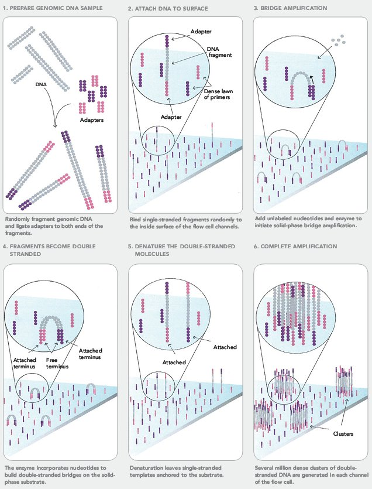
```

```{r echo=FALSE, out.width="80%", fig.cap="Illumina sequencing, steps 7 to 12 (Source: Illumina)."}
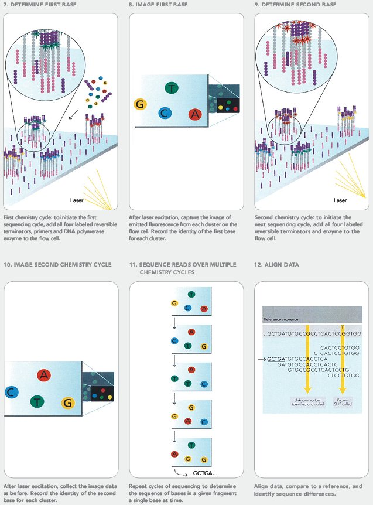
```

## Protocol choices

```{r echo=FALSE, out.width="60%", fig.cap="Single-end versus paired-end sequencing. In paired-end sequencing both ends of a fragment are sequenced (from Zhernakova et al., 2013, doi:10.1371/journal.pgen.1003594)."}
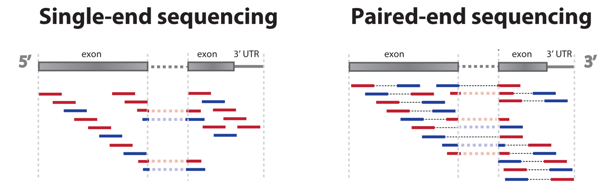
```

- **Single-end vs paired-end**: one or both ends of each fragment are sequenced. Paired-end reads carry more information to locate a fragment, which is especially useful at the transcript level.
- **Stranded vs unstranded**: stranded protocols preserve the information from which DNA strand the RNA was transcribed.
- **Read length and sequencing depth**: the number of reads per sample. For gene expression, more biological replicates are typically more valuable than a higher depth.

## The sequencing output: FASTQ files

- The sequencer returns a FASTQ file per sample (two for paired-end data), with millions of sequences, called **reads**.
- Each read takes four lines:
    1. a sequence identifier, starting with `@`,
    2. the sequence,
    3. a separator line, starting with `+`,
    4. a quality score for every base call.

```{r echo=FALSE, out.width="90%", fig.cap="One read in a FASTQ file (slide courtesy of Charlotte Soneson)."}
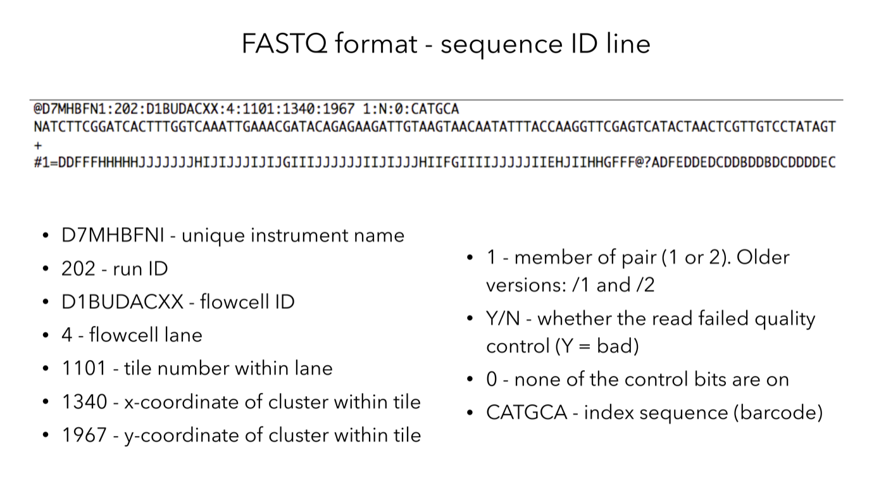
```

The quality scores are Phred scores, $Q = -10 \log_{10} p$, with $p$ the probability of an incorrect base call.
They are stored as ASCII characters: with the common Phred+33 encoding the character with ASCII code $Q + 33$ is stored.

```{r echo=FALSE}
data.frame(
  Q = seq(10, 40, 10),
  p = paste0("1/", 10^(1:4)),
  accuracy = paste0((1 - 1/10^(1:4)) * 100, "%"),
  ASCII = sapply(as.raw(seq(10, 40, 10) + 33), rawToChar)
) |>
  knitr::kable(col.names = c("Phred score", "Probability of an incorrect base call", "Base call accuracy", "Phred+33 character"))
```

# Preprocessing of raw reads

```{r echo=FALSE, out.width="90%", fig.cap="The RNA-seq workflow including preprocessing and mapping (adapted from Van den Berge et al., 2019)."}
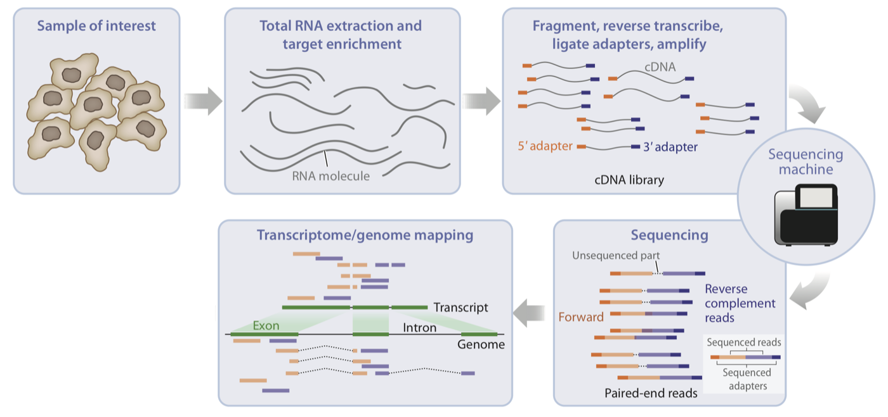
```

## Quality control

- Quality control (QC) checks the quality of each sample, e.g. to detect degraded RNA or adapter contamination.
- The most popular QC tool is [FastQC](https://www.bioinformatics.babraham.ac.uk/projects/fastqc/). [MultiQC](https://multiqc.info/) aggregates the reports of many samples.
- Compare a report of [good](https://www.bioinformatics.babraham.ac.uk/projects/fastqc/good_sequence_short_fastqc.html) and [bad](https://www.bioinformatics.babraham.ac.uk/projects/fastqc/bad_sequence_fastqc.html) Illumina data.

The most important plot shows the distribution of the Phred quality scores at every position in the reads.

```{r echo=FALSE, out.width="100%", fig.cap="Per-base sequence quality of good and bad Illumina data: boxplots of the Phred scores at every position in the reads, with the mean in blue. Green: good quality, orange: reasonable, red: poor. Source: FastQC example reports."}
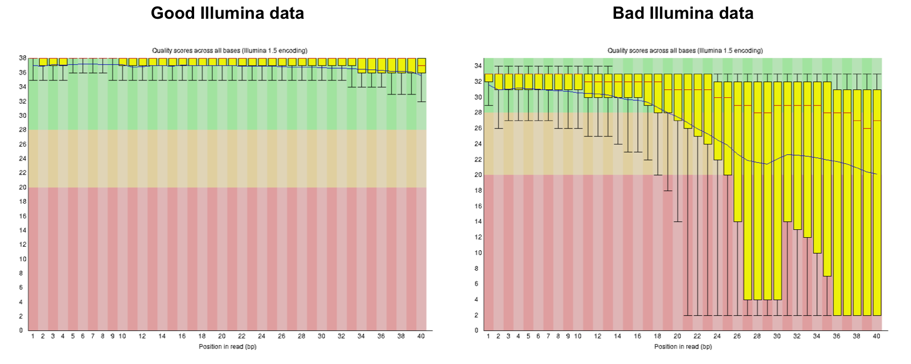
```

- In good data the quality stays high over the whole read.
- In bad data the quality drops towards the end of the reads: these bases can be trimmed (see below).

FastQC flags every module with pass, warn or fail. Its thresholds assume a random sample of genomic DNA, so some flags are expected for RNA-seq data:

- **Sequence duplication levels**: highly expressed transcripts produce many identical fragments.
- **Per base sequence content**: the base composition of the first 10 to 15 bases is uneven because of the random hexamer priming during library preparation.
- **Overrepresented sequences**: often fragments of very highly expressed transcripts, e.g. mitochondrial or ribosomal RNA.

## Read trimming and filtering

- Trimming of adapter sequences, barcodes, poly-A tails and, if needed, low quality bases at the end of reads. This is often already done by the sequencing provider.
- Filtering of low quality reads.
- In RNA-seq we do **not** remove duplicate reads: highly expressed transcripts naturally produce many identical fragments.

# Mapping and quantification

- Mapping assigns each read to the genomic feature(s) (genes, transcripts, exons) that could have produced it.
- The number of reads assigned to a feature is a proxy for its expression in the sample.
- Mapping is hard: many reads cannot be assigned uniquely and are compatible with several genes or transcripts (**multi-mapping** reads).

## Reference files

- A **reference genome** is a representative genome sequence of a species. It comes with an annotation file (GTF or GFF) that defines the coordinates of the genes, transcripts and exons.
- A **reference transcriptome** contains the sequences of all known transcripts.
- Both can be downloaded from e.g. [Ensembl](https://www.ensembl.org/info/data/ftp/index.html) or [GENCODE](https://www.gencodegenes.org/human/).

```{r echo=FALSE, out.width="90%", fig.cap="A reference genome (slide courtesy of Charlotte Soneson)."}
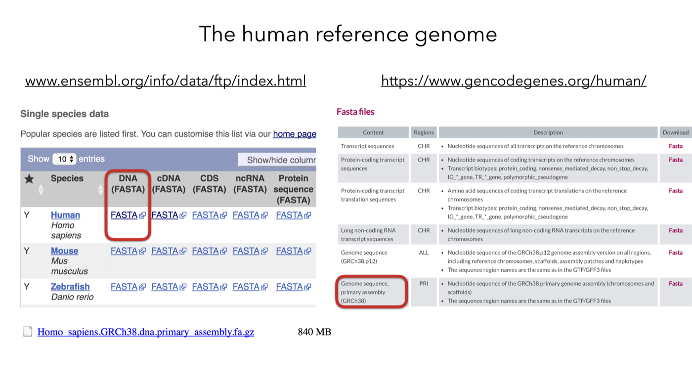
```

```{r echo=FALSE, out.width="90%", fig.cap="A reference transcriptome (slide courtesy of Charlotte Soneson)."}
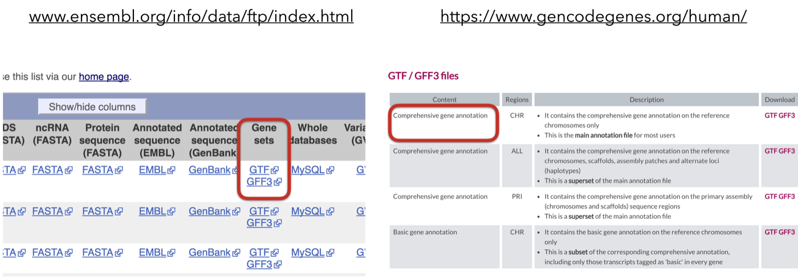
```

```{r echo=FALSE, out.width="90%", fig.cap="An example GTF file."}
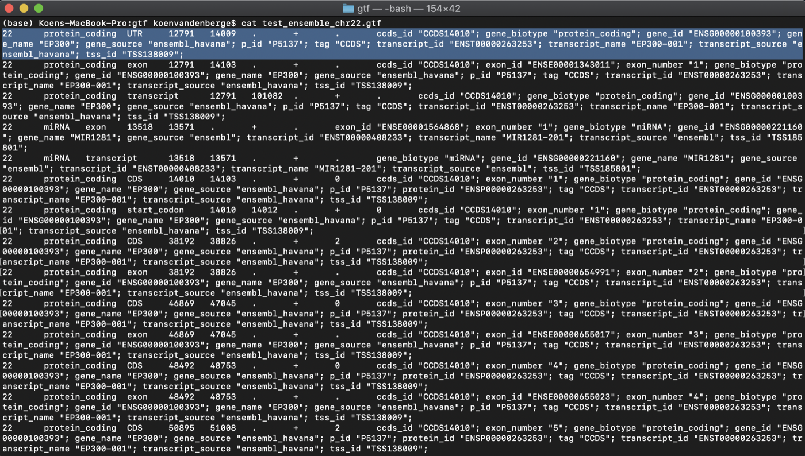
```

## Alignment-based workflows

- Reads are aligned to the exact position in the reference genome, e.g. with [STAR](https://github.com/alexdobin/STAR).
- Because of splicing, a read can span an exon-exon junction and has to be split over positions that can be thousands of basepairs apart (**spliced alignment**).
- The aligned reads are then counted per gene, e.g. with featureCounts. Many heuristic choices are involved: do we count reads that only partly overlap a gene, intronic reads, multi-mapping reads?

```{r echo=FALSE, out.width="70%", fig.cap="Unspliced and spliced alignment (from Van den Berge et al., 2019)."}
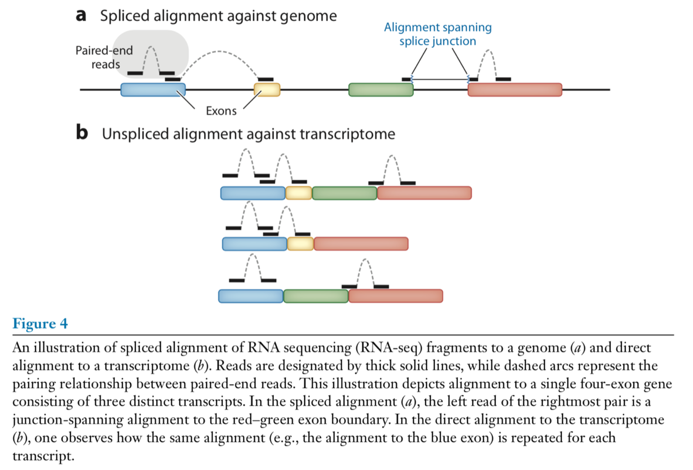
```

```{r echo=FALSE, out.width="70%", fig.cap="Gene- and exon-level read counting (adapted from Charlotte Soneson)."}
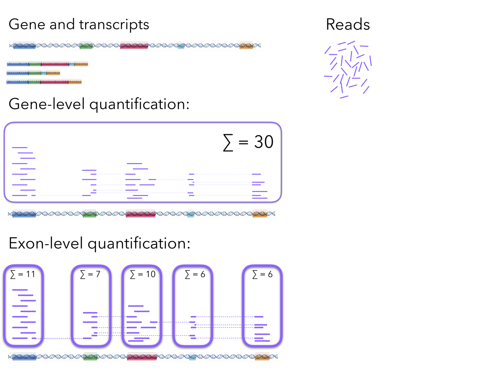
```

## Alignment-free workflows

- Lightweight methods such as kallisto [@Bray2016-kallisto] and salmon [@Patro2017-salmon] do not search the exact position of each read in the genome.
- They map reads to a reference transcriptome using $k$-mers, short subsequences of length $k$.
- For each read they determine the set of transcripts it is compatible with: its **equivalence class**.
- This is much faster and requires much less memory than spliced alignment to the genome.

```{r echo=FALSE, out.width="90%", fig.cap="Overview of kallisto (from Bray et al., 2016)."}
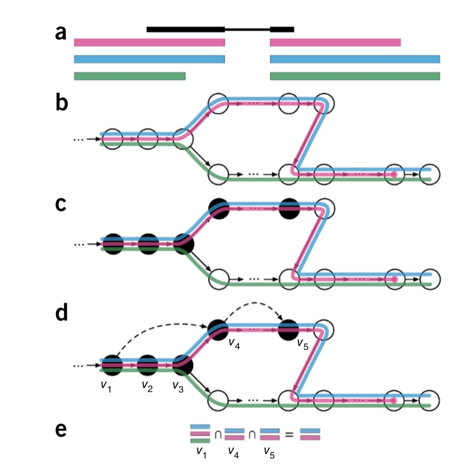
```

## Abundance estimation

- Counting reads per gene ignores the multi-mapping problem at the transcript level.
- Lightweight methods therefore **estimate** the transcript abundances with a statistical model.
- The number of reads in each equivalence class are sufficient statistics. The abundances are estimated by the EM algorithm, which assigns each read probabilistically to its compatible transcripts.
- The resulting counts are estimated counts, which are not necessarily integers.

```{r echo=FALSE, out.width="90%", fig.cap="Abundance estimation with the EM algorithm (from Van den Berge et al., 2019)."}
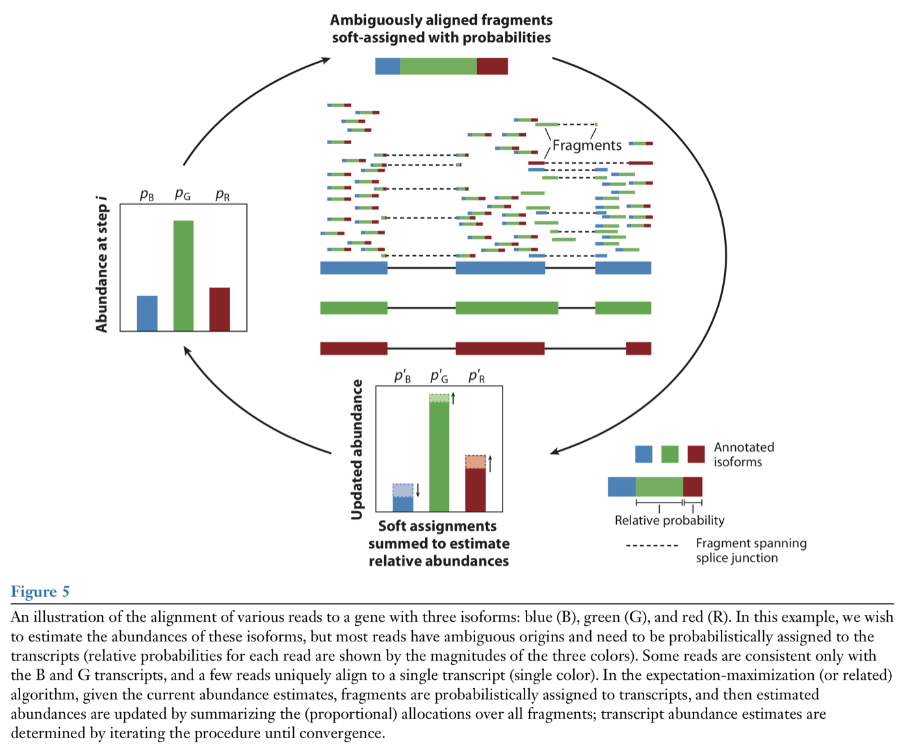
```

Read-to-transcript ambiguity makes the estimated transcript counts more variable than gene counts.
We come back to this when we analyse data at the transcript level in the [technical details chapter](05-rnaseq-technical.html).

## Running salmon

With salmon, mapping and quantification takes two commands: building an index of the reference transcriptome, which only has to be done once, and quantifying each sample.

```
salmon index -t gencode.v29.transcripts.fa.gz -i gencode.v29_salmon_index --gencode

salmon quant -i gencode.v29_salmon_index -l A \
  -1 SAMEA103884898_1.fastq.gz -2 SAMEA103884898_2.fastq.gz \
  --validateMappings --gcBias --numGibbsSamples 20 -o quants/SAMEA103884898
```

- `-l A`: salmon automatically detects the library type, e.g. whether the protocol is stranded.
- `--gcBias`: corrects for fragment GC-content bias.
- `--numGibbsSamples 20`: draws 20 Gibbs samples of the counts to quantify their uncertainty (see the [technical details chapter](05-rnaseq-technical.html)).

We use the salmon quantifications of the macrophage data set, which we introduce below.
They are distributed with the Bioconductor package macrophage.

```{r}
macDir <- system.file("extdata", package = "macrophage")
list.files(file.path(macDir, "quants", "SAMEA103884898"))
```

Every sample has its own folder with a (here compressed) `quant.sf` file:

```{r}
read.delim(file.path(macDir, "quants", "SAMEA103884898", "quant.sf.gz")) |>
  head()
```

- `Length`: the length of the transcript.
- `EffectiveLength`: the number of positions where a fragment of typical length can start, corrected for sequence and GC bias.
- `TPM`: transcripts per million (see below).
- `NumReads`: the estimated number of reads (counts) for the transcript.

## Abundance metrics

Let $Y_{gi}$ be the count of feature $g$ in sample $i$ and $N_i = \sum_g Y_{gi}$ the sequencing depth (library size) of sample $i$.

- A sample that is sequenced deeper gives higher counts for all genes.
- A longer transcript produces more fragments than a shorter one at the same concentration.

Several metrics correct for these effects:

- **Counts per million**: $\text{CPM}_{gi} = \frac{Y_{gi}}{N_i} 10^6$.
- **Transcripts per million**: $\text{TPM}_{gi} = \frac{Y_{gi}/l^{\text{eff}}_{gi}}{\sum_{g'} Y_{g'i}/l^{\text{eff}}_{g'i}} 10^6$, with $l^{\text{eff}}_{gi}$ the effective length. TPM estimates the relative concentration of a transcript in a sample.

For differential expression we model the **counts** and not CPM or TPM: the counts carry the information on the precision of the measurement.
A count of 5 out of 1 million reads is much less precise than a count of 500 out of 100 million reads, while both have a CPM of 5.
Differences in sequencing depth are accounted for in the model with offsets.

## Other protocols: 3' tag sequencing and UMIs

- **3' tag sequencing** only sequences a short fragment at the 3' end of each molecule.
    - Each molecule gives one fragment, so there is no length bias.
    - There is no information on the isoforms.
- **Unique molecular identifiers (UMIs)** are random barcodes attached to each molecule before PCR amplification. Reads with the same UMI come from the same molecule, so PCR duplicates can be collapsed and molecules are counted instead of fragments.

```{r echo=FALSE, out.width="80%", fig.cap="Full-length versus UMI-based protocols."}
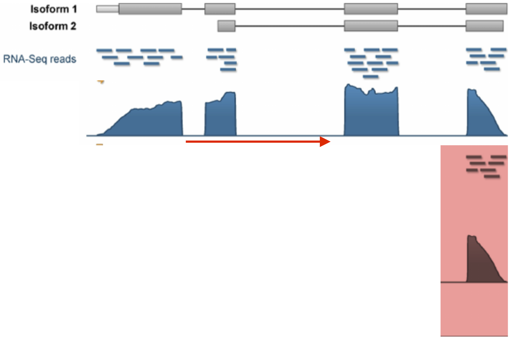
```

Both are central in single-cell RNA-seq, which we cover in the next module.

# Modelling count data

## Technical variability: the Poisson distribution

- A count of a gene can be seen as the number of fragments of that gene in a random sample of fragments from the library.
- If we sequence the same library repeatedly (**technical replicates**), the count of a gene follows approximately a Poisson distribution [@Marioni2008-tech]:
$$
Y_{gr} \sim \text{Poisson}(\mu_g), \quad E[Y_{gr}] = \text{Var}[Y_{gr}] = \mu_g.
$$
- Count data thus have a **mean-variance relation**: the variance increases with the mean.

```{r echo=FALSE, out.width="100%", fig.cap="Left: design of the study, in which liver and kidney samples were sequenced in several lanes. Right: QQ-plot of the p-values of a test for a lane effect, comparing the counts of the same library in two lanes at the same concentration. Under the null hypothesis the reads in both lanes are random samples from the library (Poisson sampling), so the p-values are uniform and the points lie on the diagonal. From Marioni et al. (2008)."}
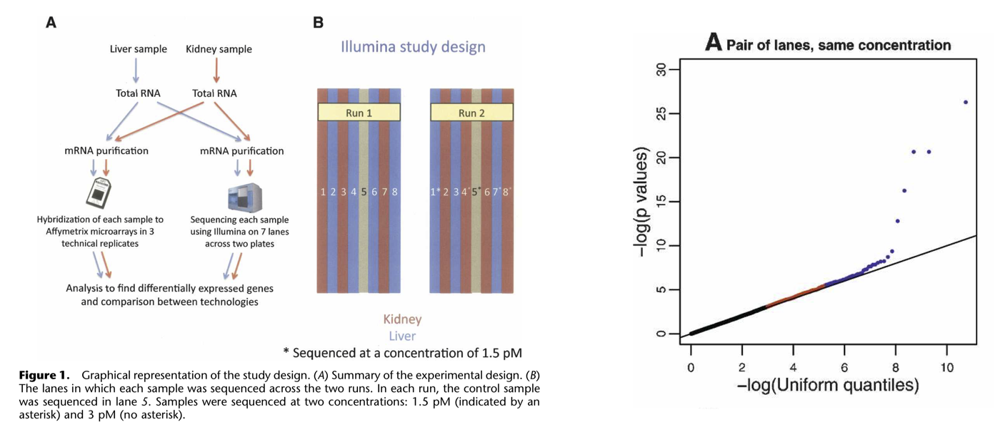
```

- @Marioni2008-tech sequenced the same library in several lanes and tested every gene for a lane effect: do the counts in the lanes differ more than expected from random sampling of reads, given the sequencing depth of each lane?
- "No lane effect" thus means pure sampling variability, i.e. Poisson counts with a mean proportional to the sequencing depth. A gene-specific lane effect and extra-Poisson variability between technical replicates cannot be distinguished.
- The p-values are uniform for almost all genes: technical replicates only vary by sampling, consistent with the Poisson model.

### Relative uncertainty

Suppose that two genes have the same fold change of 5 between a tumour and a healthy tissue sample, each measured in three technical replicates:

- gene $g$: mean 2 in healthy and 10 in tumour tissue,
- gene $k$: mean 20 in healthy and 100 in tumour tissue.

For which gene is the fold change estimated more precisely?

```{r}
set.seed(11)
nSim <- 1000
foldChanges <- tibble(
  gene = rep(c("g: 2 vs 10", "k: 20 vs 100"), each = nSim),
  ratio = c(
    replicate(nSim, mean(rpois(3, 10)) / mean(rpois(3, 2))),
    replicate(nSim, mean(rpois(3, 100)) / mean(rpois(3, 20))))
)
foldChanges |>
  ggplot(aes(ratio)) +
  geom_histogram(binwidth = 0.5) +
  geom_vline(xintercept = 5, col = "red") +
  facet_wrap(~ gene) +
  xlim(0, 30) +
  theme_bw()
```

- The variance of the counts is larger for gene $k$, but the **relative** uncertainty is much smaller.
- The coefficient of variation of a Poisson count is $\text{CV} = \sqrt{\mu}/\mu = 1/\sqrt{\mu}$: `r round(1/sqrt(10), 2)` for a mean of 10 and `r round(1/sqrt(100), 2)` for a mean of 100.
- Fold changes of lowly expressed genes are thus much more noisy.

## Why not a linear model on the counts?

The linear model of the first module assumes

$$
\mathbf{Y} = \mathbf{X}\boldsymbol{\beta} + \boldsymbol{\epsilon}, \quad \boldsymbol{\epsilon} \sim N(\mathbf{0}, \sigma^2\mathbf{I}).
$$

For counts:

- the variance is not constant but depends on the mean,
- counts are non-negative, while $\mathbf{X}\boldsymbol{\beta}$ can be negative,
- low counts have a skewed distribution.

In proteomics we log-transformed the intensities.
For counts, a log transformation leaves the data heteroscedastic and requires an arbitrary pseudo-count for zeros.

## Generalised linear models

Generalised linear models (GLMs) extend the linear model in two ways:

1. The response follows a distribution of the **exponential family**, which includes the normal, binomial, Poisson and negative binomial distribution.
2. A **link function** $g(.)$ links the mean to the linear predictor: $g(E[Y_i]) = \mathbf{x}_i^T\boldsymbol{\beta}$.

A Poisson GLM is defined as

$$
\left\{
\begin{array}{lcl}
Y_i &\sim& \text{Poisson}(\mu_i)\\
\log \mu_i &=& \eta_i\\
\eta_i &=& \mathbf{x}_i^T\boldsymbol{\beta}
\end{array}
\right.
$$

- In the GLM we model $\log E[Y_i]$, the log of the mean. In a linear model on log-transformed counts we would model $E[\log Y_i]$, a geometric mean.
- The inverse link $\mu_i = \exp(\eta_i)$ ensures that the mean is positive.
- The parameters have a log fold change interpretation, as in proteomics.

How these models are fitted is discussed in the [technical details chapter](05-rnaseq-technical.html).

## The parathyroid data

We illustrate the properties of count data on a subset of the parathyroid data set [@Haglund2012-parathyroid].
Tumour cultures of 4 patients were treated with diarylpropionitrile (DPN), 4-hydroxytamoxifen (OHT) or a control, and sequenced after 24 and 48 hours.

```{r echo=FALSE, out.width="80%", fig.cap="Design of the parathyroid experiment (Methods section of Haglund et al., 2012)."}
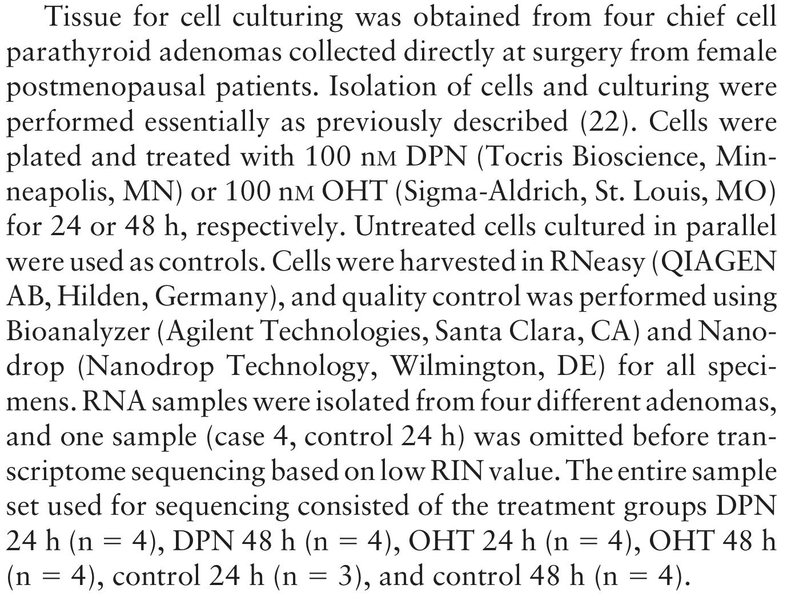
```

The data were distributed in the Bioconductor package `parathyroidSE`, which is no longer part of Bioconductor.
We load the data directly from the archived package.

```{r}
bfc <- BiocFileCache()
paraTar <- bfcrpath(bfc, "https://bioconductor.org/packages/3.21/data/experiment/src/contrib/parathyroidSE_1.46.0.tar.gz")
untar(paraTar, files = "parathyroidSE/data/parathyroidGenesSE.RData", exdir = tempdir())
load(file.path(tempdir(), "parathyroidSE/data/parathyroidGenesSE.RData"))
se <- parathyroidGenesSE
colData(se)
```

Some samples (`experiment`) were sequenced in two runs: these are technical replicates.

```{r}
techRep <- colData(se) |>
  as.data.frame() |>
  filter(duplicated(experiment)) |>
  pull(experiment)
techRep
```

## Technical replicates and normalisation

We compare the two runs of the first sample with technical replicates in an MA plot: the log2 fold change $M$ against the average log2 count $A$.

```{r}
techCounts <- assay(se)[, colData(se)$experiment == techRep[1]]
colSums(techCounts)

maData <- tibble(
  A = rowMeans(log2(techCounts + 0.5)),
  M = log2(techCounts[, 2] + 0.5) - log2(techCounts[, 1] + 0.5)
) |>
  filter(rowSums(techCounts) > 0)

logFCdepth <- diff(log2(colSums(techCounts)))

maData |>
  ggplot(aes(A, M)) +
  geom_point(alpha = 0.2, size = 0.5) +
  geom_hline(yintercept = 0) +
  geom_hline(yintercept = logFCdepth, col = "red") +
  xlab("A: average log2 count") +
  ylab("M: log2 fold change") +
  theme_bw()
```

- The second run has about `r round(2^logFCdepth, 1)` times more reads than the first.
- The log fold changes of the genes fluctuate around the log fold change of the library sizes (red line), not around zero.
- The spread of $M$ is much larger for low counts: the Poisson relative uncertainty.

We correct for differences in sequencing depth with an **offset** in the GLM:

$$
\log \mu_{gi} = \mathbf{x}_i^T\boldsymbol{\beta}_g + \log N_i
\quad \Leftrightarrow \quad
\log \frac{\mu_{gi}}{N_i} = \mathbf{x}_i^T\boldsymbol{\beta}_g.
$$

- An offset is a covariate with a known coefficient of 1: the parameters now model the mean count per read sequenced.
- A sample that is sequenced deeper contributes more information, because its counts are larger and thus relatively more precise.
- Better offsets than the raw library size exist: e.g. the TMM method of edgeR corrects for differences in RNA composition between samples [@Robinson2010-tmm]. The idea is the same as the median of ratios normalisation in proteomics: most genes are assumed not to change. Details are in the [technical details chapter](05-rnaseq-technical.html).
- Technical replicates are Poisson and the sum of Poisson counts is again Poisson. We can therefore **sum** the counts of technical replicates.

## Biological replicates: overdispersion

We look at the four biological replicates of the control treatment at 48 hours.

```{r}
bioReps <- colData(se)$treatment == "Control" & colData(se)$time == "48h"
bioCounts <- assay(se)[, bioReps]
bioCounts <- bioCounts[rowSums(bioCounts) > 0, ]
cpmBio <- sweep(bioCounts, 2, colSums(bioCounts), "/") * mean(colSums(bioCounts))

tibble(mean = rowMeans(cpmBio), variance = rowVars(cpmBio)) |>
  filter(variance > 0) |>
  ggplot(aes(mean, variance)) +
  geom_point(alpha = 0.1, size = 0.5) +
  geom_abline(intercept = 0, slope = 1, col = "red") +
  geom_smooth(col = "orange") +
  scale_x_log10() +
  scale_y_log10() +
  theme_bw()
```

- With thousands of genes we can assess the mean-variance relation empirically.
- The data are **overdispersed** with respect to the Poisson distribution (red line): biological replicates differ more than technical replicates.
- The variance increases approximately quadratically with the mean.

## The negative binomial distribution

This motivates the negative binomial (NB) distribution:

$$
\left\{
\begin{array}{lcl}
Y_{gi} &\sim& NB(\mu_{gi}, \phi_g)\\
\log \mu_{gi} &=& \mathbf{x}_i^T\boldsymbol{\beta}_g + \log N_i
\end{array}
\right.
\quad \text{with} \quad
\text{Var}[Y_{gi}] = \mu_{gi} + \phi_g \mu_{gi}^2.
$$

|   |   | Sequencing |   | Biology |
|---|---|---|---|---|
| total variability | = | technical variability | + | biological variability |
| $\text{Var}[Y_{gi}]$ | = | $\mu_{gi}$ | + | $\phi_g \mu_{gi}^2$ |
| total CV$^2$ | = | $1/\mu_{gi}$ | + | $\phi_g$ |

- $\phi_g$ is the squared **biological coefficient of variation** (BCV).
- For low counts the technical (Poisson) variability dominates: a higher sequencing depth helps.
- For high counts the biological variability dominates: only more biological replicates help.
- With few replicates per gene, $\phi_g$ is estimated very imprecisely. Like in proteomics, we will borrow information across genes.

## Gene-specific variability: quasi-likelihood and empirical Bayes

The current version of edgeR [@Chen2025-edgeR4] uses a quasi-negative binomial model [@Lund2012-ql]:

$$
\left\{
\begin{array}{lcl}
E[Y_{gi}] &=& \mu_{gi}\\
\log \mu_{gi} &=& \mathbf{x}_i^T\boldsymbol{\beta}_g + \log N^{\text{eff}}_i\\
\text{Var}[Y_{gi}] &=& \sigma^2_g\left(\mu_{gi} + \phi\mu_{gi}^2\right)
\end{array}
\right.
$$

- $\phi$ is a single NB dispersion for all genes: it describes the global shape of the mean-variance relation.
- $\sigma^2_g$ is a gene-specific **quasi-likelihood dispersion**, which captures how much more (or less) variable a gene is than the global trend.
- $\sigma^2_g$ is estimated from the residual deviance divided by its degrees of freedom: the GLM counterpart of the residual variance $s^2_g$ in a linear model.
- With few replicates $\sigma^2_g$ is unstable. It is therefore shrunken towards a common trend with **empirical Bayes**, using the same `squeezeVar` function that msqrob2 uses.
- Inference uses moderated F-tests (moderated t-tests for a single contrast).

This is the same strategy as in the proteomics module:

|   | msqrob2 (proteomics) | edgeR quasi-likelihood (RNA-seq) |
|---|---|---|
| Data | log2 intensities | counts |
| Model per feature | robust linear (mixed) model | quasi-NB GLM with log link |
| Normalisation | median of ratios, centring | offsets: effective library sizes (TMM) and average transcript lengths |
| Feature-specific variability | residual variance $s^2_g$ | QL dispersion $\sigma^2_g$ |
| Empirical Bayes | `squeezeVar`: shrink $s^2_g$ to a common prior | `squeezeVar`: shrink $\sigma^2_g$ to a trend in the average expression |
| Test | moderated t | moderated F / t |
| Multiple testing | FDR (Benjamini-Hochberg) | FDR (Benjamini-Hochberg) |

The details are covered in the [technical details chapter](05-rnaseq-technical.html).

DESeq2 [@Love2014-deseq2] is the other widely used tool.

- It uses the same NB GLM
- But estimates a dispersion $\phi_g$ per gene (similarly to edgeR prior to version 4), shrinks it with empirical Bayes towards a trend, and uses Wald tests (relying on asymptotic normality).
- Both tools typically give similar results. 
- The quasi-likelihood F-tests of edgeR account for the uncertainty in the estimated dispersion and therefore control the type I error better with few replicates.

limma-voom [@Law2014-voom] takes a different route: 

- it does not model the counts, but the log2 CPM values with linear models, as we did for the log2 intensities in proteomics.
- Log2 CPM values are still heteroscedastic: low counts are more variable.
- voom estimates the mean-variance trend of the log2 CPM values and turns it into a precision weight for every observation.
- The weighted log2 CPM values are analysed with the limma pipeline: linear models, empirical Bayes moderation with `squeezeVar` and moderated t-tests.
- voom is fast, works well with sufficient replicates and gives access to the full limma toolbox, e.g. random effects via `duplicateCorrelation` for designs with repeated measures.
- voom becomes problematic for small counts: on the log scale, counts of 0, 1 or 2 become a few discrete values that depend on the prior count, and their distribution is far from normal, which precision weights cannot repair.
- edgeR models the counts directly and handles small counts better. 
- This becomes even more important for single-cell data, where most counts are very small.

# A complete workflow: the macrophage data

## Background

Macrophages are immune cells that detect and engulf pathogens.
@Alasoo2018-macrophage differentiated macrophages from induced pluripotent stem cells (iPSCs) of a large panel of donors and exposed them to four conditions:

- naive: no stimulation,
- IFNg: priming with interferon gamma (IFN$\gamma$), a cytokine that activates macrophages, for 18 hours,
- SL1344: infection with *Salmonella enterica* serovar Typhimurium (strain SL1344) for 5 hours,
- IFNg_SL1344: priming with IFN$\gamma$ followed by infection with *Salmonella*.

The Bioconductor package macrophage contains the salmon quantifications of the 24 samples of 6 donors (ENA: [PRJEB18997](https://www.ebi.ac.uk/ena/browser/view/PRJEB18997)).

Research questions:

1. Which genes respond to IFN$\gamma$ priming in uninfected macrophages?
2. Which genes respond to IFN$\gamma$ priming in infected macrophages?
3. Which genes respond to *Salmonella* infection in naive macrophages?
4. Which genes respond to *Salmonella* infection in IFN$\gamma$-primed macrophages?
5. For which genes does IFN$\gamma$ priming change the response to the infection?

The last question is the core of the study: IFN$\gamma$ primes the macrophages, e.g. by opening enhancers, so that they respond differently to the pathogen [@Alasoo2018-macrophage].

- What is the experimental unit?
- What is the design?

```{r}
coldata <- read.csv(file.path(macDir, "coldata.csv")) |>
  transmute(
    names,
    files = file.path(macDir, "quants", names, "quant.sf.gz"),
    donor = factor(line_id),
    condition = factor(condition_name, levels = c("naive", "IFNg", "SL1344", "IFNg_SL1344")),
    ifng = factor(ifelse(grepl("IFNg", condition_name), "yes", "no")),
    salmonella = factor(ifelse(grepl("SL1344", condition_name), "yes", "no"))
  )
coldata |>
  dplyr::select(-files)
table(coldata$ifng, coldata$salmonella)
```

- The cells of every donor are exposed to all four conditions: the donors are blocks, as in the mouse T-cell example of the proteomics module.
- The treatments have a 2 $\times$ 2 **factorial** structure: IFN$\gamma$ priming (no/yes) and *Salmonella* infection (no/yes).

## Data import

The tximeta package [@Love2020-tximeta] imports salmon quantifications into a `SummarizedExperiment`.
It recognises the reference transcriptome that was used for the quantification and adds the transcript annotation.
The quantifications also contain 20 Gibbs samples per sample; we only need them for the transcript-level analyses in the [technical details chapter](05-rnaseq-technical.html), so we do not import them here.

```{r}
st <- tximeta(coldata, dropInfReps = TRUE)
st
```

We summarise the transcript-level counts to the gene level, and add gene symbols and Entrez IDs.

```{r}
sg <- summarizeToGene(st)
sg <- addIds(sg, "SYMBOL", gene = TRUE)
sg <- addIds(sg, "ENTREZID", gene = TRUE)
sg
```

- A `SummarizedExperiment` stores the assays (counts, abundances (TPM) and average transcript lengths), the sample annotation in `colData` and the feature annotation in `rowData`.
- We keep the stable Ensembl gene IDs as row names and use the symbols for interpretation: symbols are not unique and change over time.

## Transcript length

The gene-level counts are the sums of the estimated counts of the transcripts of a gene.
`summarizeToGene` also computes, for every gene and sample, the **average transcript length**: the average of the effective lengths of the transcripts of the gene, weighted by their abundance.

- Within a gene, the length is the same in all samples as long as the gene uses its transcripts in the same proportions. It then cancels in comparisons between samples.
- If the usage of the transcripts changes, e.g. the treatment shifts the expression of a gene to a longer isoform, the gene produces more fragments without containing more molecules. Summed counts then suggest a change in expression that is due to the change in transcript length.
- @Soneson2015-tx showed that this leads to false positives in differential gene expression analyses on summed counts, and that it is solved by using the average transcript length as an additional offset in the model.

The average transcript lengths are stored in the `length` assay:

```{r}
assay(sg, "length")[1:3, 1:4]
```

For most genes they hardly vary between the samples, but for some genes they change with the treatment, e.g. *ASB1*:

```{r}
asb1 <- rownames(sg)[which(rowData(sg)$SYMBOL == "ASB1")]
tibble(
  length = assay(sg, "length")[asb1, ],
  count = assay(sg, "counts")[asb1, ],
  donor = sg$donor,
  condition = sg$condition
) |>
  pivot_longer(c(length, count), names_to = "assay") |>
  ggplot(aes(condition, value, group = donor, color = donor)) +
  geom_point() +
  geom_line() +
  facet_wrap(~ assay, scales = "free_y") +
  ggtitle("ASB1: average transcript length and summed count") +
  ylab(NULL) +
  theme_bw() +
  theme(axis.text.x = element_text(angle = 45, hjust = 1))
```

IFN$\gamma$ shifts the expression of *ASB1* to shorter transcripts: the average transcript length almost halves.
Shorter transcripts produce fewer fragments per molecule, so the summed counts drop as well.

`DGEListFromTximeta` creates the `DGEList` for edgeR and stores the centred log average transcript lengths in `offset.prior`.
edgeR adds them to the log effective library sizes, so that every model below automatically corrects for the average transcript length.
This is the edgeR counterpart of DESeq2, which uses the average transcript lengths as offsets when it is given a tximeta object.

## Filtering and normalisation

We store the counts in a `DGEList`, the data container of edgeR.

```{r}
dge <- DGEListFromTximeta(sg)
dge$genes <- dge$genes[, c("SYMBOL", "ENTREZID")]
colnames(dge) <- paste(sg$donor, sg$condition, sep = "_")
design <- model.matrix(~ donor + ifng * salmonella, data = colData(sg))
```

A first quality check is the sequencing depth of the samples.
tximeta also stores the run information of salmon, e.g. the number of reads (fragments) that were processed and the percentage that could be mapped to the transcriptome.
The library size in the `DGEList` is the sum of the estimated counts over all genes.

```{r, fig.width = 10, fig.height = 6}
noXaxis <- theme(axis.text.x = element_blank(), axis.ticks.x = element_blank(),
                 axis.title.x = element_blank())
qcMac <- tibble(
  donor = sg$donor,
  condition = sg$condition,
  processed = metadata(sg)$quantInfo$num_processed / 1e6,
  percentMapped = metadata(sg)$quantInfo$percent_mapped,
  libSize = dge$samples$lib.size / 1e6
)
libPlot <- qcMac |>
  pivot_longer(c(processed, libSize), names_to = "type", values_to = "millions") |>
  mutate(type = factor(type, levels = c("processed", "libSize"),
                       labels = c("processed reads", "library size (counts)"))) |>
  ggplot(aes(condition, millions, fill = condition)) +
  geom_col() +
  facet_grid(type ~ donor) +
  ylab("millions") +
  theme_bw() +
  noXaxis
mapPlot <- ggplot(qcMac, aes(condition, percentMapped, fill = condition)) +
  geom_point(shape = 21, size = 2.5) +
  guides(fill = "none") +
  facet_grid(~ donor) +
  ylab("% mapped") +
  theme_bw() +
  noXaxis
libPlot / mapPlot + plot_layout(heights = c(2, 1), guides = "collect") &
  theme(legend.position = "bottom")
```

- All samples were sequenced to a depth of `r round(min(qcMac$processed))` to `r round(max(qcMac$processed))` million reads, and `r round(min(qcMac$percentMapped))`% to `r round(max(qcMac$percentMapped))`% of the reads could be assigned to the transcriptome.
- The differences in depth are moderate (at most a factor `r round(max(qcMac$libSize) / min(qcMac$libSize), 1)` in library size) and are not related to the treatment: the offsets in the model correct for them.
- A sample with a much lower depth or mapping rate than the others should be inspected: it has less information, and a low mapping rate can point to contamination, degraded RNA or a wrong reference.

Genes with very low counts carry almost no information and are removed.
`filterByExpr` keeps genes with a sufficiently large count per million in a minimum number of samples, based on the design.

```{r}
keep <- filterByExpr(dge, design)
table(keep)
dge <- dge[keep, , keep.lib.sizes = FALSE]
```

The effective library sizes are computed with TMM normalisation.

```{r}
dge <- normLibSizes(dge)
head(dge$samples)
```

`dge$offset.prior` contains the centred log average transcript lengths.
The offsets that edgeR uses in all models are the log effective library sizes plus these length offsets:

```{r}
dge$offset.prior[1:3, 1:4]
logEffLibSize <- log(dge$samples$lib.size * dge$samples$norm.factors)
all.equal(
  unname(getOffset(dge)),
  unname(sweep(dge$offset.prior, 2, logEffLibSize, "+"))
)
```

## Exploratory data analysis

We visualise the samples with multidimensional scaling (MDS) on the log2 CPM values.
The distance between two samples is the typical log2 fold change between them for the 500 genes that differ most.

```{r}
plotMDS(dge, col = as.double(sg$condition), pch = as.double(sg$donor), labels = NULL)
legend("topright", legend = levels(sg$condition), col = 1:4, pch = 16, cex = 0.8)
```

- The first dimension separates the infected from the uninfected samples: *Salmonella* is the largest source of variability in the experiment.
- Within infection status, the IFN$\gamma$-primed samples are shifted to the right.
- The second dimension mainly reflects differences between the donors (symbols): there is a block effect.

## Design

The model for the log mean of gene $g$ in sample $i$ contains a block effect for the donor and the main effects of IFN$\gamma$ and *Salmonella* and their interaction:

$$
\log \mu_{gi} = \beta_{g0} + \beta_{g,\text{donor}(i)} + \beta_{g,\text{IFN}\gamma}\, x_{i,\text{IFN}\gamma} + \beta_{g,\text{Sal}}\, x_{i,\text{Sal}} + \beta_{g,\text{IFN}\gamma:\text{Sal}}\, x_{i,\text{IFN}\gamma}\, x_{i,\text{Sal}} + \log N^{\text{eff}}_i,
$$

with $x_{i,\text{IFN}\gamma}$ and $x_{i,\text{Sal}}$ indicator variables for IFN$\gamma$ priming and *Salmonella* infection.

```{r}
colnames(design)
```

```{r, fig.width = 12, fig.height = 8}
vd <- VisualizeDesign(colData(sg) |> as.data.frame(),
                      designFormula = ~ donor + ifng * salmonella)
wrap_plots(vd$plotlist, ncol = 3)
```

- Every donor has its own $2 \times 2$ panel with the four treatment combinations.
- The first donor (`diku_1`) is the reference: its naive samples are modelled by the intercept alone.
- For the other donors, the donor effect (e.g. `donoreiwy_1`) is added to all four cells of the panel: it shifts the whole panel by the same amount.
- The treatment coefficients `ifngyes`, `salmonellayes` and `ifngyes:salmonellayes` appear in the same cells of every panel: the treatment effects are assumed to be the same in every donor.
- Hence, each treatment effect is estimated within donors, and the donor-to-donor variability in baseline expression drops out.

- `ifngyes`: log fold change of IFN$\gamma$ priming in uninfected cells.
- `salmonellayes`: log fold change of *Salmonella* infection in naive cells.
- `ifngyes:salmonellayes`: interaction, i.e. the difference between the IFN$\gamma$ effect in infected and in uninfected cells.
- The IFN$\gamma$ effect in infected cells is the sum `ifngyes` + `ifngyes:salmonellayes`.
- The *Salmonella* effect in IFN$\gamma$-primed cells is the sum `salmonellayes` + `ifngyes:salmonellayes`.
- The interaction can be read in two equivalent ways:
$$
\begin{aligned}
\beta_{g,\text{IFN}\gamma:\text{Sal}} &= (\text{Sal effect in primed cells}) - (\text{Sal effect in naive cells})\\
&= (\text{IFN}\gamma \text{ effect in infected cells}) - (\text{IFN}\gamma \text{ effect in uninfected cells}).
\end{aligned}
$$
"IFN$\gamma$ priming changes the response to the infection" and "the infection changes the response to IFN$\gamma$" are the same hypothesis.

We encode the five research questions as contrasts, i.e. linear combinations of the model parameters:

| | research question | contrast |
|---|---|---|
| 1 | `IFNg` | `ifngyes` |
| 2 | `IFNg_infected` | `ifngyes` + `ifngyes:salmonellayes` |
| 3 | `Salmonella` | `salmonellayes` |
| 4 | `Salmonella_primed` | `salmonellayes` + `ifngyes:salmonellayes` |
| 5 | `interaction` | `ifngyes:salmonellayes` |

```{r}
L <- matrix(0, nrow = ncol(design), ncol = 5,
            dimnames = list(colnames(design),
                            c("IFNg", "IFNg_infected", "Salmonella",
                              "Salmonella_primed", "interaction")))
L["ifngyes", c("IFNg", "IFNg_infected")] <- 1
L["salmonellayes", c("Salmonella", "Salmonella_primed")] <- 1
L["ifngyes:salmonellayes", c("IFNg_infected", "Salmonella_primed", "interaction")] <- 1
L[-(1:6), ]
```

## Model fit

```{r}
fit <- glmQLFit(dge, design)
plotQLDisp(fit)
```

- The black dots are the raw QL dispersions $\hat\sigma^2_g$ of the genes; the red dots are the squeezed QL dispersions; the blue line is the trend.
- As in msqrob2, the squeezed dispersions are a compromise between the gene-wise estimates and the trend.

```{r}
fit$df.prior
```

The prior degrees of freedom express how much information is borrowed from the trend, in units of residual degrees of freedom.

## Inference

We test every contrast with a moderated F-test.

```{r}
tests <- lapply(colnames(L), function(contrast) glmQLFTest(fit, contrast = L[, contrast]))
names(tests) <- colnames(L)
deCounts <- sapply(tests, function(test) summary(decideTests(test)))
rownames(deCounts) <- c("Down", "NotSig", "Up")
deCounts
```

The table gives the number of down-regulated, not significant and up-regulated genes at a 5% FDR.

- *Salmonella* infection changes the expression of more than half of the genes, and even more genes in IFN$\gamma$-primed cells.
- IFN$\gamma$ priming has a strong effect in uninfected cells and an even stronger effect in infected cells.
- For `r sum(decideTests(tests$interaction) != 0)` genes there is a significant interaction: IFN$\gamma$ priming changes their response to the infection.

We focus on the effect of IFN$\gamma$ priming in uninfected cells.

```{r}
topTags(tests$IFNg)
ttAll <- topTags(tests$IFNg, n = Inf)$table
ttAll |>
  ggplot(aes(PValue)) +
  geom_histogram(breaks = seq(0, 1, 0.05)) +
  theme_bw()
```

The p-value histogram has a peak near zero and is uniform elsewhere: many genes respond to IFN$\gamma$.

## Effect of the length offsets

We refit the model without the length offsets, i.e. with only the effective library sizes as offsets, and compare the IFN$\gamma$ effect on *ASB1*.

```{r}
dgeNoLength <- dge
dgeNoLength$offset.prior <- NULL
fitNoLength <- glmQLFit(dgeNoLength, design)
ttNoLength <- topTags(glmQLFTest(fitNoLength, contrast = L[, "IFNg"]), n = Inf)$table

data.frame(
  rbind(ttAll[asb1, c("logFC", "PValue", "FDR")],
        ttNoLength[asb1, c("logFC", "PValue", "FDR")]),
  row.names = c("with length offset", "without length offset")
)
lengthNaive <- assay(sg, "length")[asb1, sg$condition == "naive"]
lengthIFNg <- assay(sg, "length")[asb1, sg$condition == "IFNg"]
mean(log2(lengthIFNg / lengthNaive))
```

- Without the length offset, *ASB1* is significantly down-regulated by IFN$\gamma$.
- The average log2 ratio of the transcript lengths explains most of this fold change: the log fold change with the length offset is approximately the log fold change without it minus the log2 length ratio.
- With the length offset, the number of *ASB1* molecules hardly changes: *ASB1* shows a change in transcript usage (DTU, see the [technical details chapter](05-rnaseq-technical.html)), not in expression.

Over all genes:

```{r}
table(
  withLength = ttAll[rownames(dge), "FDR"] < 0.05,
  withoutLength = ttNoLength[rownames(dge), "FDR"] < 0.05
)
```

## Testing for a minimal fold change

With strong treatment effects, thousands of genes are significant, and many of them have small fold changes that are biologically less relevant.
Selecting genes by an FDR cut-off and a fold change cut-off, as on a volcano plot, does not control the FDR for the combined criterion.
TREAT [@McCarthy2009-treat] instead tests the null hypothesis $H_0: |\beta_g| \leq \tau$ against $H_1: |\beta_g| > \tau$ for a minimal log fold change $\tau$, here a fold change of 2.

```{r}
treatIFNg <- glmTreat(fit, contrast = L[, "IFNg"], lfc = 1)
summary(decideTests(treatIFNg))
topTags(treatIFNg)
```

## Visualisation

We visualise the IFN$\gamma$ effect in uninfected cells and colour every gene according to the test(s) in which it is significant at a 5% FDR: the ordinary QL test and TREAT. All genes that are significant in TREAT are also significant in the QL test.

```{r}
deStatus <- tibble(
  logFC = tests$IFNg$table$logFC,
  logCPM = tests$IFNg$table$logCPM,
  PValue = tests$IFNg$table$PValue,
  PValueTreat = treatIFNg$table$PValue,
  FDR = p.adjust(tests$IFNg$table$PValue, "BH"),
  FDRtreat = p.adjust(treatIFNg$table$PValue, "BH")
) |>
  mutate(
    status = case_when(
      FDRtreat < 0.05 ~ "QL test and TREAT",
      FDR < 0.05 ~ "QL test only",
      TRUE ~ "not significant"
    ) |>
      factor(levels = c("not significant", "QL test only", "QL test and TREAT"))
  ) |>
  arrange(status)
table(deStatus$status)
statusColors <- c("grey60", "orange", "red")
```

The left volcano plot shows the p-values of the QL test ($H_0: \beta_g = 0$), the right one the p-values of TREAT ($H_0: |\beta_g| \leq 1$).

```{r fig.width=10, fig.height=5}
volcanoQL <- deStatus |>
  ggplot(aes(logFC, -log10(PValue), color = status)) +
  geom_point(size = 0.5) +
  geom_vline(xintercept = c(-1, 1), linetype = "dashed") +
  scale_color_manual(values = statusColors) +
  ylab("-log10 p-value (QL test, H0: logFC = 0)") +
  theme_bw()
volcanoTreat <- deStatus |>
  ggplot(aes(logFC, -log10(PValueTreat), color = status)) +
  geom_point(size = 0.5) +
  geom_vline(xintercept = c(-1, 1), linetype = "dashed") +
  scale_color_manual(values = statusColors) +
  ylab("-log10 p-value (TREAT, H0: |logFC| <= 1)") +
  theme_bw()
volcanoQL + volcanoTreat +
  plot_layout(guides = "collect") &
  theme(legend.position = "bottom")
```

- In the QL volcano plot the p-values decrease steadily with the absolute log fold change: the typical V shape.
- In the TREAT volcano plot genes with an estimated $|\text{logFC}| \leq 1$ get p-values close to 1: TREAT only finds evidence for fold changes that are clearly larger than 2.
- For genes with a large fold change, both p-values are similar.

```{r}
deStatus |>
  ggplot(aes(logCPM, logFC, color = status)) +
  geom_point(size = 0.5) +
  geom_hline(yintercept = c(-1, 1), linetype = "dashed") +
  scale_color_manual(values = statusColors) +
  theme_bw() +
  theme(legend.position = "bottom")
```

- The QL test detects every change that differs significantly from zero, including many genes with a small fold change.
- TREAT only selects genes whose fold change is significantly larger than 2 in absolute value.
- Genes with an estimated log fold change just outside the dashed lines are not selected by TREAT: their fold change is not *significantly* larger than 2. Selecting genes with FDR < 0.05 and |logFC| > 1 would select them, without controlling the FDR for this criterion.

The heatmap shows the 30 most significant genes of the TREAT analysis in all samples.

```{r}
topGenes <- rownames(topTags(treatIFNg, n = 30))
logCPM <- cpm(dge, log = TRUE)[topGenes, ]
rownames(logCPM) <- dge$genes[topGenes, "SYMBOL"]
pheatmap::pheatmap(
  logCPM - rowMeans(logCPM),
  scale = "none",
  annotation_col = data.frame(condition = sg$condition, row.names = colnames(dge)),
  show_colnames = FALSE
)
```

- The samples cluster according to IFN$\gamma$ priming, with and without infection.
- The block effect of the donors is much smaller than the treatment effects for these genes.

We plot the expression of the gene with the strongest interaction, i.e. the gene with the smallest p-value in the ordinary QL test of the interaction contrast.

```{r}
topInteraction <- rownames(topTags(tests$interaction, n = 1))
tibble(
  logCPM = cpm(dge, log = TRUE)[topInteraction, ],
  donor = sg$donor,
  ifng = sg$ifng,
  salmonella = sg$salmonella
) |>
  ggplot(aes(salmonella, logCPM, color = ifng, group = ifng)) +
  geom_point() +
  stat_summary(fun = mean, geom = "line") +
  ggtitle(dge$genes[topInteraction, "SYMBOL"]) +
  theme_bw()
```

- IFN$\gamma$ priming and *Salmonella* infection both induce *`r dge$genes[topInteraction, "SYMBOL"]`* as compared to uninfected, non-primed macrophages.
  - In infected cells, however, the expression is about the same with and without priming: the IFN$\gamma$ effect in infected cells, `ifngyes` + `ifngyes:salmonellayes`, is much
  smaller than in uninfected cells.
  - Equivalently, the effect of the infection is much smaller in primed than in non-primed macrophages: it even flips sign.
  - The interaction measures exactly this difference between the effects:
  $$
  \begin{aligned}
  \beta_{g,\text{IFN}\gamma:\text{Sal}} &= \log_2 \text{FC}^\text{primed}_\text{infected vs uninfected} - \log_2 \text{FC}^\text{non-primed}_\text{infected vs uninfected}\\
  &= \log_2 \text{FC}^\text{infected}_\text{primed vs non-primed} - \log_2 \text{FC}^\text{uninfected}_\text{primed vs non-primed}.
  \end{aligned}
  $$
    The effect of the infection depends on the priming status or, equivalently, the effect of the priming depends on the infection status.

## Gene set analysis

Which biological processes are affected by IFN$\gamma$?

The simplest approach is **over-representation analysis** (ORA):

1. Classify each gene as DE or not (e.g. FDR < 0.05).
2. For each gene set, e.g. a Gene Ontology (GO) term, build a 2x2 table:

|   | in gene set | not in gene set |
|---|---|---|
| DE | $a$ | $b$ |
| not DE | $c$ | $d$ |

3. Test whether the gene set contains more DE genes than expected by chance with a one-sided Fisher exact test (hypergeometric test).
4. Correct for multiple testing over all gene sets.

`goana` performs ORA for all GO terms.
With thousands of DE genes, ORA mainly picks up very general GO terms.
We therefore use the genes that are significant in the TREAT analysis, i.e. with a fold change that is significantly larger than 2, separately for up- and down-regulated genes, and only consider GO terms with 10 to 500 genes.
The universe consists of the genes that passed the filtering: genes that were not measured cannot be DE.

```{r}
ttTreat <- topTags(treatIFNg, n = Inf)$table |>
  filter(!is.na(ENTREZID))
deGenes <- list(
  Up = ttTreat |> filter(FDR < 0.05, logFC > 0) |> pull(ENTREZID),
  Down = ttTreat |> filter(FDR < 0.05, logFC < 0) |> pull(ENTREZID)
)
lengths(deGenes)
go <- goana(deGenes, universe = ttTreat$ENTREZID, species = "Hs")
go |>
  filter(Ont == "BP", N >= 10, N <= 500) |>
  topGO(sort = "Up", number = 10)
```

The up-regulated genes are enriched for the response to type II interferon (IFN$\gamma$ is the only type II interferon), the adaptive immune response and T cell activation, e.g. the HLA class II genes that present antigens to T cells.

Limitations of ORA:

- The result depends on the arbitrary FDR cut-off and ignores the effect sizes.
- Genes in a set are correlated, while the test assumes independence: the p-values are too small.
- Long and highly expressed genes are more easily detected as DE.

Methods that use the statistics of all genes avoid the cut-off, e.g. `camera` (competitive test accounting for correlation between genes) and `fry` (self-contained test), which are available in limma and edgeR. You will use them in the tutorial.

# Summary

- RNA-seq measures expression by sequencing fragments of cDNA. Reads are mapped to a reference and summarised in a count table.
- Counts of technical replicates are Poisson; biological replicates are overdispersed, with a quadratic mean-variance relation.
- GLMs model the counts directly. Differences in sequencing depth, RNA composition and average transcript length are accounted for with offsets.
- edgeR combines a global NB mean-variance shape with gene-specific quasi-likelihood dispersions, shrunken with empirical Bayes: the same strategy as msqrob2.
- Factorial designs are analysed with contrasts of the model parameters; TREAT tests for a minimal fold change.
- Gene set analysis helps to interpret the list of DE genes.

# References {-}
