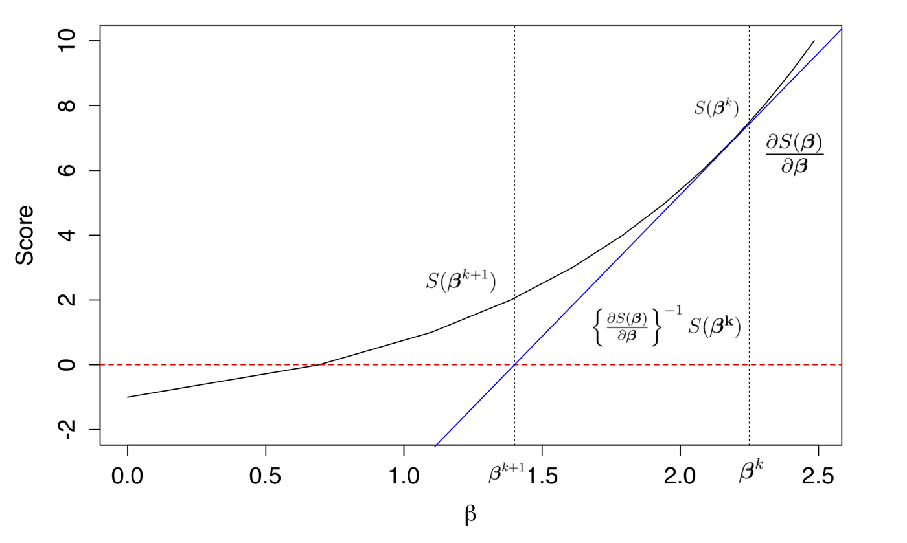
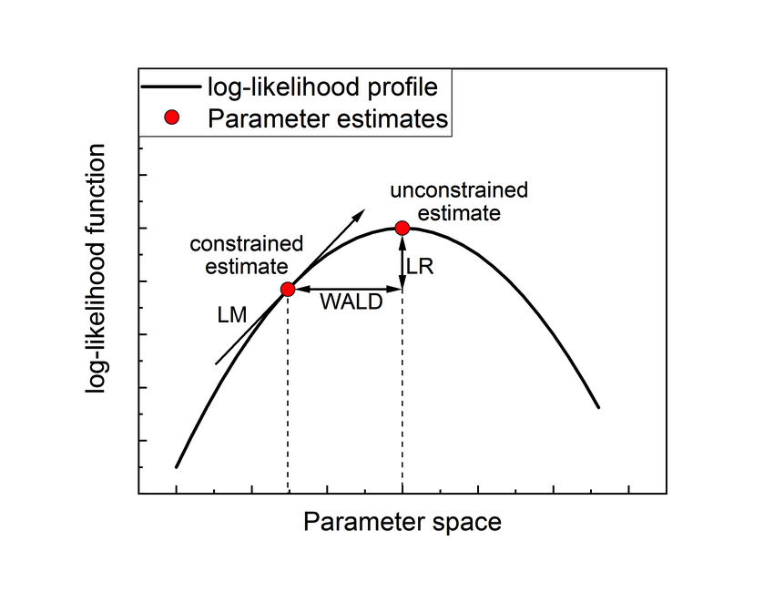
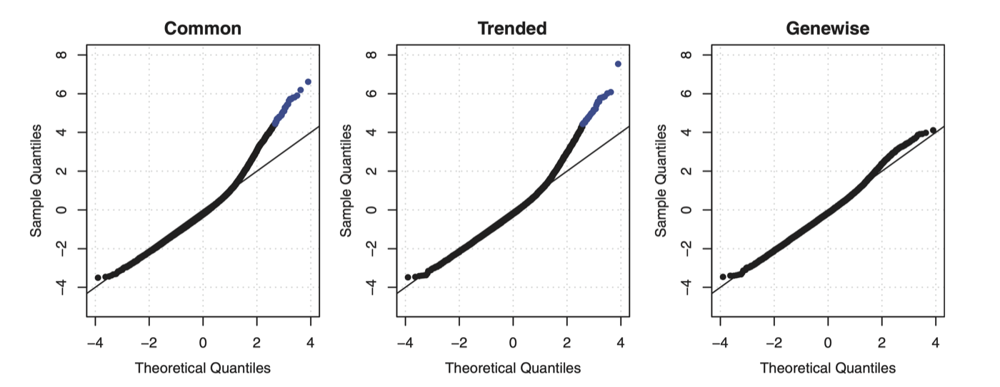
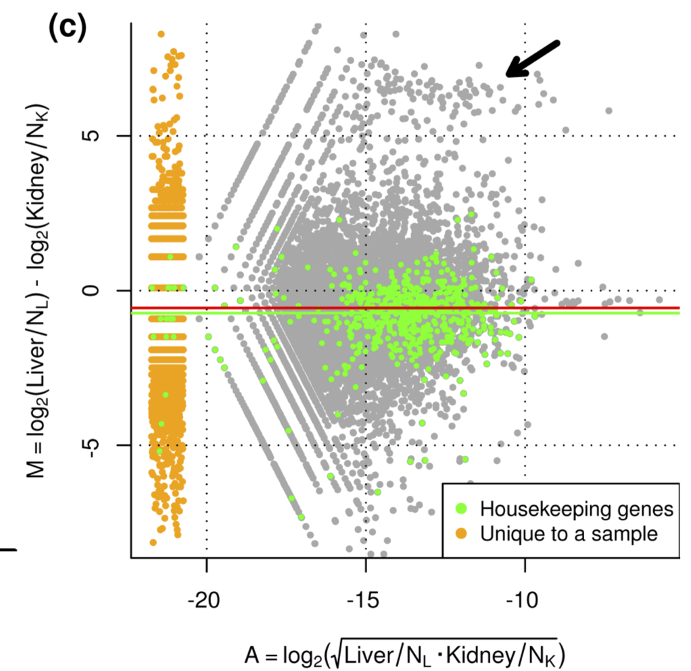
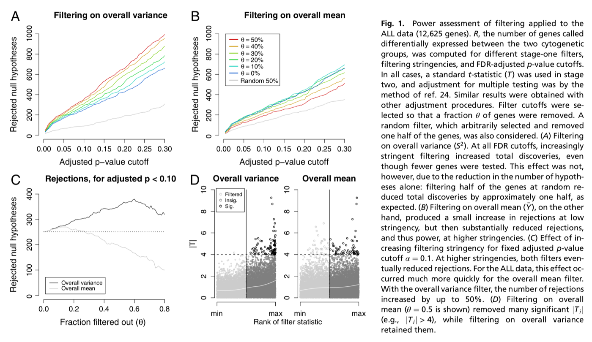
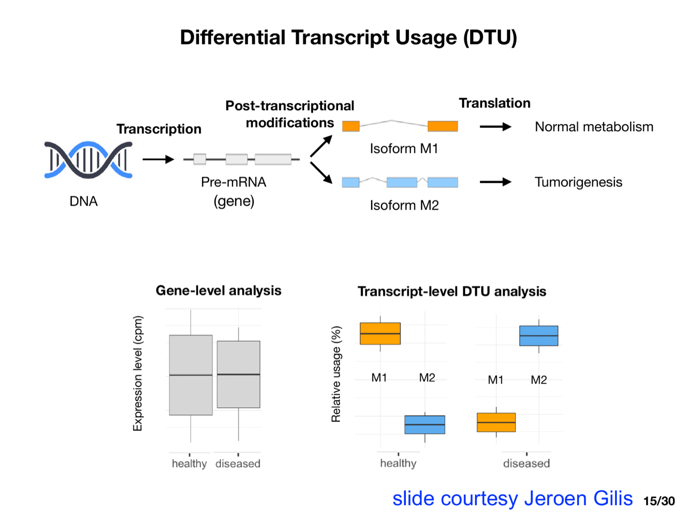

```{r echo = FALSE}
source("R/knitr_setup.R")
```

```{r, warning=FALSE, message=FALSE}
library(tidyverse)
library(SummarizedExperiment)
library(edgeR)
library(BiocFileCache)
library(tximeta)
library(org.Hs.eg.db)
library(DESeq2)
library(stageR)
library(patchwork)
library(macrophage)
```

In the [introduction to bulk RNA-seq](04-rnaseq-intro.html) we introduced count models and a complete edgeR workflow.
In this chapter we look under the hood:

1. How generalised linear models (GLMs) are fitted and how inference works.
2. How edgeR estimates the variability with negative binomial (NB) and quasi-likelihood (QL) models, and how this compares to limma-voom and DESeq2.
3. The calibration of the tests under the null hypothesis.
4. Normalisation and independent filtering.
5. Analyses at the transcript level: differential transcript expression and differential transcript usage.

# Generalised linear models

## Simulated Poisson data

We simulate Poisson counts for 100 observations with two covariates, $\beta_0 = 2$, $\beta_1 = 0.8$ and $\beta_2 = 1.2$.

```{r}
set.seed(300)
X <- cbind(1, rnorm(100), rnorm(100))
betasTrue <- c(2, 0.8, 1.2)
etaTrue <- X %*% betasTrue
y <- rpois(100, exp(etaTrue))
```

## Exponential family

GLMs assume that the response follows a distribution of the exponential family:

$$
f(y_i\vert \theta_i,\phi)=\exp\left\{ \frac{y_i\theta_i- b(\theta_i)}{a(\phi)}+c(y_i,\phi)\right\}
$$

with

- $\theta_i$: the canonical parameter,
- $\phi$: the dispersion parameter,
- $a(.)$, $b(.)$, $c(.)$: functions that depend on the distribution.

The first two moments follow from $b(.)$:

- $E[y_i]=\mu_i=b^\prime(\theta_i)$,
- $\text{Var}[y_i]=a(\phi)\, b^{\prime\prime}(\theta_i)$.

The variance is thus a function of the mean.

**Poisson.**
$$
f(y_i \vert \mu_i) = \frac{\mu_i^{y_i}e^{-\mu_i}}{y_i!} = \exp\left\{y_i\log(\mu_i) - \mu_i - \log(y_i!)\right\}
$$
so $\theta_i = \log\mu_i$, $b(\theta_i) = \exp(\theta_i)$, $a(\phi) = 1$ and $c(y_i, \phi) = -\log(y_i!)$.
Hence $E[y_i] = b^\prime(\theta_i) = \exp(\theta_i) = \mu_i$ and $\text{Var}[y_i] = b^{\prime\prime}(\theta_i) = \mu_i$.

## Components of a GLM

$$
\left\{\begin{array}{lcl}
y_i\vert \mathbf{x}_i&\sim&f(y_i\vert{\theta}_i,\phi)\\
E\left[ y_i\vert \mathbf{x}_i\right]&=&\mu_i\\
g(\mu_i)&=&\eta_i\\
\eta_i&=&\mathbf{x}_i^T\boldsymbol{\beta}
\end{array}\right.
$$

with $g(.)$ the link function, e.g.

- identity link $g(\mu) = \mu$ for the normal distribution,
- log link $g(\mu) = \log\mu$ for the Poisson distribution,
- logit link $g(\mu) = \log\frac{\mu}{1-\mu}$ for the Bernoulli distribution.

These are the **canonical** links: with a canonical link $\theta_i = \eta_i$.

## Likelihood

- The likelihood is the probability (density) to observe the sample, as a function of the model parameters:
$$
L(\boldsymbol{\beta}\vert \mathbf{y})=\prod\limits_{i=1}^n f(y_i\vert\theta_i,\phi)
$$
- We work with the log-likelihood
$$
l(\boldsymbol{\beta}\vert \mathbf{y}) =  \sum\limits_{i=1}^n \log f(y_i\vert\theta_i,\phi).
$$
- For the Poisson GLM with log link:
$$
l(\boldsymbol{\beta} \vert \mathbf{y}) = \sum\limits_{i=1}^n \left\{ y_i \eta_i - e^{\eta_i} - \log y_i!\right\}, \quad \eta_i = \mathbf{x}_i^T\boldsymbol{\beta}.
$$

```{r}
c(dpois = sum(dpois(y, exp(etaTrue), log = TRUE)),
  formula = sum(y * etaTrue - exp(etaTrue) - lfactorial(y)))
```

## Maximum likelihood estimation

We choose the parameters that maximise the log-likelihood, i.e. we solve the **score equations**

$$
S(\boldsymbol{\beta}) = \frac{\partial l(\boldsymbol{\beta} \vert \mathbf{y})}{\partial\boldsymbol{\beta}} = \mathbf{0}.
$$

With the chain rule we obtain

$$
S(\boldsymbol{\beta}) = \sum\limits_{i=1}^n \frac{y_i-\mu_i}{\text{Var}[y_i]}\frac{\partial\mu_i}{\partial\eta_i}\mathbf{x}_i = \mathbf{X}^T\mathbf{A}\left(\mathbf{y}-\boldsymbol{\mu}\right),
$$

with $\mathbf{A}$ a diagonal matrix with elements $a_{ii}=\left(\text{Var}[y_i]\frac{\partial \eta_i}{\partial \mu_i}\right)^{-1}$.

- For the Poisson GLM with log link: $\text{Var}[y_i] = \mu_i$ and $\partial\mu_i/\partial\eta_i = \mu_i$, so $\mathbf{A} = \mathbf{I}$ and $S(\boldsymbol{\beta}) = \mathbf{X}^T(\mathbf{y}-\boldsymbol{\mu})$.
- The score equations are non-linear in $\boldsymbol{\beta}$ because $\boldsymbol{\mu} = \exp(\mathbf{X}\boldsymbol{\beta})$.
- Note that only the **mean and the variance** of $y_i$ enter the score equations. This is the basis of quasi-likelihood.

### Newton-Raphson and Fisher scoring

We find the root of the score function iteratively with the Newton-Raphson algorithm: walk along the tangent of the score function to the point where it crosses zero.

```{r echo=FALSE, fig.cap="Newton-Raphson: starting from an initial guess, the algorithm walks along the tangent of the score function to the point where the tangent crosses zero, and repeats this until the root is found."}
S <- function(beta) (beta - 3)^2
dS <- function(beta) 2 * (beta - 3)
tangent <- function(beta, betak) dS(betak) * (beta - betak) + S(betak)
betaSeq <- -20
for (i in 1:4) betaSeq <- c(betaSeq, betaSeq[i] - S(betaSeq[i]) / dS(betaSeq[i]))
p <- ggplot(tibble(beta = seq(-21, 15, length = 200)), aes(beta, S(beta))) +
  geom_line() +
  geom_hline(yintercept = 0, col = "grey")
for (i in 1:4) {
  seg <- tibble(beta = seq(betaSeq[i], betaSeq[i + 1], length = 50))
  p <- p +
    geom_line(data = seg, aes(beta, tangent(beta, betaSeq[i])), linetype = "dashed", col = "red") +
    geom_segment(x = betaSeq[i + 1], xend = betaSeq[i + 1], y = 0, yend = S(betaSeq[i + 1]), linetype = "dashed", col = "red")
}
p +
  geom_point(data = tibble(beta = betaSeq), aes(beta, S(beta)), col = "red") +
  xlab(expression(beta)) +
  ylab(expression(S(beta))) +
  theme_bw()
```

The update step is

$$
\boldsymbol{\beta}^{k+1}=\boldsymbol{\beta}^k-\left(\left.\frac{\partial S(\boldsymbol{\beta})}{\partial \boldsymbol{\beta}}\right\vert_{\boldsymbol{\beta}^{k}}\right)^{-1}S(\boldsymbol{\beta}^k)
= \boldsymbol{\beta}^k + \left(\mathbf{X}^T\mathbf{WX}\right)^{-1} S(\boldsymbol{\beta}^k),
$$

with $\mathbf{W}$ a diagonal matrix with weights $w_{ii} = \text{Var}[y_i]^{-1}\left(\frac{\partial\mu_i}{\partial\eta_i}\right)^2$.

- $\mathbf{X}^T\mathbf{WX}$ is the Fisher information matrix.
- With a canonical link the observed and expected Fisher information are equal, so Newton-Raphson and Fisher scoring coincide.

### Iteratively reweighted least squares

Rewriting the update step gives

$$
\boldsymbol{\beta}^{k+1} = \left(\mathbf{X}^T\mathbf{WX}\right)^{-1}\mathbf{X}^T\mathbf{W}\mathbf{z}, \quad
\mathbf{z} = \mathbf{X}\boldsymbol{\beta}^k + \frac{\partial \boldsymbol{\eta}}{\partial \boldsymbol{\mu}}\left(\mathbf{y}-\boldsymbol{\mu}\right).
$$

Each iteration is a **weighted least squares** fit of the working response $\mathbf{z}$ on $\mathbf{X}$, as in a linear model.
The weights account for the mean-variance relation: observations with a smaller variance get more weight.
This is iteratively reweighted least squares (IRLS).

```{r echo=FALSE, out.width="70%", fig.cap="The IRLS algorithm."}

```

For the Poisson GLM with log link: $z_i = \eta_i + e^{-\eta_i}(y_i - e^{\eta_i})$ and $w_{ii} = e^{\eta_i}$.

### IRLS in R

We start from the fit of a linear model on the log counts and iterate until the deviance no longer changes (the deviance is defined below).

```{r}
poisDeviance <- function(y, eta) {
  2 * sum(ifelse(y == 0, 0, y * log(y)) - y * eta - (y - exp(eta)))
}

betas <- lm(log(y + 0.5) ~ -1 + X)$coef
eta <- X %*% betas
dev <- poisDeviance(y, eta)
devOld <- Inf
iteration <- 0
while ((devOld - dev) / dev > 1e-8) {
  iteration <- iteration + 1
  z <- eta + exp(-eta) * (y - exp(eta))  # working response
  w <- c(exp(eta))                        # weights
  wlsFit <- lm(z ~ -1 + X, weights = w)   # weighted least squares
  betas <- coef(wlsFit)
  eta <- X %*% betas
  devOld <- dev
  dev <- poisDeviance(y, eta)
  cat("iteration", iteration, "deviance", dev, "\n")
}
```

The variance-covariance matrix of the estimators is the inverse of the Fisher information:
$\boldsymbol{\Sigma}_{\hat{\boldsymbol{\beta}}}=\left(\mathbf{X}^T\mathbf{WX}\right)^{-1}$.

```{r}
w <- c(exp(eta))
seBetas <- sqrt(diag(solve(t(X) %*% diag(w) %*% X)))
glmFitPois <- glm(y ~ -1 + X, family = poisson)
cbind(
  irls = c(betas, seBetas, deviance = dev),
  glm = c(coef(glmFitPois), summary(glmFitPois)$coef[, 2], deviance(glmFitPois))
)
```

Our IRLS implementation gives the same estimates, standard errors and deviance as `glm`.

## Inference

### Wald test

The maximum likelihood estimator is asymptotically normal:

$$
\hat{\boldsymbol{\beta}} \sim N\left[\boldsymbol{\beta},\left(\mathbf{X}^T\mathbf{WX}\right)^{-1}\right].
$$

For a contrast $\mathbf{L}^T\boldsymbol{\beta}$:

$$
W = \frac{\mathbf{L}^T\hat{\boldsymbol{\beta}}}{\text{SE}_{\mathbf{L}^T\hat{\boldsymbol{\beta}}}} \approx N(0,1) \text{ under } H_0: \mathbf{L}^T\boldsymbol{\beta}=0.
$$

For $c$ contrasts simultaneously, $\mathbf{L}$ is a $p \times c$ matrix and

$$
W = \hat{\boldsymbol{\beta}}^T\mathbf{L}\left(\mathbf{L}^T\boldsymbol{\Sigma}_{\hat{\boldsymbol{\beta}}}\mathbf{L}\right)^{-1}\mathbf{L}^T\hat{\boldsymbol{\beta}} \approx \chi^2_c \text{ under } H_0: \mathbf{L}^T\boldsymbol{\beta}=\mathbf{0}.
$$

### Deviance and likelihood ratio test

- The **deviance** compares the fit of the model with the saturated model, which fits every observation perfectly ($\hat\mu_i = y_i$):
$$
D = 2\left[l(\mathbf{y}\vert\mathbf{y}) - l(\hat{\boldsymbol{\mu}}\vert\mathbf{y})\right].
$$
It plays the role of the residual sum of squares in a linear model.
- The **likelihood ratio test** compares a full model with a nested reduced model, e.g. without the treatment effect:
$$
\text{LRT} = 2\left[l(\hat{\boldsymbol{\beta}}_\text{full}) - l(\hat{\boldsymbol{\beta}}_0)\right] = D_0 - D_\text{full} \approx \chi^2_c \text{ under } H_0,
$$
with $c$ the number of parameters that are dropped.

```{r echo=FALSE, out.width="50%", fig.cap="The Wald test looks at the distance between the estimate and the null value on the parameter scale, the likelihood ratio test at the difference in log-likelihood."}

```

**These results are asymptotic.**
With the typical 3 to 5 biological replicates per group in bulk RNA-seq, the large sample theory does not hold.
Moreover, the dispersion of the NB distribution has to be estimated, which adds uncertainty that the $\chi^2$ tests ignore.
Quasi-likelihood F-tests address both issues.

# Differential expression with edgeR

## The negative binomial GLM

$$
\left\{
\begin{array}{lcl}
Y_{gi} &\sim& NB(\mu_{gi}, \phi_g)\\
\log \mu_{gi} &=& \mathbf{x}_i^T\boldsymbol{\beta}_g + \log N^{\text{eff}}_i
\end{array}
\right.
\quad \text{with} \quad
\text{Var}[Y_{gi}] = \mu_{gi} + \phi_g \mu_{gi}^2.
$$

- For a known dispersion $\phi_g$, the NB distribution is a member of the exponential family and the model is fitted with IRLS.
- The original edgeR pipeline [@McCarthy2012-edgeR] estimates the dispersions with an adjusted profile likelihood (Cox-Reid), which corrects for the estimation of the mean parameters, similar to REML in mixed models.
- Gene-wise dispersions are very unstable with few replicates. They are shrunken towards a trend in the average expression with empirical Bayes, and the genes are then tested with likelihood ratio tests.
- The uncertainty in the estimated dispersions is ignored by these tests.

```{r echo=FALSE, out.width="80%", fig.cap="QQ-plots of goodness of fit statistics with a common, trended or empirical Bayes (tagwise) dispersion (from McCarthy et al., 2012)."}

```

## Quasi-likelihood

In quasi-likelihood we no longer specify the full distribution, but only the mean and the variance:

$$
\left\{ \begin{array}{lcl}
E[Y_i\vert \mathbf{x}_i] &=& \mu_i\\
g(\mu_i) &=& \mathbf{x}_i^T\boldsymbol{\beta}\\
\text{Var}[Y_i] &=& \sigma^2 V(\mu_i)
\end{array}\right.
$$

- $V(\mu_i)$ is the variance function of a known distribution, e.g. $V(\mu) = \mu$ (quasi-Poisson) or $V(\mu) = \mu + \phi\mu^2$ (quasi-NB).
- $\sigma^2$ is the **quasi-likelihood dispersion**, which allows for more ($\sigma^2>1$) or less ($\sigma^2<1$) variability than the original distribution.

### Estimation

The estimating equations become

$$
U(\boldsymbol{\beta}) = \frac{1}{\sigma^2}\mathbf{X}^T\mathbf{A}\left(\mathbf{y}-\boldsymbol{\mu}\right) = \mathbf{0}
\quad \Leftrightarrow \quad
\mathbf{X}^T\mathbf{A}\left(\mathbf{y}-\boldsymbol{\mu}\right) = \mathbf{0}.
$$

- The estimators of the mean parameters are identical to those of the original GLM: we can use the same IRLS algorithm.
- The variance-covariance matrix is inflated: $\boldsymbol{\Sigma}_{\hat{\boldsymbol{\beta}}}= \sigma^2(\mathbf{X}^T\mathbf{WX})^{-1}$.
- $\sigma^2$ is estimated from the residuals, e.g. based on the deviance:
$$
\hat{\sigma}^2 = \frac{D}{n-p},
$$
the GLM counterpart of the residual variance $\hat\sigma^2 = \text{SSE}/(n-p)$ in a linear model.

### Inference

- t-test: $t = \frac{\mathbf{L}^T\hat{\boldsymbol{\beta}}}{\text{SE}^{QL}} \approx t_{n-p}$ under $H_0$, with $\text{SE}^{QL} = \hat\sigma\, \text{SE}^{ML}$.
- F-test: $F = \frac{\text{LRT}/c}{\hat\sigma^2} \approx F_{c, n-p}$ under $H_0$.

The $t$ and $F$ distributions account for the uncertainty in $\hat\sigma^2$, as in linear models.

### Example: quasi-Poisson

```{r}
counts <- c(18, 17, 15, 20, 10, 20, 25, 13, 12)
outcome <- gl(3, 1, 9)
treatment <- gl(3, 3)
glmPois <- glm(counts ~ outcome + treatment, family = poisson())
glmQPois <- glm(counts ~ outcome + treatment, family = quasipoisson())
```

The quasi-Poisson fit gives the same estimates, but its standard errors are inflated with $\hat\sigma$.
`glm` estimates $\sigma^2$ with the Pearson residuals, $\hat\sigma^2 = \sum_i \frac{(y_i-\hat\mu_i)^2}{V(\hat\mu_i)}/(n-p)$.

```{r}
sigma2 <- sum(residuals(glmPois, type = "pearson")^2) / df.residual(glmPois)
sigma2
cbind(
  estimate = coef(glmPois),
  sePois = summary(glmPois)$coef[, 2],
  seQPois = summary(glmQPois)$coef[, 2],
  sePoisTimesSigma = summary(glmPois)$coef[, 2] * sqrt(sigma2)
)
```

The F-test for the outcome effect equals the LRT divided by its degrees of freedom and $\hat\sigma^2$:

```{r}
glmQPois0 <- glm(counts ~ treatment, family = quasipoisson())
anova(glmQPois0, glmQPois, test = "F")
(deviance(glmQPois0) - deviance(glmQPois)) / 2 / sigma2
```

## The edgeR quasi-likelihood pipeline

edgeR [@Lund2012-ql; @Chen2025-edgeR4] uses a quasi-NB model with a gene-specific QL dispersion:

$$
\text{Var}[Y_{gi}] = \sigma^2_g\left(\mu_{gi} + \phi\mu_{gi}^2\right).
$$

We illustrate it on the macrophage data of the [introduction](04-rnaseq-intro.html): 6 donors, with IFN$\gamma$ priming and *Salmonella* infection in a 2 $\times$ 2 factorial design [@Alasoo2018-macrophage].

```{r}
macDir <- system.file("extdata", package = "macrophage")
coldata <- read.csv(file.path(macDir, "coldata.csv")) |>
  transmute(
    names,
    files = file.path(macDir, "quants", names, "quant.sf.gz"),
    donor = factor(line_id),
    condition = factor(condition_name, levels = c("naive", "IFNg", "SL1344", "IFNg_SL1344")),
    ifng = factor(ifelse(grepl("IFNg", condition_name), "yes", "no")),
    salmonella = factor(ifelse(grepl("SL1344", condition_name), "yes", "no"))
  )
st <- tximeta(coldata, dropInfReps = TRUE)
sg <- summarizeToGene(st)
sg <- addIds(sg, "SYMBOL", gene = TRUE)

dge <- DGEListFromTximeta(sg)
dge$genes <- dge$genes[, c("SYMBOL", "Max2MinLength")]
design <- model.matrix(~ donor + ifng * salmonella, data = colData(sg))
keep <- filterByExpr(dge, design)
dge <- dge[keep, , keep.lib.sizes = FALSE]
dge <- normLibSizes(dge)
```

As in the [introduction](04-rnaseq-intro.html), `DGEListFromTximeta` stores the centred log average transcript lengths in `dge$offset.prior`.
`getOffset` returns the offsets that edgeR uses in all models: the log effective library sizes plus these length offsets.

```{r}
getOffset(dge)[1:3, 1:4]
```

### Step 1: a global NB dispersion

`glmQLFit` no longer needs gene-wise NB dispersions.
It estimates a single NB dispersion $\phi$ from the most highly expressed genes, for which the Poisson noise is negligible.

```{r}
fit <- glmQLFit(dge, design)
fit$dispersion
fit$top.proportion
```

$\phi$ = `r round(fit$dispersion, 3)` corresponds to a biological coefficient of variation of `r round(sqrt(fit$dispersion) * 100)`%.
All gene-specific variability is captured by the QL dispersions $\sigma^2_g$.

### Step 2: QL dispersions with bias-adjusted degrees of freedom

The QL dispersion is estimated as $\hat\sigma^2_g = D_g/\text{df}_g$.
For low counts the deviance does not follow a scaled $\chi^2_{n-p}$ distribution: its expected value is smaller than $n-p$, so $\hat\sigma^2_g$ would be biased downwards and low-count genes would look too stable.
edgeR 4 therefore adjusts the deviance of each observation and uses **effective residual degrees of freedom**, which are smaller for low counts.

```{r}
tibble(AveLogCPM = fit$AveLogCPM, df = fit$df.residual.adj) |>
  ggplot(aes(AveLogCPM, df)) +
  geom_point(alpha = 0.2, size = 0.5) +
  geom_hline(yintercept = ncol(dge) - ncol(design), col = "red") +
  ylab("adjusted residual df") +
  theme_bw()
```

The red line is the nominal $n-p$ = `r ncol(dge) - ncol(design)` residual degrees of freedom.

### Step 3: empirical Bayes

The QL dispersions are shrunken towards a trend in the average expression with `squeezeVar`, exactly as the residual variances in limma and msqrob2:

$$
\tilde\sigma^2_g = \frac{d_0 s^2_0 + d_g \hat\sigma^2_g}{d_0 + d_g},
$$

with $s^2_0$ the trend, $d_0$ the prior degrees of freedom and $d_g$ the (adjusted) residual degrees of freedom of gene $g$.

```{r}
plotQLDisp(fit)
fit$df.prior
```

### Step 4: moderated F-tests

$$
F_g = \frac{\text{LRT}_g/c}{\tilde\sigma^2_g} \approx F_{c, d_0 + d_g} \text{ under } H_0.
$$

For a single parameter ($c = 1$), e.g. the IFN$\gamma$ effect in uninfected cells, the F-test is equivalent to a moderated t-test:

```{r}
qlf <- glmQLFTest(fit, coef = "ifngyes")
topTags(qlf, n = 5)
summary(decideTests(qlf))
```

With several parameters we test whether any of them differs from zero, e.g. whether a gene responds to any of the treatments ($c = 3$):

```{r}
qlfAny <- glmQLFTest(fit, coef = c("ifngyes", "salmonellayes", "ifngyes:salmonellayes"))
topTags(qlfAny, n = 5)
summary(decideTests(qlfAny))
```

### Effect of the length correction

We refit the model without the length offsets, i.e. on the summed counts with only the effective library sizes as offsets.

```{r}
dgeNoLength <- dge
dgeNoLength$offset.prior <- NULL
fitNoLength <- glmQLFit(dgeNoLength, design)
qlfNoLength <- glmQLFTest(fitNoLength, coef = "ifngyes")
summary(decideTests(qlfNoLength))
c(withLength = median(fit$s2.post), withoutLength = median(fitNoLength$s2.post))
```

```{r}
tibble(
  Max2MinLength = dge$genes$Max2MinLength,
  difference = qlf$table$logFC - qlfNoLength$table$logFC
) |>
  ggplot(aes(Max2MinLength, difference)) +
  geom_point(alpha = 0.2, size = 0.5) +
  scale_x_log10() +
  xlab("ratio of largest to smallest average transcript length over samples") +
  ylab("logFC with - logFC without length offset") +
  theme_bw()
```

- The log fold changes only change noticeably for genes whose average transcript length differs between samples, i.e. genes with a change in transcript usage.
- For these genes, part of the apparent change in the summed counts is due to the change in transcript length, as described by @Soneson2015-tx.
- With the length offsets, the median QL dispersion is larger and fewer genes are significant. The variation of the average transcript length between samples is no longer interpreted as a change in expression.

### Comparison with the legacy pipeline

The original QL pipeline (`legacy = TRUE`) first estimates trended NB dispersions with `estimateDisp`, and uses the nominal residual degrees of freedom.

```{r}
dgeLegacy <- estimateDisp(dge, design)
plotBCV(dgeLegacy)
fitLegacy <- glmQLFit(dgeLegacy, design, legacy = TRUE)
qlfLegacy <- glmQLFTest(fitLegacy, coef = "ifngyes")
summary(decideTests(qlfLegacy))
```

```{r}
tibble(
  AveLogCPM = qlf$AveLogCPM,
  new = -log10(qlf$table$PValue),
  legacy = -log10(qlfLegacy$table$PValue)
) |>
  ggplot(aes(legacy, new, color = AveLogCPM)) +
  geom_point(size = 0.5) +
  geom_abline(intercept = 0, slope = 1, col = "red") +
  scale_color_viridis_c() +
  xlab("-log10 p-value legacy") +
  ylab("-log10 p-value edgeR 4") +
  theme_bw()
```

Both pipelines agree for most genes. The differences are mainly found for lowly expressed genes, for which the bias adjustment of the deviance and the degrees of freedom matters most: the legacy pipeline is conservative for these genes, and edgeR 4 gives them smaller p-values.

## limma-voom

An alternative is to model log-transformed counts with linear models [@Law2014-voom].

- The log2 CPM values are still heteroscedastic: low counts are more variable.
- voom estimates the mean-variance trend of the log2 CPM values and converts it into a **precision weight** for every observation.
- The weighted log2 CPM values are then analysed with the limma pipeline: linear models, empirical Bayes moderation with `squeezeVar` and moderated t-tests.

```{r}
v <- voom(dge, design, plot = TRUE)
fitVoom <- lmFit(v, design) |>
  eBayes()
summary(decideTests(fitVoom))[, "ifngyes"]
```

- voom is fast and has access to the full limma toolbox: e.g. random effects via `duplicateCorrelation`, array weights and gene set tests.
- It works well when the library sizes are not too different and there are sufficient replicates.
- It becomes problematic for small counts. After the log transformation, counts of 0, 1 or 2 take only a few discrete values that depend on the prior count, and their distribution is far from normal. The mean-variance trend is also estimated less reliably at low counts, so these observations get less appropriate weights.
- edgeR 4 models the counts directly and corrects the deviance and degrees of freedom for small counts, which gives better error control when the data are dominated by small counts [@Chen2025-edgeR4].

## DESeq2

DESeq2 [@Love2014-deseq2] also uses an NB GLM, but

- normalises with the median of ratios method (as in proteomics),
- estimates gene-wise dispersions $\phi_g$ and shrinks them towards a trend with empirical Bayes,
- uses Wald tests (or LRTs) based on the normal distribution,
- optionally shrinks the log fold changes (e.g. with apeglm) for ranking and visualisation.

`DESeqDataSet` takes the tximeta object directly. It rounds the estimated counts and, like `DGEListFromTximeta` for edgeR, uses the average transcript lengths as additional offsets. Both analyses thus correct for transcript length.

```{r}
dds <- DESeqDataSet(sg, design = ~ donor + ifng * salmonella)
dds <- dds[rownames(dge), ]
dds <- DESeq(dds, quiet = TRUE)
resDESeq <- results(dds, name = "ifng_yes_vs_no")
summary(resDESeq, alpha = 0.05)
```

```{r}
tibble(
  edgeR = qlf$table$logFC,
  DESeq2 = resDESeq$log2FoldChange
) |>
  ggplot(aes(edgeR, DESeq2)) +
  geom_point(alpha = 0.2, size = 0.5) +
  geom_abline(intercept = 0, slope = 1, col = "red") +
  xlab("log2 FC edgeR") +
  ylab("log2 FC DESeq2") +
  theme_bw()
```

The log fold changes agree well.
The Wald tests of DESeq2 do not account for the uncertainty in the dispersion estimates and can be somewhat liberal with few replicates.

# Calibration under the null

- With strong treatment effects, thousands of genes are significant.
- Can we trust the p-values, or are the tests too liberal?
- We can only check this on data for which we know that the null hypothesis holds for all genes.


$\rightarrow$ Mock analysis! 

- The naive samples of the 6 donors contain no treatment effect.
- If we split the donors at random in two groups of 3 and test for a difference between the groups, every discovery is a false positive.
- These **mock comparisons** keep everything that makes real data difficult: the biological variability between donors, the mean-variance relation, low counts and the correlation between genes.

- There are $\binom{6}{3}/2 = 10$ different splits of the 6 donors into two groups of 3.
- We analyse every split with edgeR 4 (QL F-test) and with the legacy NB likelihood ratio test (`glmFit` and `glmLRT`).

```{r}
naiveSamples <- sg$condition == "naive"
dgeNaive <- DGEListFromTximeta(sg[, naiveSamples])
dgeNaive <- dgeNaive[rownames(dge), , keep.lib.sizes = FALSE]
dgeNaive <- normLibSizes(dgeNaive)
donorNaive <- droplevels(sg$donor[naiveSamples])

donorSplits <- combn(levels(donorNaive), 3)
donorSplits <- donorSplits[, donorSplits[1, ] == levels(donorNaive)[1]]
ncol(donorSplits)

mockPValues <- lapply(seq_len(ncol(donorSplits)), function(split) {
  mockGroup <- factor(donorNaive %in% donorSplits[, split])
  mockDesign <- model.matrix(~ mockGroup)
  fitQL <- glmQLFit(dgeNaive, mockDesign)
  fitLRT <- glmFit(estimateDisp(dgeNaive, mockDesign), mockDesign)
  tibble(
    split = split,
    `edgeR 4 QL F-test` = glmQLFTest(fitQL, coef = 2)$table$PValue,
    `legacy NB LRT` = glmLRT(fitLRT, coef = 2)$table$PValue
  )
}) |>
  bind_rows() |>
  pivot_longer(-split, names_to = "method", values_to = "PValue")
```

```{r fig.width=10, fig.height=4}
mockPValues |>
  ggplot(aes(PValue)) +
  geom_histogram(breaks = seq(0, 1, 0.05)) +
  facet_grid(method ~ split) +
  scale_x_continuous(breaks = c(0, 0.5, 1), labels = c("0", "0.5", "1")) +
  theme_bw() +
  theme(panel.spacing.x = unit(0.8, "lines"))
```

```{r}
mockPValues |>
  group_by(method, split) |>
  summarise(
    p05 = mean(PValue < 0.05),
    p01 = mean(PValue < 0.01),
    falseDiscoveries = sum(p.adjust(PValue, "BH") < 0.05),
    .groups = "drop_last"
  ) |>
  summarise(
    pct05 = 100 * mean(p05),
    pct01 = 100 * mean(p01),
    meanFD = mean(falseDiscoveries),
    maxFD = max(falseDiscoveries)
  ) |>
  as.data.frame()
```

`pct05` and `pct01` are the average percentages of p-values below 0.05 and 0.01, `meanFD` and `maxFD` the average and maximum number of false discoveries at a 5% FDR over the 10 splits.

- Under the null, about 5% of the p-values should be below 0.05 and 1% below 0.01, and at a 5% FDR we expect no or very few discoveries.
- The p-value histograms of the edgeR 4 QL F-test are approximately uniform. There is some variation between the splits: in some splits the two mock groups differ by chance more than in others, e.g. because of differences in the processing of the donors.
- The edgeR 4 QL F-test does not return a single false discovery in any of the splits.
- The p-value histograms of the legacy LRT are not uniform: they have a peak near 0 and increase towards 1. The LRT treats the estimated dispersions as known. The dispersions are shrunken towards a trend, so for some genes they are too small and the test is liberal, while for others they are too large and the test is conservative. With few replicates, the uncertainty of the dispersions matters most.
- The liberal tail leads to false discoveries in every split, up to more than a thousand. This is why edgeR uses QL F-tests, which account for the uncertainty in the gene-wise variability.


# Normalisation

Normalisation corrects for technical differences between samples:

- **Sequencing depth**: a sample that is sequenced deeper has higher counts for all genes.
- **RNA composition**: if a few genes are very highly expressed in one sample, they take up a large fraction of the reads, and all other genes get lower counts.
- Other technical effects, e.g. GC content or transcript length, can also be accounted for.

We illustrate it on the parathyroid data.
We first sum the counts of the technical replicates.

```{r}
bfc <- BiocFileCache()
paraTar <- bfcrpath(bfc, "https://bioconductor.org/packages/3.21/data/experiment/src/contrib/parathyroidSE_1.46.0.tar.gz")
untar(paraTar, files = "parathyroidSE/data/parathyroidGenesSE.RData", exdir = tempdir())
load(file.path(tempdir(), "parathyroidSE/data/parathyroidGenesSE.RData"))

paraCounts <- t(rowsum(t(assay(parathyroidGenesSE)), colData(parathyroidGenesSE)$experiment))
paraSamples <- colData(parathyroidGenesSE) |>
  as.data.frame() |>
  distinct(experiment, .keep_all = TRUE) |>
  dplyr::select(experiment, patient, treatment, time)
paraCounts <- paraCounts[, paraSamples$experiment]
dim(paraCounts)
```

We compare the four control samples at 48 hours in MD plots: the difference $M$ in log2 count against the average log2 count $A$, for every pair of samples.

```{r}
mdPairs <- function(counts, libSize) {
  pairs <- combn(ncol(counts), 2)
  map(seq_len(ncol(pairs)), function(k) {
    i <- pairs[1, k]
    j <- pairs[2, k]
    use <- counts[, i] > 0 & counts[, j] > 0
    tibble(
      pair = paste(colnames(counts)[j], "vs", colnames(counts)[i]),
      A = (log2(counts[use, i]) + log2(counts[use, j])) / 2,
      M = log2(counts[use, j] / libSize[j]) - log2(counts[use, i] / libSize[i])
    )
  }) |>
    bind_rows()
}

ctrl48 <- paraSamples$treatment == "Control" & paraSamples$time == "48h"
ctrlCounts <- paraCounts[, ctrl48]
colSums(ctrlCounts) / 1e6

mdPlot <- function(mdData) {
  mdData |>
    group_by(pair) |>
    mutate(median = median(M)) |>
    ggplot(aes(A, M)) +
    geom_point(alpha = 0.1, size = 0.3) +
    geom_hline(yintercept = 0, col = "blue") +
    geom_hline(aes(yintercept = median), col = "red") +
    facet_wrap(~ pair) +
    theme_bw()
}
mdPlot(mdPairs(ctrlCounts, rep(1, ncol(ctrlCounts)))) +
  ggtitle("Raw counts")
```

The log fold changes between replicates are not centred around zero (blue line).
Dividing by the library size, i.e. using the log library size as offset, removes most of the bias:

```{r}
mdPlot(mdPairs(ctrlCounts, colSums(ctrlCounts))) +
  ggtitle("Library size")
```

## TMM (edgeR)

The trimmed mean of M-values (TMM) method [@Robinson2010-tmm] assumes that most genes are not differentially expressed.

```{r echo=FALSE, out.width="60%", fig.cap="Composition bias: a few highly expressed genes in one sample take up a large fraction of the reads (from Robinson and Oshlack, 2010)."}

```

For every sample $i$, a normalisation factor $F_i$ is computed with respect to a reference sample $r$:

$$
\log_2 F_i = \frac{\sum_{g \in G^*} w_{gi} M_{gi}}{\sum_{g \in G^*} w_{gi}},
\quad
M_{gi} = \log_2 \frac{Y_{gi}/N_i}{Y_{gr}/N_r},
\quad
w_{gi} = \left(\frac{N_i - Y_{gi}}{N_i Y_{gi}} + \frac{N_r - Y_{gr}}{N_r Y_{gr}}\right)^{-1},
$$

- $G^*$: the genes that remain after trimming the 30% most extreme $M$ values and the 5% most extreme average expression values,
- $w_{gi}$: precision weights, the inverse of the approximate variance of $M_{gi}$, so that low counts get less weight.

The effective library size $N_i^\text{eff} = N_i F_i$ is used as offset.

```{r}
dgePara <- DGEList(ctrlCounts) |>
  normLibSizes()
dgePara$samples
effLibSize <- dgePara$samples$lib.size * dgePara$samples$norm.factors
mdPlot(mdPairs(ctrlCounts, effLibSize)) +
  ggtitle("TMM")
```

## Median of ratios (DESeq2)

The median of ratios method [@Love2014-deseq2] that we used in proteomics computes a size factor for each sample with respect to a pseudo-reference sample, the geometric mean of the counts over all samples:

$$
s_i = \text{median}_{g: Y^*_{g} > 0} \frac{Y_{gi}}{Y^{*}_{g}}, \quad Y^{*}_{g} = \left( \prod_{i=1}^n Y_{gi} \right)^{1/n}.
$$

```{r}
ddsPara <- DESeqDataSetFromMatrix(ctrlCounts, colData = DataFrame(sample = colnames(ctrlCounts)), design = ~ 1)
ddsPara <- estimateSizeFactors(ddsPara)
tibble(
  sample = colnames(ctrlCounts),
  TMM = effLibSize / exp(mean(log(effLibSize))),
  MoR = sizeFactors(ddsPara) / exp(mean(log(sizeFactors(ddsPara))))
)
```

After rescaling both to a geometric mean of one, both methods give very similar normalisation factors.

# Independent filtering

- Lowly expressed genes have little power to be found DE, but they count in the multiple testing correction.
- Removing them before testing can increase the number of discoveries at the same FDR.
- But we then only test the genes that pass the filter. The FDR is only controlled if the filter does not change the distribution of the test statistic of the null genes [@Bourgon2010-filtering].

```{r echo=FALSE, out.width="70%", fig.cap="Figure 1 of Bourgon et al. (2010)."}

```

**Filtering is valid if the filter statistic is independent of the test statistic under the null hypothesis.**

We illustrate this with simulated null data: two groups of 5 samples, no DE genes.

```{r}
set.seed(24)
nGenes <- 5000
group <- factor(rep(c("A", "B"), each = 5))
mu <- 2^runif(nGenes, 0, 10)
simCounts <- matrix(rnbinom(nGenes * 10, mu = mu, size = 5), nrow = nGenes)

rowT <- function(x, group) {
  xA <- x[, group == "A"]
  xB <- x[, group == "B"]
  se <- sqrt(matrixStats::rowVars(xA) / ncol(xA) + matrixStats::rowVars(xB) / ncol(xB))
  (rowMeans(xB) - rowMeans(xA)) / se
}
tStat <- rowT(log2(simCounts + 1), group)

filters <- tibble(
  t = tStat,
  `overall mean` = rowMeans(simCounts),
  `difference in means` = abs(rowMeans(simCounts[, group == "B"]) - rowMeans(simCounts[, group == "A"]))
) |>
  mutate(
    across(c(`overall mean`, `difference in means`), ~ .x > quantile(.x, 0.5))
  )

bind_rows(
  tibble(filter = "no filter", t = filters$t),
  tibble(filter = "overall mean", t = filters$t[filters$`overall mean`]),
  tibble(filter = "difference in means", t = filters$t[filters$`difference in means`])
) |>
  ggplot(aes(t, color = filter)) +
  geom_density() +
  theme_bw()
```

- Filtering on the overall mean (independent of the group labels) leaves the null distribution of the test statistic unchanged.
- Filtering on the difference in means selects genes with large test statistics: the null distribution changes and the FDR is no longer controlled.

`filterByExpr` uses the counts per million, irrespective of the group labels: it keeps genes with a CPM above a threshold, corresponding to about 10 reads in a sample with the median library size, in at least as many samples as the smallest group (or more precisely, the inverse of the largest leverage of the design).

# Transcript-level analysis

## DGE, DTE and DTU

Salmon quantifies the expression of every transcript. This allows three types of analyses [@Soneson2015-tx]:

- **Differential gene expression (DGE)**: does the total expression of the gene change?
- **Differential transcript expression (DTE)**: does the expression of a transcript change?
- **Differential transcript usage (DTU)**: does the relative abundance of the transcripts of a gene change?

```{r echo=FALSE, out.width="90%", fig.cap="Differential transcript usage: the gene expression stays the same, while the usage of the isoforms switches (slide courtesy of Jeroen Gilis)."}

```

## Transcript-level data

For the transcript-level analyses we use the naive and IFN$\gamma$-primed samples of the macrophage data: a randomised complete block design with the 6 donors as blocks.
The salmon quantifications of the macrophage package contain 20 Gibbs samples per sample, which we now need.

```{r}
macData <- coldata |>
  filter(condition %in% c("naive", "IFNg")) |>
  mutate(condition = droplevels(condition))
macData |>
  dplyr::select(names, donor, condition)
macDesign <- model.matrix(~ donor + condition, data = macData)
```

We import the quantifications with tximeta, which also imports the Gibbs samples as additional assays (`infRep1`, `infRep2`, ...).

```{r}
macSt <- tximeta(macData)
assayNames(macSt) |> head()
```

## Quantification uncertainty

- Many reads are compatible with several transcripts of the same gene. Their assignment is estimated with the EM algorithm.
- Transcript counts therefore have an additional source of variability: **read-to-transcript ambiguity**. Transcripts that share most of their sequence with other transcripts have a much more uncertain count.
- Salmon and kallisto can quantify this uncertainty with bootstrap or Gibbs samples (inferential replicates), e.g. with `salmon quant ... --numGibbsSamples 20`.
- `catchSalmon` estimates an overdispersion factor for every transcript from the inferential replicates [@Baldoni2024-catchSalmon]. If a count is $c$ times more variable than expected because of the ambiguity, dividing the count by $c$ gives a **scaled count** with the usual mean-variance relation, which can be analysed with the standard edgeR pipeline.

Why does dividing work?
Suppose that the ambiguity inflates the technical variance of the count $Y_{ti}$ of transcript $t$ by a factor $c_t$:

$$
\text{Var}(Y_{ti}) \approx c_t\,\mu_{ti}.
$$

The scaled count $\tilde Y_{ti} = Y_{ti}/c_t$ then has

$$
E[\tilde Y_{ti}] = \frac{\mu_{ti}}{c_t}, \quad \text{Var}(\tilde Y_{ti}) = \frac{c_t\,\mu_{ti}}{c_t^2} = \frac{\mu_{ti}}{c_t} = E[\tilde Y_{ti}],
$$

so it again has a Poisson-like technical variability, and biological variability can be modelled on top of it as usual.

- The scaled count is an **effective count**: a transcript whose count is 4 times too variable carries the same information as a count that is 4 times smaller.
- The factor $c_t$ is estimated from the inferential replicates: within every sample the variance of the bootstrap or Gibbs counts is compared with their mean, this ratio is pooled over the samples and moderated, and it is at least 1.
- The idea is similar to that of the juggling offsets below: both make the standard bulk RNA-seq tools applicable by changing their input. Scaling changes the counts, juggling offsets change the offset.

`catchSalmon` reads the salmon output directly.
When the data are imported with tximeta, `DGEListFromTximeta` does the same: it estimates the overdispersion factors from the inferential replicates and, with `divide = TRUE`, returns the divided counts [@Baldoni2024-catchSalmon; @Baldoni2025-dtu].

```{r}
macRaw <- DGEListFromTximeta(macSt)
macDivided <- DGEListFromTximeta(macSt, divide = TRUE)
summary(macDivided$genes$Overdispersion)
```

```{r}
tibble(Overdispersion = macDivided$genes$Overdispersion) |>
  filter(Overdispersion > 1) |>
  ggplot(aes(Overdispersion)) +
  geom_histogram(bins = 50) +
  scale_x_log10() +
  theme_bw()
```

Some transcripts have counts that are many times more variable than their expression level suggests.

**Long reads** (PacBio, Oxford Nanopore) sequence full-length transcripts and thus remove most of the read-to-transcript ambiguity.
Their lower throughput and higher error rate, however, imply that short reads remain the standard for quantification.

## Differential transcript expression

We analyse the raw and the divided transcript counts with the same edgeR pipeline.

```{r}
dteAnalysis <- function(y) {
  y$genes <- data.frame(tx = y$genes$tx_name, gene = y$genes$gene_id,
                        Overdispersion = y$genes$Overdispersion, row.names = rownames(y))
  keep <- filterByExpr(y, macDesign)
  y <- y[keep, , keep.lib.sizes = FALSE]
  y <- normLibSizes(y)
  fit <- glmQLFit(y, macDesign)
  list(y = y, fit = fit, test = glmQLFTest(fit, coef = "conditionIFNg"))
}
dteRaw <- dteAnalysis(macRaw)
dteScaled <- dteAnalysis(macDivided)
```

```{r}
plotQLDisp(dteRaw$fit, main = "Raw counts")
plotQLDisp(dteScaled$fit, main = "Divided counts")
c(raw = median(dteRaw$fit$s2.post), divided = median(dteScaled$fit$s2.post))
```

- With the raw counts, the QL dispersions are inflated: the ambiguity overdispersion is not captured by the NB model.
- After dividing by the overdispersion, the QL dispersions are centred around one.

```{r}
summary(decideTests(dteScaled$test))
```

## Differential transcript usage

The usage of transcript $t$ of gene $g$ in sample $i$ is its fraction of the gene's total count:

$$
\pi_{gti} = \frac{E[Y_{gti}]}{E[Y_{g.i}]}, \quad Y_{g.i} = \sum_t Y_{gti}.
$$

Only genes with at least two transcripts can show DTU.

```{r}
yTx <- dteScaled$y
multiTxGenes <- yTx$genes |>
  dplyr::count(gene) |>
  filter(n > 1) |>
  pull(gene)
dtu <- yTx[yTx$genes$gene %in% multiTxGenes, ]
c(genes = length(multiTxGenes), transcripts = nrow(dtu))
```

### Juggling offsets

In DGE we use the (effective) library size as offset, so that the parameters model the expression relative to the sequencing depth.
For DTU we **replace this offset by the total count of the gene** [@Segers2023-juggling]:

$$
\left\{
\begin{array}{lcl}
E[Y_{gti}] &=& \mu_{gti}\\
\log \mu_{gti} &=& \mathbf{x}_i^T\boldsymbol{\beta}_{gt} + \log Y_{g.i}\\
\text{Var}[Y_{gti}] &=& \sigma^2_{gt}(\mu_{gti} + \phi\mu^2_{gti})
\end{array}
\right.
\quad \Rightarrow \quad
\log \frac{\mu_{gti}}{Y_{g.i}} = \mathbf{x}_i^T\boldsymbol{\beta}_{gt}.
$$

- The parameters now model the log usage of the transcript.
- A condition effect in $\boldsymbol{\beta}_{gt}$ is a change in usage: DTU.
- The gene total already accounts for the sequencing depth: no further normalisation is needed.
- Everything else in the edgeR pipeline stays the same: QL dispersions, empirical Bayes and moderated F-tests. The same trick works with DESeq2.
- The gene total is plugged in as known; its uncertainty is ignored.

```{r}
geneTotals <- rowsum(dtu$counts, dtu$genes$gene)[dtu$genes$gene, ]
dtu$offset <- log(pmax(geneTotals, 1))

fitDtu <- glmQLFit(dtu, macDesign)
qlfDtu <- glmQLFTest(fitDtu, coef = "conditionIFNg")
topTags(qlfDtu, n = 5)
summary(decideTests(qlfDtu))
```

The estimated global NB dispersion is close to zero:

```{r}
fitDtu$dispersion
```

Given the gene total, the transcript counts are no longer overdispersed by the biological variation of the gene expression, which cancels out in the usage.
The model then reduces to a quasi-Poisson model on the usages, close to the quasi-binomial model of the dedicated DTU tool satuRn.

### diffSplice

edgeR and limma also have a dedicated function for differential usage.
`diffSplice` uses the transcript-level fit with the usual offsets and tests whether the log fold change of a transcript differs from the log fold change of the gene as a whole.
This is a test for a transcript $\times$ condition interaction within each gene.
In recent versions of edgeR and limma, `diffSplice` is a generic function that works on both edgeR (`glmQLFit`) and limma (`voomLmFit`) fits; it replaces the older `diffSpliceDGE` [@Baldoni2025-dtu].

```{r}
fitTx <- dteScaled$fit
ds <- diffSplice(fitTx[fitTx$genes$gene %in% multiTxGenes, ],
                 coef = "conditionIFNg", geneid = "gene", exonid = "tx", verbose = FALSE)
topSplice(ds, test = "t", number = 5)
topSplice(ds, test = "F", number = 5)
topSplice(ds, test = "simes", number = 5)
```

- `test = "t"`: transcript-level tests.
- `test = "F"`: gene-level F-test of any DTU within the gene. It is most powerful when several transcripts change in opposite directions.
- `test = "simes"`: gene-level test that combines the transcript-level p-values with the Simes method. It is most powerful when one transcript stands out.

In the simulation study of @Baldoni2025-dtu, the edgeR and limma pipelines on divided counts controlled the FDR in all scenarios, also for small sample sizes, and edgeR with Simes p-values was the most powerful.

We compare both approaches on the transcripts that are analysed by both.

```{r}
dtuComparison <- inner_join(
  tibble(tx = dtu$genes$tx, logFC_offsets = qlfDtu$table$logFC, p_offsets = qlfDtu$table$PValue),
  tibble(tx = ds$genes$tx, logFC_diffSplice = as.vector(ds$coefficients), p_diffSplice = as.vector(ds$p.value)),
  by = "tx"
) |>
  mutate(
    offsets = p.adjust(p_offsets, "BH") < 0.05,
    diffSplice = p.adjust(p_diffSplice, "BH") < 0.05
  )

dtuComparison |>
  ggplot(aes(logFC_offsets, logFC_diffSplice)) +
  geom_point(alpha = 0.2, size = 0.5) +
  geom_abline(intercept = 0, slope = 1, col = "red") +
  theme_bw()

dtuComparison |>
  ggplot(aes(-log10(p_offsets), -log10(p_diffSplice))) +
  geom_point(alpha = 0.2, size = 0.5) +
  geom_abline(intercept = 0, slope = 1, col = "red") +
  theme_bw()
```

```{r}
c(
  logFC = cor(dtuComparison$logFC_offsets, dtuComparison$logFC_diffSplice, method = "spearman"),
  pValue = cor(dtuComparison$p_offsets, dtuComparison$p_diffSplice, method = "spearman")
)
table(offsets = dtuComparison$offsets, diffSplice = dtuComparison$diffSplice)
```

Both approaches agree well on the direction and size of the usage changes, but only moderately on the ranking.
The offset model estimates a dispersion per transcript, while diffSplice shares one dispersion across all transcripts of a gene, so transcripts with a variability that differs from the rest of their gene are ranked differently.

Dedicated DTU methods also exist, e.g. DEXSeq, DRIMSeq and satuRn.

## Stage-wise testing

DTU analyses test many transcripts per gene. Biologists are mostly interested in

1. which genes show DTU, and
2. which transcripts within these genes are responsible.

stageR [@VandenBerge2017-stageR] controls the FDR at the gene level with a two-stage procedure:

1. **Screening stage**: test every gene for DTU (any transcript) and control the FDR over genes.
2. **Confirmation stage**: for the significant genes only, test the individual transcripts with a family-wise error rate correction within the gene.

We use the gene-level Simes test of `diffSplice` for screening and the transcript-level tests of the offset model for confirmation.

```{r}
pScreen <- as.vector(ds$gene.simes.p.value)
names(pScreen) <- ds$gene.genes$gene
pConfirmation <- matrix(qlfDtu$table$PValue, ncol = 1,
                        dimnames = list(dtu$genes$tx, "transcript"))
tx2gene <- data.frame(transcript = dtu$genes$tx, gene = dtu$genes$gene)

stageRObj <- stageRTx(pScreen = pScreen, pConfirmation = pConfirmation, tx2gene = tx2gene)
stageRObj <- stageWiseAdjustment(stageRObj, method = "dtu", alpha = 0.05)
padj <- getAdjustedPValues(stageRObj, order = TRUE, onlySignificantGenes = TRUE)
head(padj)
c(genes = length(unique(padj$geneID)), transcripts = sum(padj$transcript < 0.05))
```

We plot the usages of the transcripts of the top gene, *WARS1*, a gene that is strongly induced by interferon gamma:

```{r}
topGene <- padj$geneID[1]
usage <- dtu$counts[dtu$genes$gene == topGene, ] /
  geneTotals[dtu$genes$gene == topGene, ]
usage |>
  as_tibble(rownames = "tx") |>
  pivot_longer(-tx, names_to = "names", values_to = "usage") |>
  left_join(macData, by = "names") |>
  ggplot(aes(condition, usage, group = donor, color = donor)) +
  geom_point() +
  geom_line() +
  facet_wrap(~ tx) +
  ggtitle(paste0(topGene, " (", mapIds(org.Hs.eg.db, sub("\\..*", "", topGene), "SYMBOL", "ENSEMBL"), ")")) +
  theme_bw()
```

# Summary

- GLMs are fitted with IRLS: iterated weighted least squares fits of a working response. Inference with Wald and likelihood ratio tests is asymptotic.
- Quasi-likelihood only specifies the mean and the variance. The QL dispersion is estimated from the deviance and leads to t- and F-tests.
- edgeR 4 combines a global NB dispersion with gene-specific QL dispersions with bias-adjusted degrees of freedom, moderated with empirical Bayes: the same strategy as limma and msqrob2.
- Mock comparisons on real null data show that the edgeR 4 QL F-tests are well calibrated, while the legacy LRT is liberal. Ignoring that samples of the same donor are not independent (pseudo-replication) leads to massive numbers of false positives.
- Normalisation methods (TMM, median of ratios) assume that most genes are not DE and provide offsets.
- Independent filtering is valid when the filter does not use the group labels.
- At the transcript level, read-to-transcript ambiguity adds variability. DTU can be analysed with the standard tools by replacing the library size offset with the gene total, and stage-wise testing controls the FDR at the gene level.

# References {-}
