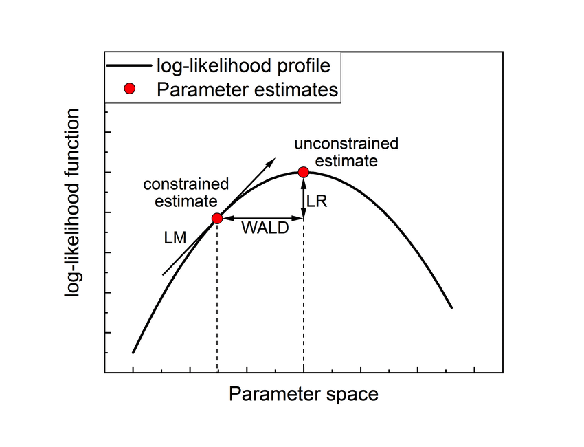
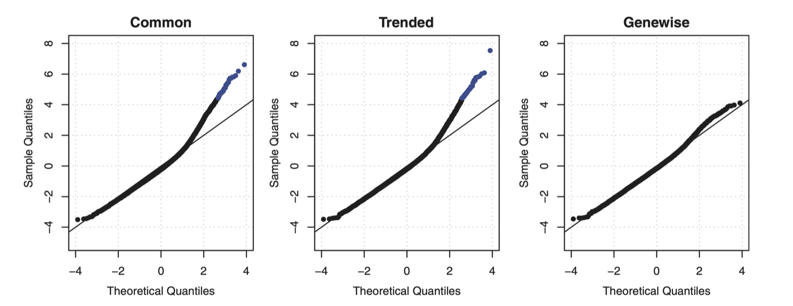
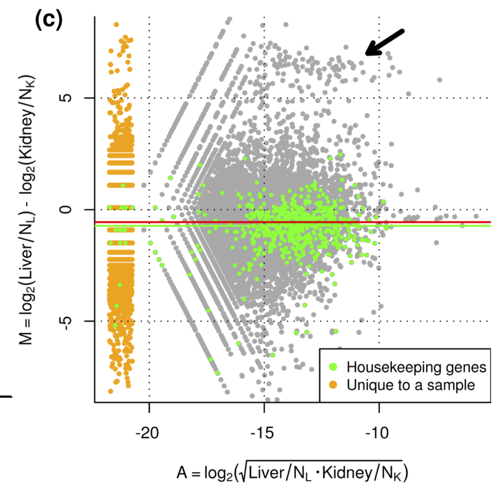
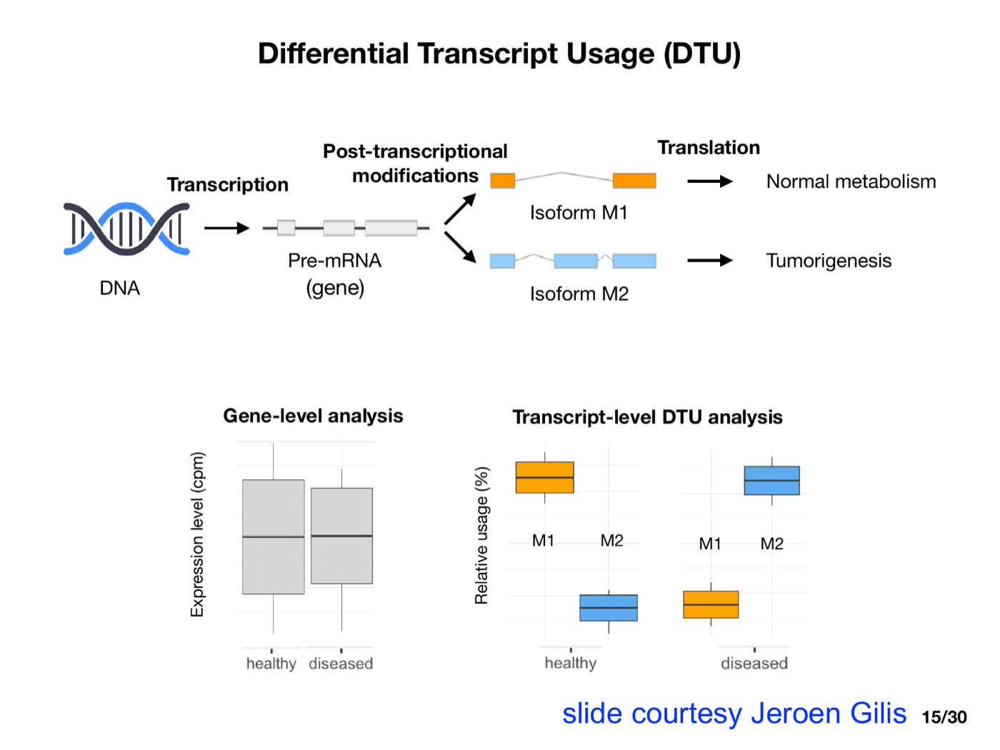

```{r echo = FALSE}
source("R/knitr_setup.R")
```

```{r, warning=FALSE, message=FALSE}
library(tidyverse)
library(SummarizedExperiment)
library(edgeR)
library(BiocFileCache)
library(tximeta)
library(org.Hs.eg.db)
library(DESeq2)
library(stageR)
library(patchwork)
library(macrophage)
```

In the [introduction to bulk RNA-seq](04-rnaseq-intro.html) we introduced count models and a complete edgeR workflow.
In this chapter we look under the hood:

1. How generalised linear models (GLMs) are fitted and how inference works.
2. How edgeR estimates the variability with negative binomial (NB) and quasi-likelihood (QL) models, and how this compares to limma-voom and DESeq2.
3. The calibration of the tests under the null hypothesis.
4. Normalisation and independent filtering.
5. Analyses at the transcript level: differential transcript expression and differential transcript usage.

# Generalised linear models

## Simulated Poisson data

We simulate Poisson counts for 100 observations with two covariates, $\beta_0 = 2$, $\beta_1 = 0.8$ and $\beta_2 = 1.2$.

```{r}
set.seed(300)
X <- cbind(1, rnorm(100), rnorm(100))
betasTrue <- c(2, 0.8, 1.2)
etaTrue <- X %*% betasTrue
y <- rpois(100, exp(etaTrue))
```

```{r fig.width=4, fig.height=3}
tibble(coef = 0:2, beta = betasTrue) |>
  ggplot(aes(coef, beta)) +
  geom_point() +
  geom_line() +
  scale_x_continuous(breaks = 0:2) +
  ylim(0, 4) +
  xlab("parameter") +
  ylab("true value") +
  theme_bw()
```

The counts increase exponentially with the covariates; on the log scale the relation becomes (approximately) linear.

```{r}
simData <- tibble(x1 = X[, 2], x2 = X[, 3], y = y)
if (knitr::is_html_output()) {
  plot3d <- function(z, title) {
    plotly::plot_ly(simData, x = ~x1, y = ~x2, z = z, size = 0.5) |>
      plotly::add_markers(type = "scatter3d") |>
      plotly::layout(title = title, scene = list(aspectmode = "cube", zaxis = list(title = title)))
  }
  htmltools::tagList(
    plot3d(~y, "y"),
    plot3d(~ log2(y + 0.5), "log2(y + 0.5)")
  )
} else {
  simData |>
    mutate(`log2(y + 0.5)` = log2(y + 0.5)) |>
    pivot_longer(c(y, `log2(y + 0.5)`), names_to = "scale", values_to = "count") |>
    mutate(scale = factor(scale, levels = c("y", "log2(y + 0.5)"))) |>
    ggplot(aes(x1, count, color = x2)) +
    geom_point() +
    facet_wrap(~scale, scales = "free_y") +
    scale_color_viridis_c() +
    ylab("") +
    theme_bw()
}
```

## Exponential family

GLMs assume that the response follows a distribution of the exponential family:

$$
f(y_i\vert \theta_i,\phi)=\exp\left\{ \frac{y_i\theta_i- b(\theta_i)}{a(\phi)}+c(y_i,\phi)\right\}
$$

with

- $\theta_i$: the canonical parameter,
- $\phi$: the dispersion parameter,
- $a(.)$, $b(.)$, $c(.)$: functions that depend on the distribution.

The first two moments follow from $b(.)$:

- $E[y_i]=\mu_i=b^\prime(\theta_i)$,
- $\text{Var}[y_i]=a(\phi)\, b^{\prime\prime}(\theta_i)$.

The variance is thus a function of the mean.

**Poisson.**
$$
f(y_i \vert \mu_i) = \frac{\mu_i^{y_i}e^{-\mu_i}}{y_i!} = \exp\left\{y_i\log(\mu_i) - \mu_i - \log(y_i!)\right\}
$$
so 

- $\theta_i = \log\mu_i$, 
- $b(\theta_i) = \exp(\theta_i)$, 
- $a(\phi) = 1$ and 
- $c(y_i, \phi) = -\log(y_i!)$.

Hence 

- $E[y_i] = b^\prime(\theta_i) = \exp(\theta_i) = \mu_i$ and 
- $\text{Var}[y_i] = b^{\prime\prime}(\theta_i) = \mu_i$.

## Components of a GLM

$$
\left\{\begin{array}{lcl}
y_i\vert \mathbf{x}_i&\sim&f(y_i\vert{\theta}_i,\phi)\\
E\left[ y_i\vert \mathbf{x}_i\right]&=&\mu_i\\
g(\mu_i)&=&\eta_i\\
\eta_i&=&\mathbf{x}_i^T\boldsymbol{\beta}
\end{array}\right.
$$

with $g(.)$ the link function, e.g.

- identity link $g(\mu) = \mu$ for the normal distribution,
- log link $g(\mu) = \log\mu$ for the Poisson distribution,
- logit link $g(\mu) = \log\frac{\mu}{1-\mu}$ for the Bernoulli distribution.

These are the **canonical** links: with a canonical link $\theta_i = \eta_i$.

## Likelihood

- The likelihood is the probability (density) to observe the sample, as a function of the model parameters (here we explicitly assume that the observations are independent):
$$
L(\boldsymbol{\beta}\vert \mathbf{y})=\prod\limits_{i=1}^n f(y_i\vert\theta_i,\phi)
$$
- We work with the log-likelihood
$$
l(\boldsymbol{\beta}\vert \mathbf{y}) =  \sum\limits_{i=1}^n \log f(y_i\vert\theta_i,\phi).
$$
- For the Poisson GLM with log link:

$$
l(\boldsymbol{\beta} \vert \mathbf{y}) = \sum\limits_{i=1}^n \left\{ y_i \eta_i - e^{\eta_i} - \log y_i!\right\}, \quad \theta_i = \eta_i = \mathbf{x}_i^T\boldsymbol{\beta}.
$$

We verify the formula on the simulated data, first for every observation and then for the full sample:

```{r fig.width=4, fig.height=4}
tibble(
  dpois = dpois(y, exp(etaTrue), log = TRUE),
  formula = c(y * etaTrue - exp(etaTrue) - lfactorial(y))
) |>
  ggplot(aes(dpois, formula)) +
  geom_point() +
  geom_abline(intercept = 0, slope = 1) +
  xlab("log-likelihood with dpois") +
  ylab("log-likelihood with the formula") +
  theme_bw()

c(dpois = sum(dpois(y, exp(etaTrue), log = TRUE)),
  formula = sum(y * etaTrue - exp(etaTrue) - lfactorial(y)))
```

## Maximum likelihood estimation

We choose the parameters that maximise the log-likelihood, i.e. we solve the **score equations**

$$
S(\boldsymbol{\beta}) = \frac{\partial l(\boldsymbol{\beta} \vert \mathbf{y})}{\partial\boldsymbol{\beta}} = \mathbf{0}.
$$

With the chain rule we obtain

$$
\begin{aligned}
S(\boldsymbol{\beta}) &=  \sum_{i=1}^n  \frac{\partial l(\boldsymbol{\beta} \vert{y_i})}{\partial \boldsymbol{\beta}} \\\\
&\Updownarrow \text{ canonical link} \\\\
&=   \sum_{i=1}^n  \frac{\partial\left\{ \frac{y_i \theta_i - b(\theta_i)}{a(\phi)}+c(y_i,\phi)\right\}}{\partial \theta_i}\frac{\partial\theta_i}{\partial \mu_i}\frac{\partial\mu_i}{\partial\eta_i}\frac{\partial\eta_i}{\partial\boldsymbol{\beta}}\\\\
&=  \sum_{i=1}^n \frac{y_i - \mu_i}{a(\phi)}\frac{1}{b^{\prime\prime}(\theta)}\frac{\partial\mu_i}{\partial\eta_i}\mathbf{x}_i^T\\\\
&= \sum_{i=1}^n \frac{y_i-\mu_i}{\text{Var}[y_i]}\frac{\partial\mu_i}{\partial\eta_i}\mathbf{x}_i^T\\\\
&=  \mathbf{X}^T\mathbf{A}\left(\mathbf{y}-\boldsymbol{\mu}\right),
\end{aligned}
$$


with $\mathbf{A}$ a diagonal matrix with elements $a_{ii}=\left(\text{Var}[y_i]\frac{\partial \eta_i}{\partial \mu_i}\right)^{-1}$.

- For the Poisson GLM with log link: 

    - $\text{Var}[y_i] = \mu_i$ and 
    - $\partial\mu_i/\partial\eta_i = \mu_i$, so $\mathbf{A} = \mathbf{I}$ and
    - $S(\boldsymbol{\beta}) = \mathbf{X}^T(\mathbf{y}-\boldsymbol{\mu})$.

Note that, 

-  Only the **mean and the variance** of $y_i$ enter the score equations. This is the idea used by the quasi-likelihood implementation we already have seen in edgeR and allows us to specify a model with a more flexible model than members of the exponential family.

- The score equations are non-linear in $\boldsymbol{\beta}$ because $\boldsymbol{\mu} = g(\boldsymbol{\eta})$.

- $a_{ii}=\left(\text{var}[y_i]\frac{\partial \eta_i}{\partial \mu_i}\right)^{-1}$

$\rightarrow$ Find roots of score equation by using Newton-Raphson method.


### Newton-Raphson and Fisher scoring

We find the root of the score function iteratively with the Newton-Raphson algorithm: walk along the tangent of the score function to the point where it crosses zero.

```{r echo=FALSE, fig.cap="Newton-Raphson: starting from an initial guess, the algorithm walks along the tangent of the score function to the point where the tangent crosses zero, and repeats this until the root is found."}
S <- function(beta) (beta - 3)^2
dS <- function(beta) 2 * (beta - 3)
betaSeq <- -20
for (i in 1:5) betaSeq <- c(betaSeq, betaSeq[i] - S(betaSeq[i]) / dS(betaSeq[i]))
k <- seq_len(length(betaSeq) - 1)

# the tangent in beta_k crosses zero in beta_k+1
tangents <- tibble(x = betaSeq[k], y = S(betaSeq[k]), xend = betaSeq[k + 1], yend = 0)
verticals <- tibble(x = betaSeq[k + 1], y = 0, yend = S(betaSeq[k + 1]))

ggplot(tibble(beta = seq(-21, 15, length = 200)), aes(beta, S(beta))) +
  geom_hline(yintercept = 0, col = "grey") +
  geom_line() +
  geom_segment(data = tangents, aes(x, y, xend = xend, yend = yend),
               linetype = "dashed", col = "red") +
  geom_segment(data = verticals, aes(x, y, xend = x, yend = yend),
               linetype = "dashed", col = "red") +
  geom_point(data = tibble(beta = betaSeq), col = "red") +
  annotate("text", x = betaSeq[1:3], y = S(betaSeq[1:3]) + 40, col = "red", parse = TRUE,
           label = c("S(beta[k])", "S(beta[k+1])", "S(beta[k+2])")) +
  annotate("text", x = betaSeq[2:4], y = -40, col = "red", parse = TRUE,
           label = paste0("beta[k+", 1:3, "]")) +
  annotate("text", x = -20, y = 400, col = "red", parse = TRUE,
           label = "frac(partialdiff*S, partialdiff*beta)*' |'*beta[k]") +
  labs(x = expression(beta), y = expression(S(beta))) +
  theme_bw()
```


Newton Raphson algorithm to find the root of the score function. 

1. Choose initial parameter estimate $\boldsymbol{\beta}^k=\boldsymbol{\beta}^0$
2. Calculate score $S(\boldsymbol{\beta})\vert_{\boldsymbol{\beta}=\boldsymbol{\beta}^k}$
3. Calculate derivative of the function for which you want to calculate the roots
4. Walk along first derivative until line (plane) of the derivative crosses zero
5. Update the betas $\boldsymbol{\beta}^{k+1}$
6. Iterate from step 2 - 5 until convergence.


#### Derivative of Score 

We have to implement an interative algorithm for optimisation. To make things tractable we will act as if $\mathbf{A}$ is known and fix it using the current values of $\boldsymbol{\beta}^k$. Note, that for Poisson regression $\mathbf{A}=\mathbf{I}$.

\begin{eqnarray*}
\frac{\partial S(\boldsymbol{\beta})}{\partial \boldsymbol{\beta}} &=& \frac{\partial \mathbf{X}^T\mathbf{A} \left\{\mathbf{Y}-\boldsymbol{\mu}\right\}}{\partial \boldsymbol{\beta}}\\
&\approx& - \mathbf{X}^T \mathbf{A}\left[
\begin{array}{cccc} \frac{\partial \mu_1}{\partial \eta_1} &0&\ldots&0\\
 0&\frac{\partial \mu_2}{\partial \eta_2} &\ldots&0\\
\vdots&\vdots&\vdots&\vdots\\
0&0&\ldots& \frac{\partial \mu_n}{\partial \eta_n}\\
\end{array}\right] \frac{\partial \boldsymbol{\eta}}{\partial \boldsymbol{\beta}}\\
&\approx&-\mathbf{X}^T\mathbf{WX}
\end{eqnarray*}

#### Define equation of Tangent Line (Plane)

- We know two points of the tangent plane $(\boldsymbol{\beta}^k,S(\boldsymbol{\beta}^k))$ and $(\boldsymbol{\beta}^{k+1},0)$
- We know the direction of the plane $S^\prime(\boldsymbol{\beta})=\frac{\partial S(\boldsymbol{\beta})}{\partial \boldsymbol{\beta}}$
- Equation of Plane:
$$S(\boldsymbol{\beta})={\alpha}_0+S^\prime\vert_{\boldsymbol{\beta}^k} \boldsymbol{\beta}$$

- Get $\boldsymbol{\beta}_{k+1}$
$$
\begin{aligned}
\mathbf{0}&= {\alpha}_0+S^\prime\vert_{\boldsymbol{\beta}^{k}} \boldsymbol{\beta}^{k+1}\\
\boldsymbol{\beta}^{k+1}&= -\left(S^{\prime}\vert_{\boldsymbol{\beta}^{k}}\right)^{-1}{\alpha}_0
\end{aligned}
$$

- Get ${\alpha}_0$

$$
\begin{aligned}
S(\boldsymbol{\beta}^k)&= \boldsymbol{\alpha}_0+S^\prime\vert_{\boldsymbol{\beta}^k} \boldsymbol{\beta}^k\\
{\alpha}_0&= -S^\prime\vert_{\boldsymbol{\beta}^k} \boldsymbol{\beta}^k + S(\boldsymbol{\beta}^k)
\end{aligned}
$$

- Get $\boldsymbol{\beta}_{k+1}$

$$
\begin{aligned}
\boldsymbol{\beta}^{k+1}&= \boldsymbol{\beta}^k-\left(S^{\prime}\vert_{\boldsymbol{\beta}^{k}}\right)^{-1}S(\boldsymbol{\beta}^k)\\
\boldsymbol{\beta}^{k+1}&= \boldsymbol{\beta}^k+ \left(\mathbf{X}^T\mathbf{WX}\right)^{-1} S(\boldsymbol{\beta}^k)
\end{aligned}
$$


- $\mathbf{X}^T\mathbf{WX}$ is the Fisher information matrix.
- With a canonical link the observed and expected Fisher information are equal

### Fisher Scoring

Because we use the canonical model parameters the observed  Fisher information matrix equals the expected  Fisher information matrix $J(\boldsymbol{\beta})=I(\boldsymbol{\beta})$.
Indeed, the observed Fisher information matrix is not depending on the observations, but only on the design and the variance of the data (via the weights).

Hence, Newton-Raphson is equivalent to Fisher scoring when the canonical link function is used.

Note, that the Fisher matrix, minus second derivative (or hessian) of the likelihood to the model parameters, is also the inverse of the variance covariance matrix of the model parameters. It is thus related to the precision.


### Iteratively reweighted least squares

We can rewrite Newton Raphson or Fisher scoring as IRLS.

$$
\begin{aligned}
\boldsymbol{\beta}^{k+1}&= \boldsymbol{\beta}^k+ \left(\mathbf{X}^T\mathbf{WX}\right)^{-1} S(\boldsymbol{\beta}^k)\\
\boldsymbol{\beta}^{k+1}&= \boldsymbol{\beta}^k+ \left(\mathbf{X}^T\mathbf{WX}\right)^{-1} \mathbf{X}^T\mathbf{A} \left(\mathbf{Y}-\boldsymbol{\mu}\right)\\
\boldsymbol{\beta}^{k+1}&=  \left(\mathbf{X}^T\mathbf{WX}\right)^{-1}\mathbf{X}^T\mathbf{WX}\boldsymbol{\beta}^k+ \left(\boldsymbol{X}^T\mathbf{WX}\right)^{-1} \mathbf{X}^T \mathbf{W}\frac{\partial \eta}{\partial \mu}  \left(\mathbf{Y}-\boldsymbol{\mu}\right)\\
\boldsymbol{\beta}^{k+1}&=  \left(\mathbf{X}^T\mathbf{WX}\right)^{-1}\mathbf{X}^T\mathbf{W} \left[\mathbf{X}\boldsymbol{\beta}^k + \frac{\partial \eta}{\partial \mu}  \left(\mathbf{Y}-\boldsymbol{\mu}\right)
\right]\\
\boldsymbol{\beta}^{k+1}&=  \left(\mathbf{X}^T\mathbf{WX}\right)^{-1}\mathbf{X}^T\mathbf{Wz}
\end{aligned}
$$

with $\mathbf{z}=\left[\mathbf{X}\boldsymbol{\beta}^k + \frac{\partial \eta}{\partial \mu}  \left(\mathbf{Y}-\boldsymbol{\mu}\right)\right]$


Each iteration is a **weighted least squares** fit of the working response $\mathbf{z}$ on $\mathbf{X}$, as in a linear model.
The weights account for the mean-variance relation: observations with a smaller variance get more weight.

For the Poisson GLM with log link: $z_i = \eta_i + e^{-\eta_i}(y_i - e^{\eta_i})$ and $w_{ii} = e^{\eta_i}$.

### IRLS in R

#### Initial Estimate

This is a very poor initial estimate used to illustrate the algorithm.
Otherwise convergence for this simple example is way too quick

```{r}
iteration=0
betas<-c(log(mean(y)),0,0)
plot(betasTrue,
     ylab=expression(beta),
     ylim=c(0,4),
     pch=19,
     type="b", 
     main=paste0("likelihood real beta=",
                 round(sum(dpois(y,exp(etaTrue),log=TRUE)),1),"\nlikelihood fit=", round(sum(dpois(y,exp(X%*%betas),log=TRUE)),1))
)
lines(betas,type="b",lty=2 )
```

#### Iteratively Reweighted Least Squares

##### Pseudo Data

$$z_i= \eta_i + \frac{\partial \eta_i}{\partial \mu_i}(y_i -\mu_i)$$
$$z_i= \eta_i + e^{-\eta_i} y_i -1$$

##### Weight Matrix?

$$[w_{ii}]= var_{y_i}^{-1} \left(\frac{\partial \mu}{\partial \eta}\right)^2$$
$$[w_{ii}]= e^{\eta_i}$$

##### Run Update Step Multiple Times

First 3 times (colors are black 0, red iteration 1, green iteration 2, blue iteration 3)

```{r}
plot(betasTrue,ylab=expression(beta),ylim=c(0,4),pch=19,type="b")
lines(betas,type="b",lty=2)

cat("\nlikelihood TRUE=", round(sum(dpois(y,exp(X%*%betasTrue),log=TRUE)),1))
cat("\nlikelihood initial fit=", round(sum(dpois(y,exp(X%*%betas),log=TRUE)),1))

#Calculate current eta
eta<-X%*%betas

iteration=0
for (i in 1:3)
{
#start IRLS UPDATE STEP
iteration=iteration+1
#calculate pseudo data based on current betas
z=eta+exp(-eta)*(y-exp(eta))
#calculate new weights: diagonal elements
w<-c(exp(eta))

#update betas
lmUpdate<-lm(z~-1+X,weight=w)
#eta<-X%*%betas
eta<-lmUpdate$fitted
betas<-lmUpdate$coef
lines(betas,type="b",col=iteration+1,pch=iteration,lty=2)
cat("\nlikelihood current fit=", round(sum(dpois(y,exp(X%*%betas),log=TRUE)),1))
}
```


### Comparison with GLM Function

#### Smarter Initialisation
```{r}
z<-log(y+.5)
betas<-lm(z~-1+X)$coef
plot(betasTrue,ylab=expression(beta),ylim=c(0,4),pch=19,type="b")
lines(betas,col=2,type="b",lty=2)
#calculate current eta
eta<-X%*%betas

cat("\nlikelihood TRUE=", round(sum(dpois(y,exp(X%*%betasTrue),log=TRUE)),1))
cat("\nlikelihood initial fit=", round(sum(dpois(y,exp(X%*%betas),log=TRUE)),1))
```

#### Evaluation Stopping Criterion

- Residual deviance: Is 2 log of LR between best possible fit and current fit
$$LR=\frac{L_\text{best}}{L_\text{current}}$$
$$D=2 (\log L_\text{best}- \log L_\text{current})$$
$$D=2 (l_\text{best}-l_\text{current})$$
- Best fit: $\mu=y$
- Optimal poisson:
$$ l_\text{best}=\sum\left[y_i \log(y_i) - y_i - \log\left(y_i!\right)\right]$$
- Current fit
$$ l_\text{current}=\sum \left[y_i \eta_i -e^{\eta_i} - log\left(y_i!\right)\right]$$
- Deviance D:
$$D = 2 \sum \left[ y_i log(y_i) - y_i \eta_i - (y_i -e^{\eta_i})\right]$$
- Problem to calculate it if y=0 but by apply l'Hopital's rule we know
$$\lim_{y_i \to 0} y_i \log(y_i) =0$$

```{r}
ylogy<-function(y)
{
return(ifelse(y==0,rep(0,length(y)),y*log(y)))
}

deviance<-2*sum(ylogy(y)-y*eta-(y-exp(eta)))

devianceOld<-1e30
```


#### Run Update Step until Convergence

```{r}
plot(betasTrue,ylab=expression(beta),ylim=c(0,4),pch=19,type="b")
lines(betas,type="b",lty=2)

tol<-1e-6
iteration=0
while(((devianceOld-deviance)/devianceOld)>tol)
{
#start IRLS UPDATE STEP
iteration=iteration+1
#calculate pseudo data based on current betas
z=eta+exp(-eta)*(y-exp(eta))
#calculate new weights: diagonal elements
w<-c(exp(eta))

#update betas
lmUpdate<-lm(z~-1+X,weight=w)
#eta<-X%*%betas
eta<-lmUpdate$fitted
betas<-lmUpdate$coef
lines(betas,type="b",col=iteration+1,pch=iteration,lty=2)

#criterion for convergence
devianceOld<-deviance
deviance<-2*sum(ylogy(y)-y*eta-(y-exp(eta)))
cat("iteration",iteration,"Deviance Old",devianceOld,"Deviance", deviance,"\n")
}
```

#### Variance $\beta$?

$$\Sigma_{\beta}=\left(\mathbf{X}^T\mathbf{W} \mathbf{X}\right)^{-1}$$

```{r}
varBeta=solve(t(X)%*%diag(w)%*%X)
```

#### Comparison with GLM fit

Use -1 because intercept is already in X
```{r}
glmfit=glm(y~-1+X,family=poisson)
comp=data.frame(glmfit=c(glmfit$deviance,glmfit$coef,summary(glmfit)$coef[,2]),ourFit=c(deviance,betas,sqrt(diag(varBeta))))
row.names(comp)=c("deviance",paste("beta",1:3,sep=""),paste("se",1:3,sep=""))
comp
```

## Inference

### Wald test

The maximum likelihood estimator is asymptotically normal:

$$
\hat{\boldsymbol{\beta}} \stackrel{a}{\sim} N\left[\boldsymbol{\beta},\left(\mathbf{X}^T\mathbf{WX}\right)^{-1}\right].
$$

For a single contrast, $\mathbf{L}$ is a $p \times 1$ vector. Under $H_0: \mathbf{L}^T\boldsymbol{\beta} = 0$,

$$
z = \frac{\mathbf{L}^T\hat{\boldsymbol{\beta}}}{\widehat{\text{SE}}_{\mathbf{L}^T\hat{\boldsymbol{\beta}}}} \stackrel{a}{\sim} N(0, 1), \qquad \widehat{\text{SE}}_{\mathbf{L}^T\hat{\boldsymbol{\beta}}} = \sqrt{\mathbf{L}^T\widehat{\boldsymbol{\Sigma}}_{\hat{\boldsymbol{\beta}}}\mathbf{L}}.
$$

For $c$ contrasts simultaneously, $\mathbf{L}$ is a $p \times c$ matrix with one contrast per column. Under $H_0: \mathbf{L}^T\boldsymbol{\beta} = \mathbf{0}$,

$$
W = \left(\mathbf{L}^T\hat{\boldsymbol{\beta}}\right)^T
\left(\mathbf{L}^T\widehat{\boldsymbol{\Sigma}}_{\hat{\boldsymbol{\beta}}}\mathbf{L}\right)^{-1}
\left(\mathbf{L}^T\hat{\boldsymbol{\beta}}\right) \stackrel{a}{\sim} \chi^2_c,
$$

with $\widehat{\boldsymbol{\Sigma}}_{\hat{\boldsymbol{\beta}}} = \left(\mathbf{X}^T\mathbf{WX}\right)^{-1}$.

### Deviance and likelihood ratio test

- The **deviance** compares the fit of the model with the saturated model, which fits every observation perfectly ($\hat\mu_i = y_i$):
$$
D = 2\left[l(\mathbf{y}\vert\mathbf{y}) - l(\hat{\boldsymbol{\mu}}\vert\mathbf{y})\right].
$$
It plays the role of the residual sum of squares in a linear model.

- The **likelihood ratio test** compares a full model with a nested reduced model, e.g. without the treatment effect:
$$
H_0: \text{LRT} = 2\left[l(\hat{\boldsymbol{\beta}}_\text{full}) - l(\hat{\boldsymbol{\beta}}_0)\right] = D_0 - D_full \xrightarrow{d} \chi^2_c ,
$$
with $c$ the number of parameters that are dropped.

```{r echo=FALSE, out.width="50%", fig.cap="The Wald test looks at the distance between the estimate and the null value on the parameter scale, the likelihood ratio test at the difference in log-likelihood."}

```

**These results are asymptotic.**

- With the typical 3 to 5 biological replicates per group in bulk RNA-seq, the large sample theory does not hold.
- Moreover, the dispersion of the NB distribution has to be estimated, which adds uncertainty that the $\chi^2$ tests ignore.
- Quasi-likelihood F-tests address both issues.

# Differential expression with edgeR

## The negative binomial GLM

$$
\left\{
\begin{array}{lcl}
Y_{gi} &\sim& NB(\mu_{gi}, \phi_g)\\
\log \mu_{gi} &=& \mathbf{x}_i^T\boldsymbol{\beta}_g + \log N^{\text{eff}}_i
\end{array}
\right.
\quad \text{with} \quad
\text{Var}[Y_{gi}] = \mu_{gi} + \phi_g \mu_{gi}^2.
$$

- For a known dispersion $\phi_g$, the NB distribution is a member of the exponential family and the model is fitted with IRLS.
- The original edgeR pipeline [@McCarthy2012-edgeR] estimates the dispersions with an adjusted profile likelihood (Cox-Reid), which corrects for the estimation of the mean parameters, similar to REML in mixed models.
- Gene-wise dispersions are very unstable with few replicates. They are shrunken towards a trend in the average expression with empirical Bayes, and the genes are then tested with likelihood ratio tests.
- The uncertainty in the estimated dispersions is ignored by these tests.

```{r echo=FALSE, out.width="80%", fig.cap="QQ-plots of goodness of fit statistics with a common, trended or empirical Bayes (tagwise) dispersion (from McCarthy et al., 2012)."}

```

## Quasi-likelihood

In quasi-likelihood we no longer specify the full distribution, but only the mean and the variance:

$$
\left\{ \begin{array}{lcl}
E[Y_i\vert \mathbf{x}_i] &=& \mu_i\\
g(\mu_i) &=& \mathbf{x}_i^T\boldsymbol{\beta}\\
\text{Var}[Y_i] &=& \sigma^2 V(\mu_i)
\end{array}\right.
$$

- $V(\mu_i)$ is the variance function of a known distribution, e.g. $V(\mu) = \mu$ (quasi-Poisson) or $V(\mu) = \mu + \phi\mu^2$ (quasi-NB).
- $\sigma^2$ is the **quasi-likelihood dispersion**, which allows for more ($\sigma^2>1$) or less ($\sigma^2<1$) variability than the original distribution.

### Estimation

The estimating equations become

$$
U(\boldsymbol{\beta}) = \frac{1}{\sigma^2}\mathbf{X}^T\mathbf{A}\left(\mathbf{y}-\boldsymbol{\mu}\right) = \mathbf{0}
\quad \Leftrightarrow \quad
\mathbf{X}^T\mathbf{A}\left(\mathbf{y}-\boldsymbol{\mu}\right) = \mathbf{0}.
$$

- The estimators of the mean parameters are identical to those of the original GLM: we can use the same IRLS algorithm.
- The variance-covariance matrix is inflated: $\boldsymbol{\Sigma}_{\hat{\boldsymbol{\beta}}}= \sigma^2(\mathbf{X}^T\mathbf{WX})^{-1}$.
- $\sigma^2$ is estimated from the residuals, e.g. based on the deviance:
$$
\hat{\sigma}^2 = \frac{D}{n-p},
$$
the GLM counterpart of the residual variance $\hat\sigma^2 = \text{SSE}/(n-p)$ in a linear model.

### Inference

- t-test: $t = \frac{\mathbf{L}^T\hat{\boldsymbol{\beta}}}{\widehat{\text{SE}}^{QL}} \stackrel{a}{\sim} t_{n-p}$ under $H_0$, with $\text{SE}^{QL} = \hat\sigma\, \text{SE}^{ML}$.
- F-test: $F = \frac{(D_0 - D_{\text{full}})/c}{\hat\sigma^2} \stackrel{a}{\sim} F_{c, n-p}$ under $H_0$.

The $t$ and $F$ distributions account for the uncertainty in $\hat\sigma^2$, as in linear models.

### Example: quasi-Poisson

We use the example from the help page of `glm` [@Dobson1990]: a randomised controlled trial with three treatments and three outcome categories, where the counts are the numbers of patients per treatment and outcome.

```{r}
counts <- c(18, 17, 15, 20, 10, 20, 25, 13, 12)
outcome <- gl(3, 1, 9)
treatment <- gl(3, 3)
glmPois <- glm(counts ~ outcome + treatment, family = poisson())
glmQPois <- glm(counts ~ outcome + treatment, family = quasipoisson())
```

The quasi-Poisson fit gives the same estimates, but its standard errors are inflated with $\hat\sigma$.
`glm` estimates $\sigma^2$ with the Pearson residuals, $\hat\sigma^2 = \sum_i \frac{(y_i-\hat\mu_i)^2}{V(\hat\mu_i)}/(n-p)$.

```{r}
sigma2 <- sum(residuals(glmPois, type = "pearson")^2) / df.residual(glmPois)
sigma2
cbind(
  estimate = coef(glmPois),
  sePois = summary(glmPois)$coef[, 2],
  seQPois = summary(glmQPois)$coef[, 2],
  sePoisTimesSigma = summary(glmPois)$coef[, 2] * sqrt(sigma2)
)
```

The F-test for the outcome effect equals the LRT divided by its degrees of freedom and $\hat\sigma^2$:

```{r}
glmQPois0 <- glm(counts ~ treatment, family = quasipoisson())
anova(glmQPois0, glmQPois, test = "F")
(deviance(glmQPois0) - deviance(glmQPois)) / 2 / sigma2
```

## The edgeR quasi-likelihood pipeline

edgeR [@Lund2012-ql; @Chen2025-edgeR4] uses a quasi-NB model with a gene-specific QL dispersion:

$$
\text{Var}[Y_{gi}] = \sigma^2_g\left(\mu_{gi} + \phi\mu_{gi}^2\right).
$$

We illustrate it on the macrophage data of the [introduction](04-rnaseq-intro.html): 6 donors, with IFN$\gamma$ priming and *Salmonella* infection in a 2 $\times$ 2 factorial design [@Alasoo2018-macrophage].

```{r}
macDir <- system.file("extdata", package = "macrophage")
coldata <- read.csv(file.path(macDir, "coldata.csv")) |>
  transmute(
    names,
    files = file.path(macDir, "quants", names, "quant.sf.gz"),
    donor = factor(line_id),
    condition = factor(condition_name, levels = c("naive", "IFNg", "SL1344", "IFNg_SL1344")),
    ifng = factor(ifelse(grepl("IFNg", condition_name), "yes", "no")),
    salmonella = factor(ifelse(grepl("SL1344", condition_name), "yes", "no"))
  )
st <- tximeta(coldata, dropInfReps = TRUE)
sg <- summarizeToGene(st)
sg <- addIds(sg, "SYMBOL", gene = TRUE)

dge <- DGEListFromTximeta(sg)
dge$genes <- dge$genes[, c("SYMBOL", "Max2MinLength")]
design <- model.matrix(~ donor + ifng * salmonella, data = colData(sg))
keep <- filterByExpr(dge, design)
dge <- dge[keep, , keep.lib.sizes = FALSE]
dge <- normLibSizes(dge)
```

As in the [introduction](04-rnaseq-intro.html), `DGEListFromTximeta` stores the centred log average transcript lengths in `dge$offset.prior`.
`getOffset` returns the offsets that edgeR uses in all models: the log effective library sizes plus these length offsets.

```{r}
getOffset(dge)[1:3, 1:4]
```

### Step 1: a global NB dispersion

- `glmQLFit` no longer needs gene-wise NB dispersions.
- It estimates a single NB dispersion $\phi$ from the most highly expressed genes, for which the Poisson noise is negligible.

```{r}
fit <- glmQLFit(dge, design)
fit$dispersion
fit$top.proportion
```

- $\phi$ = `r round(fit$dispersion, 3)` corresponds to a biological coefficient of variation of `r round(sqrt(fit$dispersion) * 100)`%.
- All gene-specific variability is captured by the QL dispersions $\sigma^2_g$.
- Older edgeR analyses first estimate trended NB dispersions with `estimateDisp` and use the classical QL theory (`glmQLFit(..., legacy = TRUE)`). For bulk RNA-seq with moderate counts, both pipelines give very similar results.

### Step 2: QL dispersions with bias-adjusted degrees of freedom

- The QL dispersion is estimated as $\hat\sigma^2_g = D_g/\text{df}_g$.
- Classical QL theory treats the deviance as a scaled $\chi^2_{n-p}$. This works well for large counts but not for small counts, where the QL dispersions are biased [@Chen2025-edgeR4].
- edgeR 4 corrects both the deviance and the residual df for the count size, which gives nearly unbiased QL dispersions.
- As a consequence, the residual df are fractional and gene-specific. They are used in the empirical Bayes step and in the F-test.

The plot below reproduces Fig. 1 of @Chen2025-edgeR4: Poisson counts for 10 000 genes and 100 samples. Because the counts are simulated from the same variance model that is used in the fit (here Poisson, i.e. NB dispersion 0), the true QL dispersion equals 1 for every gene.

```{r}
set.seed(1)
mu <- 2^runif(10000, -4, 4)
ySim <- matrix(rpois(10000 * 100, mu), 10000)
designSim <- matrix(1, 100, 1)
fitClassic <- glmQLFit(ySim, designSim, dispersion = 0, legacy = TRUE)
fitAdj <- glmQLFit(ySim, designSim, dispersion = 0, legacy = FALSE)
tibble(log2mu = log2(mu),
       `classical: deviance/(n-p)` = fitClassic$deviance / fitClassic$df.residual,
       `edgeR 4: adjusted deviance/adjusted df` = fitAdj$deviance.adj / fitAdj$df.residual.adj) |>
  pivot_longer(-log2mu, names_to = "method", values_to = "QLdisp") |>
  ggplot(aes(log2mu, QLdisp)) +
  geom_point(alpha = 0.1, size = 0.3) +
  geom_smooth(col = "red", se = FALSE) +
  geom_hline(yintercept = 1, lty = 2) +
  facet_wrap(~method) +
  coord_cartesian(ylim = c(0, 2.5)) +
  xlab("log2(expected count)") + ylab("QL dispersion (true value 1)") +
  theme_bw()
```

- The classical estimator underestimates the QL dispersion for expected counts below about 0.5 and overestimates it around 1–2.
- The adjusted estimator is unbiased for all count sizes and is also more precise at low counts.

### Step 3: empirical Bayes

The QL dispersions are shrunken towards a trend in the average expression with `squeezeVar`, exactly as the residual variances in limma and msqrob2:

$$
\tilde\sigma^2_g = \frac{d_0 s^2_0 + d_g \hat\sigma^2_g}{d_0 + d_g},
$$

with $s^2_0$ the trend, $d_0$ the prior degrees of freedom and $d_g$ the (adjusted) residual degrees of freedom of gene $g$.

```{r}
plotQLDisp(fit)
fit$df.prior
```

### Step 4: moderated F-tests

$$
F_g = \frac{(D_{0,g} - D_{\text{full,g}})/c}{\tilde\sigma^2_g} \stackrel{a}{\sim} F_{c, d_0 + d_g} \text{ under } H_0.
$$

For a single parameter ($c = 1$), e.g. the IFN$\gamma$ effect in uninfected cells, the F-test is equivalent to a moderated t-test:

```{r}
qlf <- glmQLFTest(fit, coef = "ifngyes")
topTags(qlf, n = 5)
summary(decideTests(qlf))
```

With several parameters we test whether any of them differs from zero, e.g. whether a gene responds to any of the treatments ($c = 3$):

```{r}
qlfAny <- glmQLFTest(fit, coef = c("ifngyes", "salmonellayes", "ifngyes:salmonellayes"))
topTags(qlfAny, n = 5)
summary(decideTests(qlfAny))
```

## limma-voom

An alternative is to model log-transformed counts with linear models [@Law2014-voom].

- voom computes log2 CPM values with a prior count of 0.5, so that zero counts can be log-transformed: $y_{gi} = \log_2\{(Y_{gi}+0.5)/(N_{gi}+1)\times 10^6\}$, with $N_{gi}$ the effective library size, which includes the TMM normalisation factors and the length offsets of tximeta.
- The log2 CPM values are still heteroscedastic: low counts are more variable.
- voom estimates the mean-variance trend of the log2 CPM values and converts it into a **precision weight** for every observation.
- The weighted log2 CPM values are then analysed with the limma pipeline: linear models, empirical Bayes moderation with `squeezeVar` and moderated t-tests.

```{r}
v <- voom(dge, design, plot = TRUE)
fitVoom <- lmFit(v, design) |>
  eBayes()
summary(decideTests(fitVoom))[, "ifngyes"]
```

- voom is fast and has access to the full limma toolbox: e.g. random effects via `duplicateCorrelation`, array weights and gene set tests.
- It works well when the library sizes are not too different and there are sufficient replicates.
- It becomes problematic for small counts. After the log transformation, counts of 0, 1 or 2 take only a few discrete values that depend on the prior count, and their distribution is far from normal. The mean-variance trend is also estimated less reliably at low counts, so these observations get less appropriate weights.
- edgeR 4 models the counts directly and corrects the deviance and degrees of freedom for small counts, which gives better error control when the data are dominated by small counts [@Chen2025-edgeR4].

## DESeq2

DESeq2 [@Love2014-deseq2] also uses an NB GLM, but

- normalises with the median of ratios method (as in proteomics),
- estimates gene-wise dispersions $\phi_g$ and shrinks them towards a trend with empirical Bayes,
- uses Wald tests (or LRTs) using the asymptotic theory (normal distribution),
- optionally shrinks the log fold changes (e.g. with apeglm) for ranking and visualisation.

`DESeqDataSet` takes the tximeta object directly. It rounds the estimated counts and, like `DGEListFromTximeta` for edgeR, uses the average transcript lengths as additional offsets. Both analyses thus correct for transcript length.

```{r}
dds <- DESeqDataSet(sg, design = ~ donor + ifng * salmonella)
dds <- dds[rownames(dge), ]
dds <- DESeq(dds, quiet = TRUE)
resDESeq <- results(dds, name = "ifng_yes_vs_no")
summary(resDESeq, alpha = 0.05)
```

```{r}
tibble(
  edgeR = qlf$table$logFC,
  DESeq2 = resDESeq$log2FoldChange
) |>
  ggplot(aes(edgeR, DESeq2)) +
  geom_point(alpha = 0.2, size = 0.5) +
  geom_abline(intercept = 0, slope = 1, col = "red") +
  xlab("log2 FC edgeR") +
  ylab("log2 FC DESeq2") +
  theme_bw()
```

- The log fold changes agree well.
- The Wald tests of DESeq2 do not account for the uncertainty in the dispersion estimates and can be somewhat liberal with few replicates.

# Normalisation

Normalisation corrects for technical differences between samples:

- **Sequencing depth**: a sample that is sequenced deeper has higher counts for all genes.
- **RNA composition**: if a few genes are very highly expressed in one sample, they take up a large fraction of the reads, and all other genes get lower counts.
- Other technical effects, e.g. GC content or transcript length, can also be accounted for.

We illustrate it on the parathyroid data.
We first sum the counts of the technical replicates.

```{r}
bfc <- BiocFileCache()
paraTar <- bfcrpath(bfc, "https://bioconductor.org/packages/3.21/data/experiment/src/contrib/parathyroidSE_1.46.0.tar.gz")
untar(paraTar, files = "parathyroidSE/data/parathyroidGenesSE.RData", exdir = tempdir())
load(file.path(tempdir(), "parathyroidSE/data/parathyroidGenesSE.RData"))

paraCounts <- t(rowsum(t(assay(parathyroidGenesSE)), colData(parathyroidGenesSE)$experiment))
paraSamples <- colData(parathyroidGenesSE) |>
  as.data.frame() |>
  distinct(experiment, .keep_all = TRUE) |>
  dplyr::select(experiment, patient, treatment, time)
paraCounts <- paraCounts[, paraSamples$experiment]
dim(paraCounts)
```

We compare the four control samples at 48 hours in MD plots: the difference $M$ in log2 count against the average log2 count $A$, for every pair of samples.

```{r}
mdPairs <- function(counts, libSize) {
  pairs <- combn(ncol(counts), 2)
  map(seq_len(ncol(pairs)), function(k) {
    i <- pairs[1, k]
    j <- pairs[2, k]
    use <- counts[, i] > 0 & counts[, j] > 0
    tibble(
      pair = paste(colnames(counts)[j], "vs", colnames(counts)[i]),
      A = (log2(counts[use, i]) + log2(counts[use, j])) / 2,
      M = log2(counts[use, j] / libSize[j]) - log2(counts[use, i] / libSize[i])
    )
  }) |>
    bind_rows()
}

ctrl48 <- paraSamples$treatment == "Control" & paraSamples$time == "48h"
ctrlCounts <- paraCounts[, ctrl48]
colSums(ctrlCounts) / 1e6

mdPlot <- function(mdData) {
  mdData |>
    group_by(pair) |>
    mutate(median = median(M)) |>
    ggplot(aes(A, M)) +
    geom_point(alpha = 0.1, size = 0.3) +
    geom_hline(yintercept = 0, col = "blue") +
    geom_hline(aes(yintercept = median), col = "red") +
    facet_wrap(~ pair) +
    theme_bw()
}
mdPlot(mdPairs(ctrlCounts, rep(1, ncol(ctrlCounts)))) +
  ggtitle("Raw counts")
```

The log fold changes between replicates are not centred around zero (blue line).
Dividing by the library size, i.e. using the log library size as offset, removes most of the bias:

```{r}
mdPlot(mdPairs(ctrlCounts, colSums(ctrlCounts))) +
  ggtitle("Library size")
```

## TMM (edgeR)

The trimmed mean of M-values (TMM) method [@Robinson2010-tmm] assumes that most genes are not differentially expressed.

```{r echo=FALSE, out.width="60%", fig.cap="Composition bias: a few highly expressed genes in one sample take up a large fraction of the reads (from Robinson and Oshlack, 2010)."}

```

For every sample $i$, a normalisation factor $F_i$ is computed with respect to a reference sample $r$:

$$
\log_2 F_i = \frac{\sum_{g \in G^*} w_{gi} M_{gi}}{\sum_{g \in G^*} w_{gi}},
\quad
M_{gi} = \log_2 \frac{Y_{gi}/N_i}{Y_{gr}/N_r},
\quad
w_{gi} = \left(\frac{N_i - Y_{gi}}{N_i Y_{gi}} + \frac{N_r - Y_{gr}}{N_r Y_{gr}}\right)^{-1},
$$

- $G^*$: the genes that remain after trimming the 30% most extreme $M$ values and the 5% most extreme average expression values,
- $w_{gi}$: precision weights, the inverse of the approximate variance of $M_{gi}$, so that low counts get less weight.

The effective library size $N_i^\text{eff} = N_i F_i$ is used as offset.

```{r}
dgePara <- DGEList(ctrlCounts) |>
  normLibSizes()
dgePara$samples
effLibSize <- dgePara$samples$lib.size * dgePara$samples$norm.factors
mdPlot(mdPairs(ctrlCounts, effLibSize)) +
  ggtitle("TMM")
```

## Median of ratios (DESeq2)

The median of ratios method [@Love2014-deseq2] that we used in proteomics computes a size factor for each sample with respect to a pseudo-reference sample, the geometric mean of the counts over all samples:

$$
s_i = \text{median}_{(g: Y^*_{g} > 0)} \frac{Y_{gi}}{Y^{*}_{g}}, \quad Y^{*}_{g} = \sqrt[\textstyle n]{ \prod_{i=1}^n Y_{gi}}.
$$

```{r}
ddsPara <- DESeqDataSetFromMatrix(ctrlCounts, colData = DataFrame(sample = colnames(ctrlCounts)), design = ~ 1)
ddsPara <- estimateSizeFactors(ddsPara)
tibble(
  sample = colnames(ctrlCounts),
  TMM = effLibSize / exp(mean(log(effLibSize))),
  MoR = sizeFactors(ddsPara) / exp(mean(log(sizeFactors(ddsPara))))
)
```

After rescaling both to a geometric mean of one, both methods give very similar normalisation factors.

# Independent filtering

- Lowly expressed genes have little power to be found DE, but they count in the multiple testing correction.
- Removing them before testing can increase the number of discoveries at the same FDR.
- But we then only test the genes that pass the filter. The FDR is only controlled if the filter does not change the distribution of the test statistic of the null genes [@Bourgon2010-filtering].


**Filtering is valid if the filter statistic is independent of the test statistic under the null hypothesis.**

- For every gene we compute two statistics: a filter statistic $S_F$ and a test statistic $S_T$.
- Only genes that pass the filter are tested, and the p-values are adjusted for the genes that passed the filter only.
- The second stage is thus conditional on the first. The FDR is only controlled if the conditional null distribution of $S_T$ for the genes that pass the filter equals its unconditional null distribution.


Let's build some intuition with simulated data.

- `makeExampleDESeqDataSet` simulates negative binomial counts for 1000 genes in two groups of 6 samples, without any differential expression: all genes are null genes.
- We test every gene with a two-sample t-test.

```{r}
set.seed(24)
dds <- makeExampleDESeqDataSet()
simCounts <- counts(dds)
group <- dds$condition
testStat <- apply(simCounts, 1, function(x) t.test(x ~ group, var.equal = TRUE)$statistic)
```

## A dependent filter statistic

We filter on the absolute difference in mean between the groups, which depends on the group labels.
The red line in the histogram of the filter statistic (on the log scale) gives the cutoff.

```{r fig.width=9, fig.height=3}
filterStatEffectSize <- abs(rowMeans(simCounts[, group == "A"]) - rowMeans(simCounts[, group == "B"]))
keepEffectSize <- filterStatEffectSize > 1
mean(keepEffectSize)

par(mfrow = c(1, 3))
hist(log2(filterStatEffectSize + 1), breaks = 40, main = "Filter statistic", xlab = "log2(|difference in mean| + 1)")
abline(v = log2(1 + 1), col = "red")
plot(density(testStat, na.rm = TRUE), xlab = "Test statistic", main = "Unconditional distribution")
plot(density(testStat[keepEffectSize], na.rm = TRUE), xlab = "Test statistic", main = "Conditional distribution")
```

- The genes that pass the filter have large test statistics: the conditional null distribution has lost its centre and is very different from the unconditional one.
- The p-values of the genes that pass the filter are therefore too small and the FDR is no longer controlled.

## An independent filter statistic

We filter on the overall mean, irrespective of the group labels, and remove a similar fraction of the genes.

```{r fig.width=9, fig.height=3}
filterStatGlobalMean <- rowMeans(simCounts)
keepGlobalMean <- filterStatGlobalMean > 5
mean(keepGlobalMean)

par(mfrow = c(1, 3))
hist(log2(filterStatGlobalMean + 1), breaks = 40, main = "Filter statistic", xlab = "log2(overall mean + 1)")
abline(v = log2(5 + 1), col = "red")
plot(density(testStat, na.rm = TRUE), xlab = "Test statistic", main = "Unconditional distribution")
plot(density(testStat[keepGlobalMean], na.rm = TRUE), xlab = "Test statistic", main = "Conditional distribution")
```

- The conditional null distribution is the same as the unconditional one: filtering on the overall mean is valid.
- Not using the group labels is not sufficient: @Bourgon2010-filtering show that filtering on the overall variance invalidates the moderated t-test of limma, because the filter changes the distribution of the variances from which the empirical Bayes prior is estimated. Filtering on the overall mean, as `filterByExpr` does, does not have this problem.

## filterByExpr

```{r eval=FALSE}
?edgeR::filterByExpr
```

::: {.callout-note collapse="true"}
## Help page of `filterByExpr`

```{r echo=FALSE, comment=""}
tools::Rd2txt(tools::Rd_db("edgeR")[["filterByExpr.Rd"]],
              options = list(underline_titles = FALSE))
```
:::

`filterByExpr` uses the counts per million (CPM), irrespective of the group labels.
We reconstruct it for the macrophage data, starting from the unfiltered counts.

```{r}
dgeAll <- DGEListFromTximeta(sg)
keepAuto <- filterByExpr(dgeAll, design)
```

1. A gene needs a CPM corresponding to at least `min.count = 10` reads in a sample with the median library size.

```{r}
libSize <- dgeAll$samples$lib.size * dgeAll$samples$norm.factors
cpmCutoff <- 10 / median(libSize) * 1e6
cpmCutoff
```

2. It needs this CPM in at least as many samples as the smallest group.
In a design with blocks and a factorial structure there are no simple groups.
`filterByExpr` therefore uses the inverse of the largest leverage $h_{ii}$, the diagonal elements of the hat matrix $\mathbf{X}(\mathbf{X}^T\mathbf{X})^{-1}\mathbf{X}^T$.
For a one-way design, $1/h_{ii}$ is exactly the size of the group of sample $i$.

```{r}
leverage <- hat(design)
table(round(1 / leverage, 2))
minSampleSize <- 1 / max(leverage)
```

Every sample has the same leverage here, so a gene needs a sufficient CPM in at least `r round(minSampleSize, 2)`, i.e. 3, samples.

3. The total count over all samples should be at least `min.total.count = 15`.

```{r}
keepManual <- rowSums(cpm(dgeAll$counts, lib.size = libSize) >= cpmCutoff) >= minSampleSize &
  rowSums(dgeAll$counts) >= 15
table(manual = keepManual, filterByExpr = keepAuto)
```

- The manual filter gives exactly the same genes as `filterByExpr`.
- Note that we compute the CPM from the raw counts and the library sizes: `cpm(dgeAll)` would also use the length offsets from tximeta, while `filterByExpr` does not.
- See `?filterByExpr` for the other arguments, e.g. `large.n` and `min.prop` for designs with large groups.

# Transcript-level analysis

## DGE, DTE and DTU

Salmon quantifies the expression of every transcript. This allows three types of analyses [@Soneson2015-tx]:

- **Differential gene expression (DGE)**: does the total expression of the gene change?
- **Differential transcript expression (DTE)**: does the expression of a transcript change?
- **Differential transcript usage (DTU)**: does the relative abundance of the transcripts of a gene change?

```{r echo=FALSE, out.width="90%", fig.cap="Differential transcript usage: the gene expression stays the same, while the usage of the isoforms switches (slide courtesy of Jeroen Gilis)."}

```

## Transcript-level data

For the transcript-level analyses we use the naive and IFN$\gamma$-primed samples of the macrophage data: a randomised complete block design with the 6 donors as blocks.
We restrict the analysis to one contrast, the effect of IFN$\gamma$ in uninfected cells, which keeps the DTU and stage-wise analyses simple and limits the computation time: transcript-level data with Gibbs samples are much larger than gene-level data.
The salmon quantifications of the macrophage package contain 20 Gibbs samples per sample, which we now need.

```{r}
macData <- coldata |>
  filter(condition %in% c("naive", "IFNg")) |>
  mutate(condition = droplevels(condition))
macData |>
  dplyr::select(names, donor, condition)
macDesign <- model.matrix(~ donor + condition, data = macData)
```

We import the quantifications with tximeta, which also imports the Gibbs samples as additional assays (`infRep1`, `infRep2`, ...).

```{r}
macSt <- tximeta(macData)
assayNames(macSt) |> head()
```

## Quantification uncertainty

- Many reads are compatible with several transcripts of the same gene. Their assignment is estimated with the EM algorithm.
- Transcript counts therefore have an additional source of variability: **read-to-transcript ambiguity**. Transcripts that share most of their sequence with other transcripts have a much more uncertain count.
- Quantification uncertainty is therefore especially an issue for transcripts. The assignment of an ambiguous read to one of the transcripts of a gene changes the transcript counts, but not their sum: gene counts are much less affected, and we analyse them without accounting for the quantification uncertainty.
- Salmon and kallisto can quantify this uncertainty with bootstrap or Gibbs samples (inferential replicates), e.g. with `salmon quant ... --numGibbsSamples 20`.
- `catchSalmon` estimates an overdispersion factor for every transcript from the inferential replicates [@Baldoni2024-catchSalmon]. If a count is $c$ times more variable than expected because of the ambiguity, dividing the count by $c$ gives a **scaled count** with the usual mean-variance relation, which can be analysed with the standard edgeR pipeline.

Why does dividing work?
Suppose that the ambiguity inflates the technical variance of the count $Y_{ti}$ of transcript $t$ by a factor $c_t$:

$$
\text{Var}(Y_{ti}) \approx c_t\,\mu_{ti}.
$$

The scaled count $\tilde Y_{ti} = Y_{ti}/c_t$ then has

$$
E[\tilde Y_{ti}] = \frac{\mu_{ti}}{c_t}, \quad \text{Var}(\tilde Y_{ti}) = \frac{c_t\,\mu_{ti}}{c_t^2} = \frac{\mu_{ti}}{c_t} = E[\tilde Y_{ti}],
$$

so it again has a Poisson-like technical variability, and biological variability can be modelled on top of it as usual.

- The scaled count is an **effective count**: a transcript whose count is 4 times too variable carries the same information as a count that is 4 times smaller.
- The factor $c_t$ is estimated from the inferential replicates: within every sample the variance of the bootstrap or Gibbs counts is compared with their mean, this ratio is pooled over the samples and moderated, and it is at least 1.
- The idea is similar to that of the juggling offsets below: both make the standard bulk RNA-seq tools applicable by changing their input. Scaling changes the counts, juggling offsets change the offset.

`catchSalmon` reads the salmon output directly.
When the data are imported with tximeta, `DGEListFromTximeta` does the same: it estimates the overdispersion factors from the inferential replicates and, with `divide = TRUE`, returns the divided counts [@Baldoni2024-catchSalmon; @Baldoni2025-dtu].

```{r}
macRaw <- DGEListFromTximeta(macSt)
macDivided <- DGEListFromTximeta(macSt, divide = TRUE)
summary(macDivided$genes$Overdispersion)
```

```{r}
tibble(Overdispersion = macDivided$genes$Overdispersion) |>
  filter(Overdispersion > 1) |>
  ggplot(aes(Overdispersion)) +
  geom_histogram(bins = 50) +
  scale_x_log10() +
  theme_bw()
```

Some transcripts have counts that are many times more variable than their expression level suggests.

**Long reads** (PacBio, Oxford Nanopore) sequence full-length transcripts and thus remove most of the read-to-transcript ambiguity.
Their lower throughput and higher error rate, however, imply that short reads remain the standard for quantification.

## Differential transcript expression

We analyse the raw and the divided transcript counts with the same edgeR pipeline.

```{r}
dteAnalysis <- function(y) {
  y$genes <- data.frame(tx = y$genes$tx_name, gene = y$genes$gene_id,
                        Overdispersion = y$genes$Overdispersion, row.names = rownames(y))
  keep <- filterByExpr(y, macDesign)
  y <- y[keep, , keep.lib.sizes = FALSE]
  y <- normLibSizes(y)
  fit <- glmQLFit(y, macDesign)
  list(y = y, fit = fit, test = glmQLFTest(fit, coef = "conditionIFNg"))
}
dteRaw <- dteAnalysis(macRaw)
dteScaled <- dteAnalysis(macDivided)
```

```{r}
plotQLDisp(dteRaw$fit, main = "Raw counts")
plotQLDisp(dteScaled$fit, main = "Divided counts")
c(raw = median(dteRaw$fit$s2.post), divided = median(dteScaled$fit$s2.post))
```

- With the raw counts, the QL dispersions are inflated: the ambiguity overdispersion is not captured by the NB model.
- After dividing by the overdispersion, the QL dispersions are centred around one.

```{r}
summary(decideTests(dteScaled$test))
```

## Differential transcript usage

The usage of transcript $t$ of gene $g$ in sample $i$ is its fraction of the gene's total count, i.e. the fraction of the fragments of the gene that come from the transcript:

$$
\pi_{gti} = \frac{E[Y_{gti}]}{E[Y_{g.i}]}, \quad Y_{g.i} = \sum_t Y_{gti}.
$$

Only genes with at least two transcripts can show DTU.

```{r}
yTx <- dteScaled$y
multiTxGenes <- yTx$genes |>
  dplyr::count(gene) |>
  filter(n > 1) |>
  pull(gene)
dtu <- yTx[yTx$genes$gene %in% multiTxGenes, ]
c(genes = length(multiTxGenes), transcripts = nrow(dtu))
```

### Juggling offsets

In DGE we use the (effective) library size as offset, so that the parameters model the expression relative to the sequencing depth.
For DTU we **replace this offset by the total count of the gene** [@Segers2023-juggling]:

$$
\left\{
\begin{array}{lcl}
E[Y_{gti} \mid Y_{g.i}] &=& \mu_{gti}\\
\log \mu_{gti} &=& \mathbf{x}_i^T\boldsymbol{\beta}_{gt} + \log Y_{g.i}\\
\text{Var}[Y_{gti} \mid Y_{g.i}] &=& \sigma^2_{gt}(\mu_{gti} + \phi\mu^2_{gti})
\end{array}
\right.
\quad \Rightarrow \quad
\log \pi_{gti} = \log \frac{\mu_{gti}}{Y_{g.i}} = \mathbf{x}_i^T\boldsymbol{\beta}_{gt}.
$$

- We model the counts conditionally on the observed gene total.
- The parameters now model the log usage of the transcript.
- A condition effect in $\boldsymbol{\beta}_{gt}$ is a change in usage: DTU.
- The gene total already accounts for the sequencing depth: no further normalisation is needed.
- Everything else in the edgeR pipeline stays the same: QL dispersions, empirical Bayes and moderated F-tests. The same trick works with DESeq2.
- The gene total is plugged in as known; its uncertainty is ignored.

- The total count offset above would work for raw transcript counts.

Here, we model the divided counts $\tilde Y_{gti} = Y_{gti}/c_t$, so that the quantification uncertainty of the transcripts is accounted for.

- We model the counts conditionally on the observed gene total $Y_{g.i}$.

- Given the gene total, their mean is the usage times the gene total, divided by $c_t$:

$$
E[\tilde Y_{gti} \mid Y_{g.i}] = \frac{\pi_{gti}\, Y_{g.i}}{c_t} \quad \Rightarrow \quad \text{offset} = \log Y_{g.i} - \log c_t,
$$

- with $\pi_{gti}$ the usage of transcript $t$, i.e. the fraction of the fragments of gene $g$ that come from transcript $t$.

- The gene total $Y_{g.i}$ is computed from the **undivided** counts. 
- The undivided gene total is hardly affected by the quantification uncertainty: the ambiguity between transcripts of the same gene cancels out in the sum.

- The term $-\log c_t$ is the same in all samples. It only changes the intercept of the transcript, not the log fold changes.

The undivided counts are the divided counts multiplied by the overdispersion.


```{r}
undivided <- dtu$counts * dtu$genes$Overdispersion
geneTotals <- rowsum(undivided, dtu$genes$gene)[dtu$genes$gene, ]
dtu$offset <- log(pmax(geneTotals, 1)) - log(dtu$genes$Overdispersion)

fitDtu <- glmQLFit(dtu, macDesign)
qlfDtu <- glmQLFTest(fitDtu, coef = "conditionIFNg")
topTags(qlfDtu, n = 5)
summary(decideTests(qlfDtu))
```

The estimated global NB dispersion is close to zero:

```{r}
fitDtu$dispersion
```

- Given the gene total, the transcript counts are no longer overdispersed by the biological variation of the gene expression, which cancels out in the usage.

- The model then reduces to a quasi-Poisson model on the usages, close to the quasi-binomial model of the dedicated DTU tool satuRn.

### Fragment usage or molecular usage?

- The counts are numbers of fragments.

- Let $M_{gti}$ be the (unobserved) number of molecules of transcript $t$ of gene $g$ in the library of sample $i$, and 
- $M_{g.i} = \sum_{t'} M_{gt'i}$ the numbers of molecules of all transcripts of the gene.

- The **molecular usage** is the fraction of the molecules of the gene that are transcript $t$, 

$$\rho_{gti} = M_{gti}/M_{g.i}$$

A transcript produces fragments in proportion to its number of molecules times its effective length $l_{ti}$:

$$
E[Y_{gti} \mid M_{g\cdot i}] = k_i\, l_{ti}\,M_{gti}\,  = k_i\, l_{ti}\,\rho_{gti}\, M_{g.i},
$$

- with $k_i$ the expected number of sequenced fragments per molecule and per base in sample $i$. 
- It depends on the sequencing depth and on the composition of the library, but it is the same for all transcripts in the sample.
- Dividing by the effective length and summing over the transcripts of the gene gives 

  $$
  \sum_{t'} E[Y_{gt'i} \mid M_{g\cdot i}]/l_{t'i} = k_i M_{g.i},
  $$

  which we estimate by the length-normalised gene total $\sum_{t'} Y_{gt'i}/l_{t'i}$.

Hence

$$
\log \mu_{gti} = \log \rho_{gti} + \log l_{ti} + \log \sum_{t'} \frac{Y_{gt'i}}{l_{t'i}}:
$$

- with $\log l_{ti} + \log \sum_{t'} Y_{gt'i}/l_{t'i}$ as offset, i.e. the log of the effective length of the transcript multiplied by the length-normalised gene total

- The remaining model parameters of the mean model thus describe the log molecular usage, 

$$\log \rho_{gti} = \mathbf{x}_i^T\boldsymbol{\beta}_{gt}$$

With the gene total $Y_{g.i}$ as offset, we instead model the **fragment usage**: the expected fraction of the fragments of the gene that come from transcript $t$. 

$$
\pi_{gti} = \frac{l_{ti}\,\rho_{gti}}{\sum_{t'} l_{t'i}\, \rho_{gt'i}}.
$$

Indeed, 

$$
E[Y_{g.i} \mid M_{g\cdot i}] = k_i\, \sum\limits_{t'}  l_{t'i}\,M_{gt'i}\,  = k_i\, M_{g.i}\, \sum\limits_{t'} l_{t'i}\,\rho_{gt'i}
$$


- If a gene shifts towards longer transcripts, the fragment usage of a transcript whose molecular usage does not change, also decreases. Tests on the fragment usage can thus flag transcripts that do not change themselves.

- The molecular usage is the quantity of biological interest.

- Because salmon's TPM is proportional to $Y_{gti}/l_{ti}$, the estimated molecular usage $\hat\rho_{gti} = (Y_{gti}/l_{ti})/\sum_{t'} Y_{gt'i}/l_{t'i}$ is the TPM of the transcript divided by the TPM of the gene; as for the gene total, the sum uses the undivided counts, and $-\log c_t$ is added for the divided counts.

- This is the offset counterpart of `countsFromAbundance = "dtuScaledTPM"` in tximport [@Love2018-swimdown].

- The gene-level null hypothesis of no DTU is the same on both scales, but the transcript-level tests and log fold changes differ for genes whose transcripts differ strongly in length.

We fit the offset model for the molecular usage on the macrophage data:

```{r}
effLength <- assay(macSt, "length")[rownames(dtu), ]
lengthNormTotals <- rowsum(undivided / effLength, dtu$genes$gene)[dtu$genes$gene, ]

dtuLength <- dtu
# as for the gene totals, the offset of a gene with zero counts in a sample is set to 0
dtuLength$offset <- log(effLength) + log(pmax(lengthNormTotals, 1 / effLength)) -
  log(dtu$genes$Overdispersion)

fitDtuLength <- glmQLFit(dtuLength, macDesign)
qlfDtuLength <- glmQLFTest(fitDtuLength, coef = "conditionIFNg")
table(fragment = p.adjust(qlfDtu$table$PValue, "BH") < 0.05,
      molecular = p.adjust(qlfDtuLength$table$PValue, "BH") < 0.05)
```

- Most transcripts that are significant on one scale are also significant on the other, but a substantial fraction is only significant on one of both scales: these are transcripts of genes whose average transcript length changes between the conditions.
- The transcript-level tutorial compares both offsets in more detail on the airway data, with a check that the difference between both log fold changes equals the change in the average transcript length of the gene.

### diffSplice

edgeR and limma also have a dedicated function for differential usage.
`diffSplice` uses the transcript-level fit with the usual offsets and tests whether the log fold change of a transcript differs from the log fold change of the gene as a whole.
This is a test for a transcript $\times$ condition interaction within each gene.
In recent versions of edgeR and limma, `diffSplice` is a generic function that works on both edgeR (`glmQLFit`) and limma (`voomLmFit`) fits; for an edgeR fit it calls the method `diffSplice.DGEGLM` (see `?diffSplice.DGEGLM`). It replaces the older `diffSpliceDGE` [@Baldoni2025-dtu].

```{r}
fitTx <- dteScaled$fit
ds <- diffSplice(fitTx[fitTx$genes$gene %in% multiTxGenes, ],
                 coef = "conditionIFNg", geneid = "gene", exonid = "tx", verbose = FALSE)
topSplice(ds, test = "t", number = 5)
topSplice(ds, test = "F", number = 5)
topSplice(ds, test = "simes", number = 5)
```

- `test = "t"`: transcript-level tests.
- `test = "F"`: gene-level F-test of any DTU within the gene. It is most powerful when several transcripts change in opposite directions.
- `test = "simes"`: gene-level test that combines the transcript-level p-values with the Simes method. It is most powerful when one transcript stands out.

In the simulation study of @Baldoni2025-dtu, the edgeR and limma pipelines on divided counts controlled the FDR in all scenarios, also for small sample sizes, and edgeR with Simes p-values was the most powerful.

We compare both approaches on the transcripts that are analysed by both.

```{r}
dtuComparison <- inner_join(
  tibble(tx = dtu$genes$tx, logFC_offsets = qlfDtu$table$logFC, p_offsets = qlfDtu$table$PValue),
  tibble(tx = ds$genes$tx, logFC_diffSplice = as.vector(ds$coefficients), p_diffSplice = as.vector(ds$p.value)),
  by = "tx"
) |>
  mutate(
    offsets = p.adjust(p_offsets, "BH") < 0.05,
    diffSplice = p.adjust(p_diffSplice, "BH") < 0.05
  )

dtuComparison |>
  ggplot(aes(logFC_offsets, logFC_diffSplice)) +
  geom_point(alpha = 0.2, size = 0.5) +
  geom_abline(intercept = 0, slope = 1, col = "red") +
  theme_bw()

dtuComparison |>
  ggplot(aes(-log10(p_offsets), -log10(p_diffSplice))) +
  geom_point(alpha = 0.2, size = 0.5) +
  geom_abline(intercept = 0, slope = 1, col = "red") +
  theme_bw()
```

```{r}
c(
  logFC = cor(dtuComparison$logFC_offsets, dtuComparison$logFC_diffSplice, method = "spearman"),
  pValue = cor(dtuComparison$p_offsets, dtuComparison$p_diffSplice, method = "spearman")
)
table(offsets = dtuComparison$offsets, diffSplice = dtuComparison$diffSplice)
```

Both approaches agree well on the direction and size of the usage changes, but only moderately on the ranking.
The offset model estimates a dispersion per transcript, while diffSplice shares one dispersion across all transcripts of a gene, so transcripts with a variability that differs from the rest of their gene are ranked differently.

Dedicated DTU methods also exist, e.g. DEXSeq, DRIMSeq and satuRn.

## Stage-wise testing

DTU analyses test many transcripts per gene. Biologists are mostly interested in

1. which genes show DTU, and
2. which transcripts within these genes are responsible.

stageR [@VandenBerge2017-stageR] controls the FDR at the gene level with a two-stage procedure:

1. **Screening stage**: test every gene for DTU (any transcript) and control the FDR over genes.
2. **Confirmation stage**: for the significant genes only, test the individual transcripts with a family-wise error rate correction within the gene.

We perform two stage-wise analyses, each of which uses a single DTU method for both stages:

1. **diffSplice**: the gene-level Simes p-values of `diffSplice` for screening and its transcript-level tests for confirmation.
2. **Offset model**: the Simes method applied to the transcript-level p-values of the offset model for screening, and the same transcript-level p-values for confirmation.

The Simes p-value of a gene with $n$ transcripts combines the ordered transcript-level p-values $p_{(1)} \leq \ldots \leq p_{(n)}$ into $\min_k n\, p_{(k)}/k$.

```{r}
simes <- function(p) min(sort(p) * length(p) / seq_along(p))

stageWiseDtu <- function(pScreen, pTranscript, tx, gene) {
  pConfirmation <- matrix(pTranscript, ncol = 1, dimnames = list(tx, "transcript"))
  stageRObj <- stageRTx(pScreen = pScreen, pConfirmation = pConfirmation,
                        tx2gene = data.frame(transcript = tx, gene = gene))
  stageRObj <- stageWiseAdjustment(stageRObj, method = "dtu", alpha = 0.05)
  getAdjustedPValues(stageRObj, order = TRUE, onlySignificantGenes = TRUE)
}

padjDs <- stageWiseDtu(
  pScreen = setNames(as.vector(ds$gene.simes.p.value), ds$gene.genes$gene),
  pTranscript = as.vector(ds$p.value), tx = ds$genes$tx, gene = ds$genes$gene
)
padjOffset <- stageWiseDtu(
  pScreen = c(tapply(qlfDtu$table$PValue, dtu$genes$gene, simes)),
  pTranscript = qlfDtu$table$PValue, tx = dtu$genes$tx, gene = dtu$genes$gene
)
padjLength <- stageWiseDtu(
  pScreen = c(tapply(qlfDtuLength$table$PValue, dtu$genes$gene, simes)),
  pTranscript = qlfDtuLength$table$PValue, tx = dtu$genes$tx, gene = dtu$genes$gene
)
head(padjDs)
head(padjOffset)
rbind(
  diffSplice = c(genes = length(unique(padjDs$geneID)), transcripts = sum(padjDs$transcript < 0.05)),
  offset = c(genes = length(unique(padjOffset$geneID)), transcripts = sum(padjOffset$transcript < 0.05)),
  both = c(genes = length(intersect(padjDs$geneID, padjOffset$geneID)),
           transcripts = length(intersect(padjDs$txID[padjDs$transcript < 0.05],
                                          padjOffset$txID[padjOffset$transcript < 0.05]))),
  `offset, molecular usage` = c(genes = length(unique(padjLength$geneID)),
                                transcripts = sum(padjLength$transcript < 0.05)),
  `offset, fragment and molecular` = c(genes = length(intersect(padjOffset$geneID, padjLength$geneID)),
           transcripts = length(intersect(padjOffset$txID[padjOffset$transcript < 0.05],
                                          padjLength$txID[padjLength$transcript < 0.05])))
)
```

- Both stage-wise analyses find many genes with DTU, but they agree only moderately: they test a different quantity and estimate the variability differently.
- `diffSplice` compares the log fold change of each transcript with that of the gene as a whole in the transcript-level DTE model. The offset model plugs in the observed gene total as a known offset and models the usage directly, with a separate QL dispersion for the usage of every transcript.
- The offset models for the fragment and the molecular usage select almost the same number of genes, with a large overlap, but they differ more at the transcript level: the gene-level null hypothesis is the same on both scales, the transcript-level tests are not.
- On these data the offset model finds more genes, while `diffSplice` was the most powerful method in the simulation study of @Baldoni2025-dtu. In the transcript-level tutorial on the airway data, `diffSplice` finds more genes: which method is the most powerful depends on the data.

We plot the usages of the transcripts of the top gene of the `diffSplice` analysis, *WARS1*, a gene that is strongly induced by interferon gamma:

```{r}
topGene <- padjDs$geneID[1]
usage <- undivided[dtu$genes$gene == topGene, ] /
  geneTotals[dtu$genes$gene == topGene, ]
usage |>
  as_tibble(rownames = "tx") |>
  pivot_longer(-tx, names_to = "names", values_to = "usage") |>
  left_join(macData, by = "names") |>
  ggplot(aes(condition, usage, group = donor, color = donor)) +
  geom_point() +
  geom_line() +
  facet_wrap(~ tx) +
  ggtitle(paste0(topGene, " (", mapIds(org.Hs.eg.db, sub("\\..*", "", topGene), "SYMBOL", "ENSEMBL"), ")")) +
  theme_bw()
```

# Summary

- GLMs are fitted with IRLS: iterated weighted least squares fits of a working response. Inference with Wald and likelihood ratio tests is asymptotic.
- Quasi-likelihood only specifies the mean and the variance. The QL dispersion is estimated from the deviance and leads to t- and F-tests.
- edgeR 4 combines a global NB dispersion with gene-specific QL dispersions with bias-adjusted degrees of freedom, moderated with empirical Bayes: the same strategy as limma and msqrob2.
- Normalisation methods (TMM, median of ratios) assume that most genes are not DE and provide offsets.
- Filtering is only valid if the filter statistic is independent of the test statistic under $H_0$ (independent filtering).
- At the transcript level, read-to-transcript ambiguity adds variability, which we divide out with the overdispersion estimated from the Gibbs samples. DTU can be analysed with the standard tools by replacing the library size offset with the gene totals; adding a length correction to the offset models the molecular instead of the fragment usage. Stage-wise testing controls the FDR at the gene level.

# References {-}
