```{r echo = FALSE}
source("R/knitr_setup.R")
```

```{r, warning=FALSE, message=FALSE}
library(tidyverse)
library(SingleCellExperiment)
library(scrapper)
library(scuttle)
library(DropletUtils)
library(MouseGastrulationData)
library(scDblFinder)
library(SingleR)
library(omicsGMF)
library(edgeR)
library(limma)
library(stageR)
library(patchwork)
```

In the [bulk RNA-seq lectures](./04-rnaseq-intro.html) we modelled counts:

  - with negative binomial (NB) generalised linear models, 
  - with the library size as offset, and 
  - implemented in the edgeR quasi-likelihood pipeline.

Single-cell RNA-seq (scRNA-seq) measures the expression of thousands of individual cells.

Most of these concepts carry over, but the data bring new challenges:

1. **Preprocessing**: which droplets contain a cell, and which cells are of good quality?
2. **The count model**: very low counts with many zeros. Are the data zero-inflated? How do we normalise?
3. **Exploring the cells**: feature selection, dimension reduction, clustering, marker genes and cell type annotation.
4. **Multi-sample experiments**: which cells are the experimental units? Differential expression between conditions within each cell type, and differential abundance of the cell types.

We follow the workflow of the Bioconductor book *Orchestrating single-cell analysis* [@Amezquita2020-osca] and the [Carpentries lesson on single-cell analysis with Bioconductor](https://carpentries-incubator.github.io/bioc-scrnaseq/), with the `scrapper` package, which replaces the computational functions of `scran`, `scater` and `scuttle`.

# From bulk to single cell

## Protocol

```{r, echo = FALSE, out.width = "100%", fig.cap = "Owens, 2012, doi: 10.1038/491027a"}
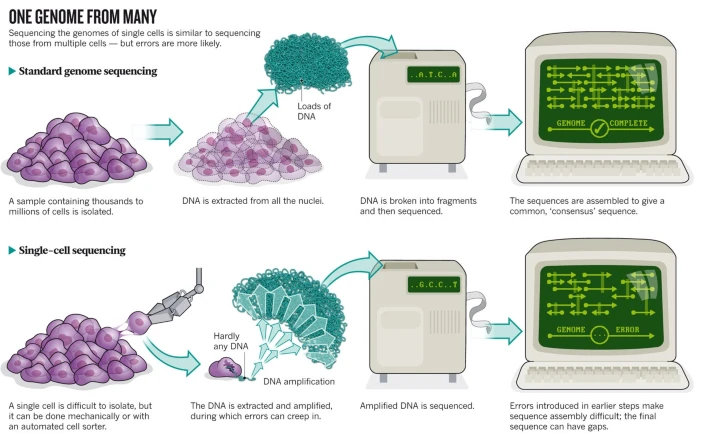
```

- Bulk RNA-seq measures the average expression of all cells of a sample, typically with millions of reads per sample.
- scRNA-seq measures thousands to millions of cells, but with only a limited number of reads per cell.
- Hence, the counts per gene and per cell are very low, and most counts are zero.

```{r, echo = FALSE, out.width = "100%", fig.cap = "Image credit: Davide Risso"}
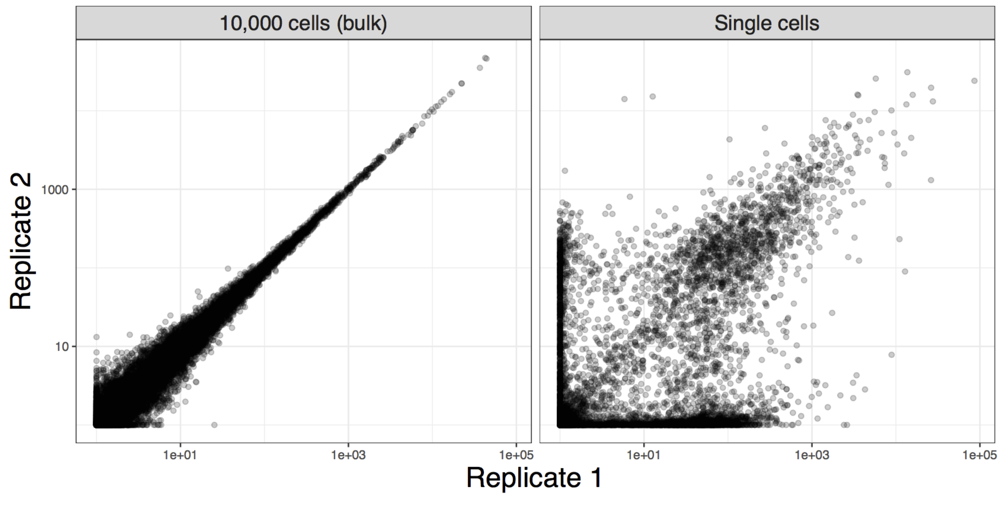
```

## Protocols

```{r, echo = FALSE, out.width = "100%", fig.cap = "Griffiths et al., 2018, doi: 10.15252/msb.20178046"}
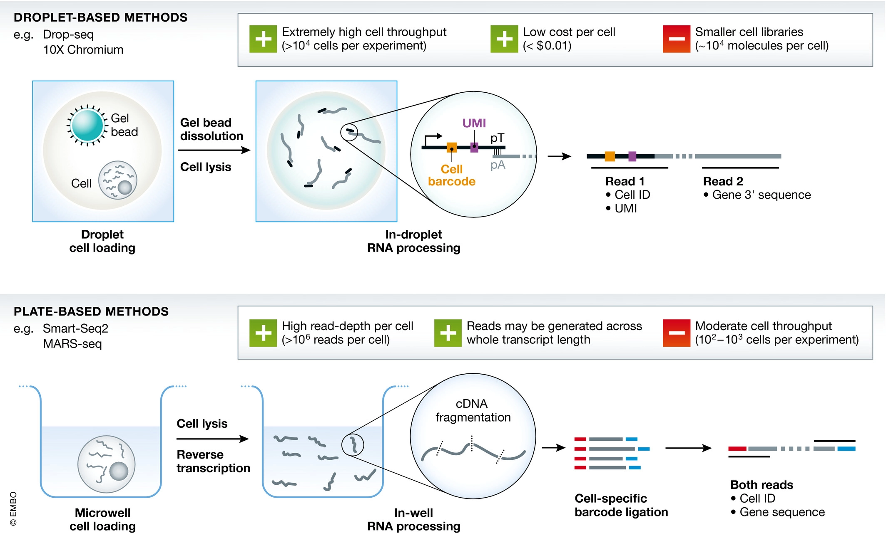
```

```{r, echo = FALSE, out.width = "100%", fig.cap = "Image credit: Davide Risso"}
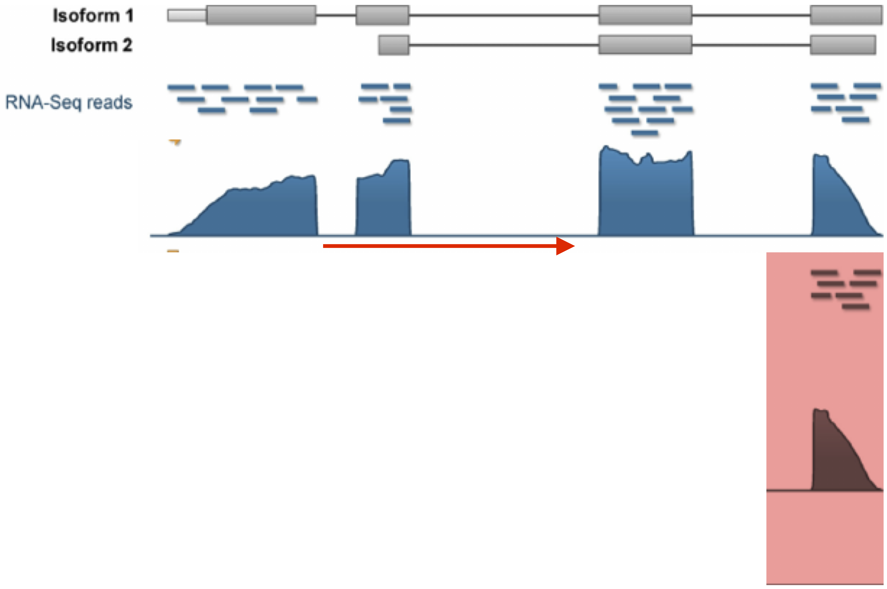
```

- **Full-length protocols** (typically plate-based, e.g. Smart-seq2 and Smart-seq3): a count is the number of reads that map to a gene, as in bulk RNA-seq. Few cells, but a high sequencing depth per cell and information on the full transcript.
- **UMI-based protocols** (typically droplet-based, e.g. 10x Genomics): every molecule gets a unique molecular identifier (UMI) before amplification. Reads with the same UMI are collapsed, so that a count is the number of observed molecules: PCR duplicates are removed. Many cells, but only the 3' or 5' end of the transcript is sequenced.
- Both suffer from a low **capture efficiency**: only a fraction of the molecules in a cell is captured and sequenced.

In this lecture we focus on UMI-based droplet data, the most common type of scRNA-seq data.

## Multiplexing

```{r, echo = FALSE, out.width = "100%", fig.cap = "Kang et al., 2018, doi: 10.1038/nbt.4042"}
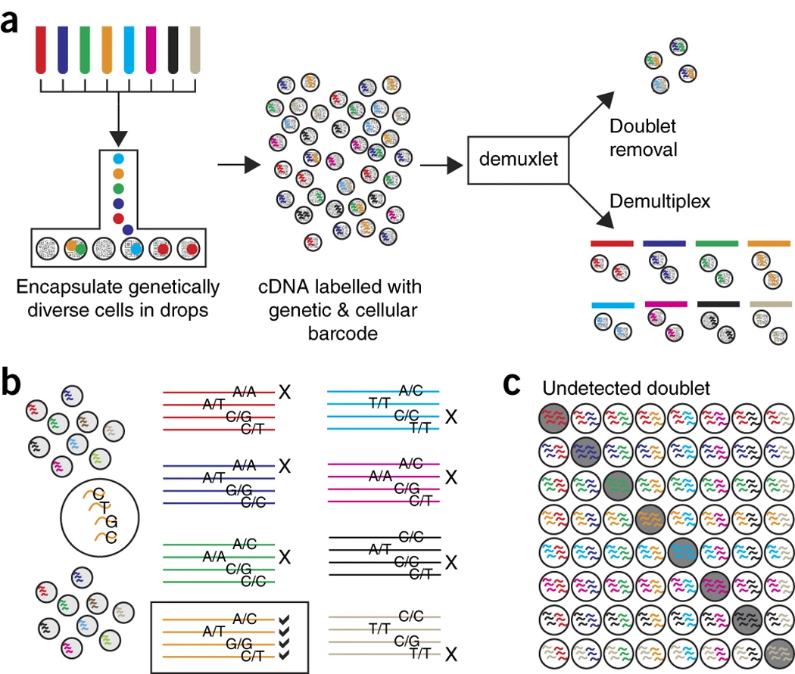
```

- Cells of different individuals can be pooled in one run and assigned to their individual afterwards, based on their genotype (demuxlet) or on a barcoded antibody (cell hashing).
- Multiplexing reduces the cost and avoids that the individual is confounded with the run.
- This is a matter of **experimental design**: we come back to this in the [multi-sample section](#multi-sample-experiments).

## Workflow

```{r, echo = FALSE, out.width = "100%", fig.cap = "Image credit: OSCA book"}
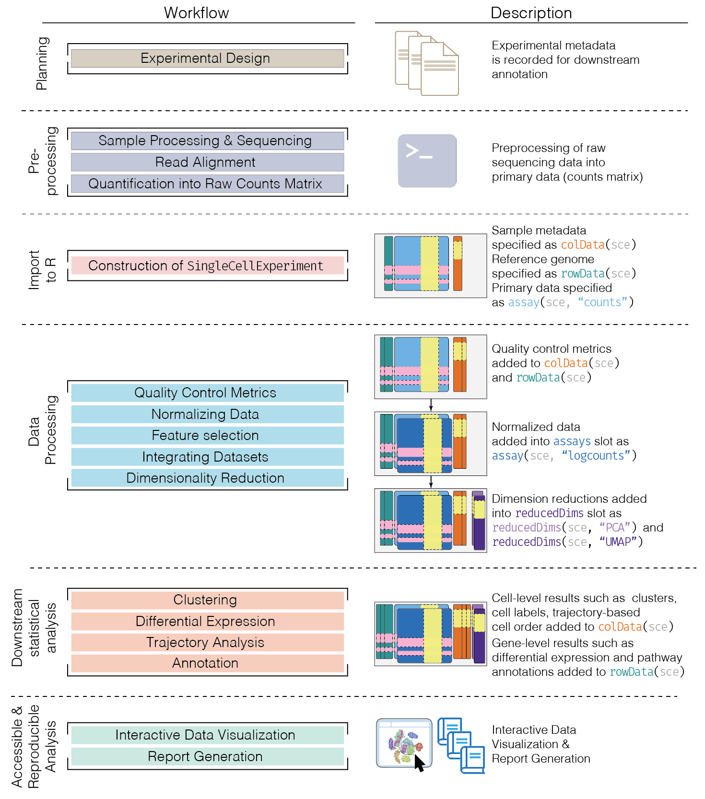
```

- The reads are processed with e.g. Cell Ranger, STARsolo or alevin-fry: cell barcode identification and correction, UMI collapsing and counting.
- The result is a count matrix with one row per gene and one column per droplet.
- In R/Bioconductor, the counts and all metadata are stored in a `SingleCellExperiment` object.

```{r, echo = FALSE, out.width = "100%", fig.cap = "Image credit: OSCA book"}
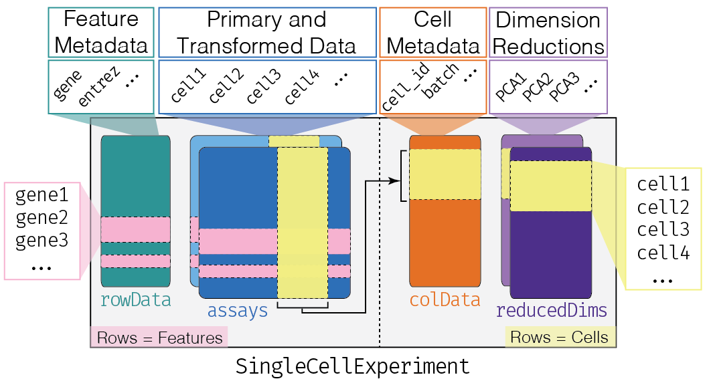
```

- It extends the `SummarizedExperiment` class of the bulk lectures with slots for dimension reduction results (`reducedDims`) and alternative experiments (`altExps`, e.g. spike-ins or antibody-derived tags).
- All slots are linked: filtering cells or genes also filters the corresponding metadata.

# Data

We use two datasets:

- **Mouse chimeric embryos** [@PijuanSala2019-gastrulation]: cells of a tdTomato-positive embryonic stem cell line were injected into wild-type mouse embryos, which were collected at E8.5 and sequenced with 10x Genomics. We analyse sample 5 to illustrate the workflow for a single sample.
- **Kang data** [@Kang2018-demuxlet]: peripheral blood mononuclear cells (PBMCs) of 8 lupus patients, untreated or stimulated with interferon beta. We use them for the multi-sample analyses.

The data are available as a [release of the course repository](https://github.com/statOmics/SGA/releases/tag/scrnaseq-v1).
The chimera data contain the cell-containing droplets of sample 5 before quality control.
The script `R/make_scrnaseq_data.R` in the course repository shows how the files were built from the Bioconductor packages MouseGastrulationData and muscData.

```{r}
dataUrl <- "https://github.com/statOmics/SGA/releases/download/scrnaseq-v1/"
dir.create("scrnaseqData", showWarnings = FALSE)
for (f in c("chimera_sample5.rds", "embryo_atlas_ref.rds", "kang.rds")) {
  if (!file.exists(file.path("scrnaseqData", f))) {
    download.file(paste0(dataUrl, f), file.path("scrnaseqData", f), mode = "wb")
  }
}
```

# Preprocessing

## Empty droplets

Most droplets do not contain a cell.
Still, they contain some RNA: **ambient RNA** of cells that were lysed or damaged before the droplets were formed.
We first look at all droplets of sample 5 with the raw data of the MouseGastrulationData package.

```{r}
raw <- WTChimeraData(samples = 5, type = "raw")[[1]]
raw
```

```{r}
ranks <- barcodeRanks(counts(raw))
as_tibble(as.data.frame(ranks)) |>
  filter(total > 0, !duplicated(rank)) |>
  ggplot(aes(rank, total)) +
  geom_point(size = 0.5) +
  geom_hline(yintercept = metadata(ranks)$knee, color = "dodgerblue", linetype = 2) +
  geom_hline(yintercept = metadata(ranks)$inflection, color = "darkgreen", linetype = 2) +
  scale_x_log10() +
  scale_y_log10() +
  labs(x = "Rank", y = "Total UMI count",
       caption = "blue: knee, green: inflection point") +
  theme_bw()
```

- The barcodes are ranked according to their total UMI count.
- Barcodes above the knee very likely contain a cell, barcodes with a very low count are empty.
- The barcodes in between are hard to classify with a threshold on the total count: a small cell with little RNA can have a lower count than an empty droplet with a lot of ambient RNA.

**emptyDrops** [@Lun2019-emptyDrops] uses the composition of the counts instead:

1. The ambient profile $\mathbf{p}_A$, i.e. the expected fraction of the ambient RNA that comes from each gene, is estimated from the barcodes with a total count below 100, which are assumed to be empty.
2. Under the null hypothesis that barcode $i$ is empty, its counts $\mathbf{y}_i$ are a sample from the ambient profile: given its total count $N_i$, they follow a Dirichlet-multinomial distribution with mean $N_i \mathbf{p}_A$.
3. The likelihood of the observed counts under this null is compared with that of random samples of the ambient profile with the same total count, which gives a **Monte Carlo p-value**.
4. The p-values are corrected for multiple testing, and barcodes with an FDR $\leq 0.001$ are called cells. Barcodes above the knee are always retained.

A cell differs from the ambient profile in its composition, regardless of its total count.
The emptyDrops results are stored in the data of the release:

```{r}
sce <- readRDS("scrnaseqData/chimera_sample5.rds")
sce
summary(sce$Total)
```

`r ncol(sce)` of the `r ncol(raw)` barcodes contain a cell.

```{r echo = FALSE}
rm(raw)
```

## Quality control

Some cells are damaged or stressed.
Typically, the cell membrane is damaged so that the cytoplasmic RNA leaks out, while the mitochondria, which have their own membrane, stay in the cell.
Such cells have

- a low total count (library size),
- a low number of detected genes,
- a high proportion of counts from mitochondrial genes.

Fixed thresholds, e.g. "at least 1000 genes and less than 5% mitochondrial counts", require experience with the tissue and the protocol: e.g. tumour cells and cardiomyocytes naturally have a high mitochondrial content.
We therefore use **adaptive thresholds**: we assume that most cells are of good quality, and flag cells that are outliers.
For the library size $N_i$, e.g., a cell is removed if

$$
\log N_i < \text{median}(\log \mathbf{N}) - 3 \times \text{MAD}(\log \mathbf{N}),
$$

with MAD the median absolute deviation, a robust estimate of the standard deviation.
For normally distributed data, the threshold of 3 MADs only removes 0.13% of the cells in each direction.
The library size and the number of detected genes are assessed on the log scale with a lower threshold, the mitochondrial proportion with an upper threshold.

```{r}
sce <- quickRnaQc.se(sce, subsets = list(mito = rowData(sce)$chr_mito))
metadata(sce)$qc$thresholds
table(sce$keep)
```

```{r, fig.width = 10, fig.height = 4}
qcData <- as_tibble(as.data.frame(colData(sce)))
p1 <- ggplot(qcData, aes(sum, detected, color = keep)) +
  geom_point(size = 0.5) +
  scale_x_log10() +
  scale_y_log10() +
  labs(x = "Library size", y = "Detected genes") +
  theme_bw()
p2 <- ggplot(qcData, aes(detected, subset.proportion.mito, color = keep)) +
  geom_point(size = 0.5) +
  scale_x_log10() +
  labs(x = "Detected genes", y = "Mitochondrial proportion") +
  theme_bw()
p1 + p2 + plot_layout(guides = "collect")
```

- Most removed cells have a small library, few detected genes and a high mitochondrial proportion: they are damaged cells.
- A concern is that we may remove a biologically distinct cell type, e.g. cells with a naturally low RNA content or a high metabolic activity.
- QC metrics are therefore often explored per cluster, or the removed cells are compared with the retained cells.

The authors of the study performed their own QC.
Cells that they removed have no published cell type label:

```{r}
table(keep = sce$keep, published = !is.na(sce$celltype.published))
sce <- sce[, sce$keep]
```

## Doublets

Some droplets contain two (or more) cells: **doublets**.
Doublets can be mistaken for intermediate or transitional cell states.

```{r, echo = FALSE, out.width = "100%", fig.cap = "Germain et al., 2021, doi: 10.12688/f1000research.73600.2"}
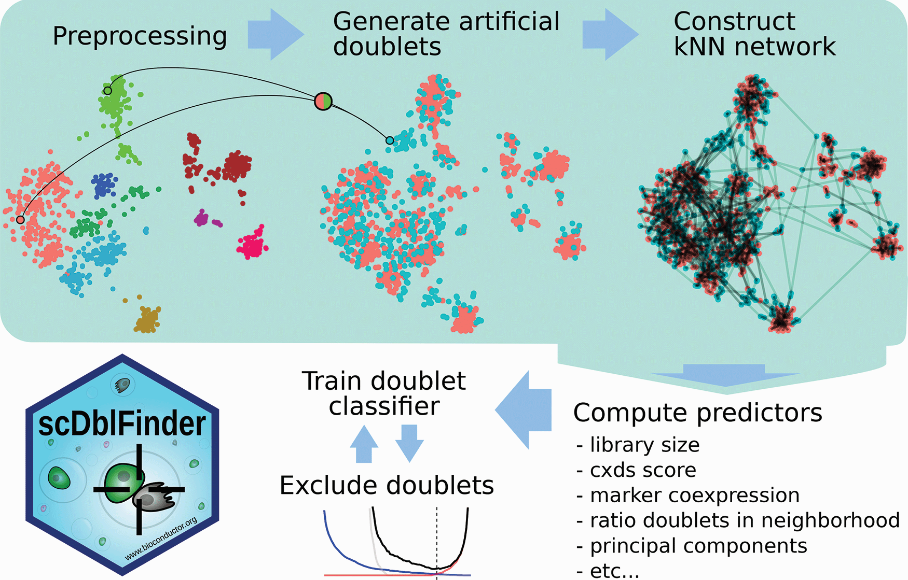
```

scDblFinder [@Germain2021-scDblFinder] simulates doublets:

1. Two random cells are selected and their counts are summed. This is repeated many times.
2. The real and simulated cells are projected into the same principal component space.
3. For each cell, the proportion of simulated doublets among its nearest neighbours is computed. Cells in a neighbourhood with many simulated doublets are likely doublets.
4. This proportion and other features are used to train a classifier that distinguishes the simulated doublets from the real cells.

Doublets of two cells of the same type cannot be detected in this way, but they are also less harmful.

```{r}
set.seed(1234)
sce <- scDblFinder(sce)
table(sce$scDblFinder.class)
table(class = sce$scDblFinder.class, published = !is.na(sce$celltype.published))
sce <- sce[, sce$scDblFinder.class == "singlet"]
```

As for QC, we should be careful: rare transitional cell populations can be hard to distinguish from doublets.

# The count model and normalisation

## A count model for UMI data

Let $y_{gi}$ be the UMI count of gene $g$ in cell $i$.
As in bulk RNA-seq, we model

$$
y_{gi} \sim NB(\mu_{gi}, \phi_g), \qquad \mu_{gi} = s_i N_i\, \pi_{gi},
$$

with $\pi_{gi}$ the relative abundance of gene $g$ in cell $i$, $N_i$ the library size and $s_i$ a normalisation factor.
In a GLM, $\log(s_i N_i)$ is used as an offset, so that the model parameters describe the relative abundances $\pi_{gi}$.

- The UMIs remove the PCR duplicates. For a homogeneous population of cells, the counts are therefore close to Poisson, i.e. the technical sampling of the molecules.
- The NB dispersion captures the biological variability between cells of the same population.

## Zero inflation?

```{r, echo = FALSE}
ct <- names(which.max(table(sce$celltype.published)))
```

scRNA-seq data contain many zeros.
Many authors have proposed **zero-inflated** models, e.g. the zero-inflated negative binomial (ZINB) distribution

$$
f(y_{gi}) = \pi^0_{gi}\, \delta_0(y_{gi}) + (1 - \pi^0_{gi})\, f_{NB}(y_{gi}; \mu_{gi}, \phi_g),
$$

a mixture of a point mass at zero, which represents "technical" zeros or dropouts, and an NB count component.

Are the zeros in UMI data more frequent than expected under an NB model?
We assess this for the `r ct` cells, the largest cell type of the published annotation [@Svensson2020-zeroinflation].
Under the model above with a common relative abundance $\pi_g$ for all cells of a homogeneous population,

- the maximum likelihood estimator of $\pi_g$ is $\hat\pi_g = \sum_i y_{gi} / \sum_i N_i$,
- the expected fraction of zeros under a Poisson model is $\frac{1}{n}\sum_i e^{-\hat\mu_{gi}}$,
- and under an NB model $\frac{1}{n}\sum_i (1 + \phi_g \hat\mu_{gi})^{-1/\phi_g}$, with $\phi_g$ estimated with the method of moments.

```{r}
y <- counts(sce)[, which(sce$celltype.published == ct)]
N <- colSums(y)
y <- y[rowSums(y) > 0, ]
pi <- rowSums(y) / sum(N)
mu <- outer(pi, N)
yDense <- as.matrix(y)
# moment estimator of the dispersion; a dispersion of (almost) zero gives the Poisson model
phi <- pmax(1e-8, rowSums((yDense - mu)^2 - mu) / rowSums(mu^2))
zeros <- tibble(
  mean = rowMeans(mu),
  observed = rowMeans(yDense == 0),
  Poisson = rowMeans(exp(-mu)),
  NB = rowMeans((1 + phi * mu)^(-1 / phi))
)
rm(yDense, mu)
```

```{r, fig.width = 10, fig.height = 4}
p1 <- ggplot(zeros, aes(mean, observed)) +
  geom_point(size = 0.3, alpha = 0.3) +
  geom_line(aes(y = Poisson), color = "red", data = ~ arrange(.x, mean)) +
  scale_x_log10() +
  labs(x = "Mean count", y = "Fraction of zeros",
       title = paste(ct, "- red: expected under Poisson")) +
  theme_bw()
p2 <- zeros |>
  pivot_longer(c(Poisson, NB), names_to = "model", values_to = "expected") |>
  ggplot(aes(expected, observed)) +
  geom_point(size = 0.3, alpha = 0.3) +
  geom_abline(intercept = 0, slope = 1, color = "red") +
  facet_wrap(~ model) +
  labs(x = "Expected fraction of zeros", y = "Observed fraction of zeros") +
  theme_bw()
p1 + p2 + plot_layout(widths = c(1, 1.6))
```

- The observed fraction of zeros closely follows the fraction expected under the Poisson model: no zero inflation is needed for UMI data of a homogeneous population.
- The zeros are mainly due to the low counts: a gene with an expected count of 0.1 in a cell is not observed in 90% of the cells.
- The few genes with more zeros than expected under the Poisson model are typically genes that differ in expression between the cells, e.g. because of cell subtypes or the cell cycle. The NB model captures this extra variability.
- Data of full-length protocols, with their high counts and the PCR amplification, may show zero inflation.

In a heterogeneous population, many zeros are biological: the gene is not expressed in a cell type.
They are captured by the cell type effects in the mean model, not by a zero-inflation component.

## Normalisation

```{r, echo = FALSE, out.width = "100%", fig.cap = "Lun et al., 2016, doi: 10.1186/s13059-016-0947-7"}
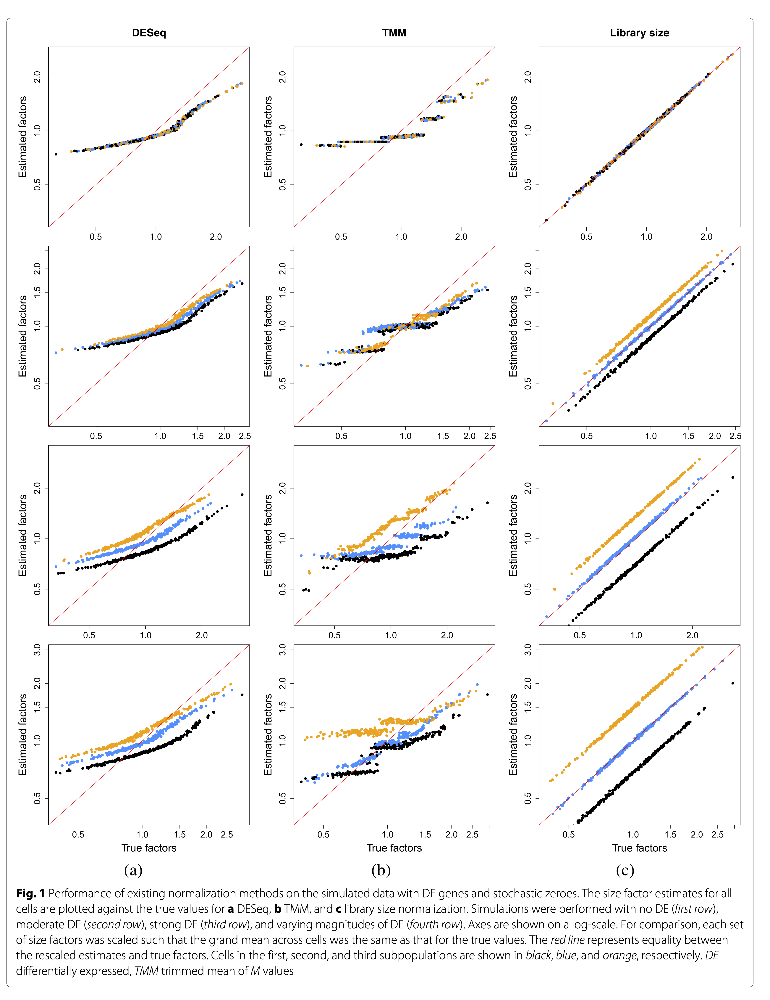
```

- **Library size normalisation**: $s_i = 1$, i.e. we only correct for the total count. This assumes that there is no composition bias between the cells.
- **TMM and DESeq2** correct for composition bias, but they are driven by the few genes without zeros, which makes them unstable for scRNA-seq data.
- **Deconvolution** [@Lun2016-pooling]: the counts of pools of cells are summed, so that there are fewer zeros, and a size factor is estimated for each pool against a reference pseudo-cell. The pools are overlapping, so that the size factors of the individual cells can be obtained from those of the pools by solving a linear system.

```{r, echo = FALSE, out.width = "100%", fig.cap = "Lun et al., 2016, doi: 10.1186/s13059-016-0947-7"}
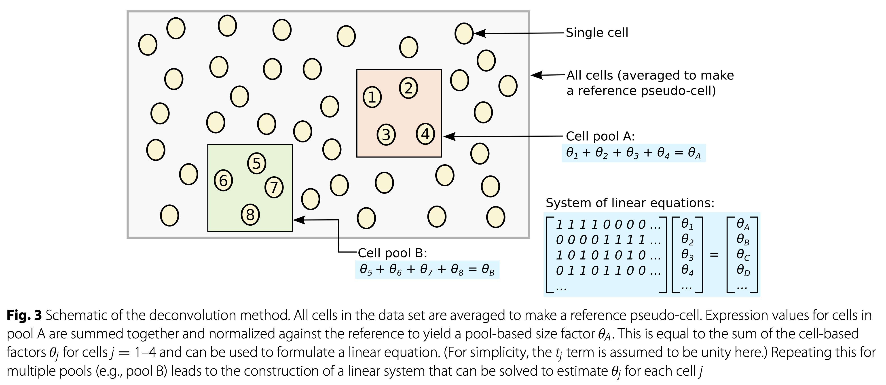
```

```{r}
libFactors <- sce$sum / mean(sce$sum)
pooledFactors <- pooledSizeFactors(sce)
```

```{r, fig.width = 6, fig.height = 4}
tibble(library = libFactors, deconvolution = pooledFactors,
       erythroid = grepl("Erythroid", sce$celltype.published)) |>
  ggplot(aes(library, deconvolution, color = erythroid)) +
  geom_point(size = 0.5) +
  geom_abline(intercept = 0, slope = 1, color = "red") +
  scale_x_log10() +
  scale_y_log10() +
  labs(x = "Library size factor", y = "Deconvolution size factor",
       color = "Erythroid cell") +
  theme_bw()
```

- Both size factors largely agree, but the deviations are cell type specific.
- The erythroid cells systematically get a smaller deconvolution size factor than their library size factor: a large part of their library consists of haemoglobin transcripts. This is a composition bias: with library size factors, all other genes appear to be expressed at a lower level in erythroid cells.
- In practice, library size factors are mostly used for exploration and clustering.
- For differential expression between conditions, we will aggregate the counts into pseudobulk samples, which can again be normalised with TMM (see [multi-sample experiments](#multi-sample-experiments)).

## Log-normalised counts

For exploration, most workflows use log-normalised counts

$$
z_{gi} = \log_2\left(\frac{y_{gi}}{s_i} + 1\right),
$$

with $s_i$ the size factor, centred at one.

```{r}
sce <- normalizeRnaCounts.se(sce)
assayNames(sce)
```

The log transformation, however, does not stabilise the variance of low counts, and the pseudocount of 1 distorts the data: a zero in a cell with a large library is more informative than a zero in a cell with a small library, but both get $z_{gi} = 0$.

```{r, echo = FALSE, out.width = "100%", fig.cap = "Townes et al., 2019, doi: 10.1186/s13059-019-1861-6"}
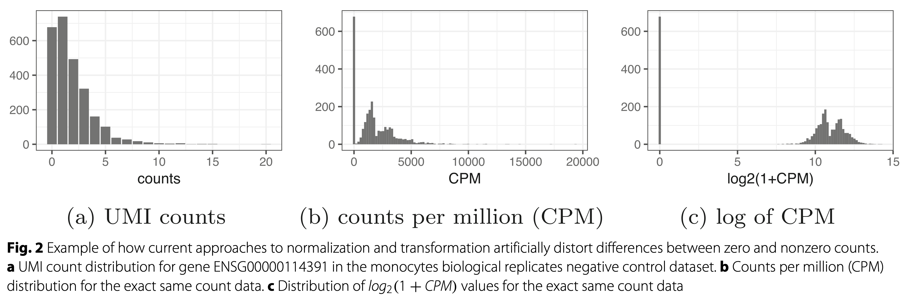
```

- @Townes2019-glmpca simulated data without any biological signal. After log normalisation, the first principal component is strongly related to the fraction of zeros in a cell.
- This motivates count models with offsets, also for dimension reduction: see [generalised matrix factorisation](#generalised-matrix-factorisation).

# Feature selection

- With thousands of genes, the distances between cells are dominated by noise: in high dimensions, all cells appear to be far apart.
- Most genes are uninformative: they are not expressed, or they are expressed at the same level in all cells.
- We therefore select the genes that are informative for the structure in the data, a first and simple step of dimension reduction.

## Highly variable genes

The most common approach selects genes with a high variance of the log-normalised counts relative to their mean.
The log transformation does not remove the mean-variance relation, so a trend is fitted, and genes with the largest residuals with respect to the trend are selected.

```{r}
sce <- chooseRnaHvgs.se(sce)
table(rowData(sce)$hvg)
```

```{r, fig.width = 6, fig.height = 4}
as_tibble(as.data.frame(rowData(sce))) |>
  ggplot(aes(means, variances, color = hvg)) +
  geom_point(size = 0.5) +
  geom_line(aes(y = fitted), color = "black") +
  labs(x = "Mean log-expression", y = "Variance of log-expression") +
  theme_bw()
```

## Genes with a high deviance

@Townes2019-glmpca select genes that fit poorly to a null model in which the relative abundance of a gene is the same in all cells,

$$
y_{gi} \sim Poisson(\mu_{gi}), \qquad \mu_{gi} = N_i\, \pi_g.
$$

The deviance compares the log-likelihood of this null model with that of the saturated model, in which every observation has its own mean:

$$
D_g = 2 \sum_i \left[ y_{gi} \log\frac{y_{gi}}{\hat\mu_{gi}} - (y_{gi} - \hat\mu_{gi}) \right], \qquad \hat\mu_{gi} = N_i \hat\pi_g.
$$

- This is the likelihood ratio test statistic for lack of fit of the null model of the [technical lecture](./05-rnaseq-technical.html#deviance-and-likelihood-ratio-test).
- With $\hat\pi_g = \sum_i y_{gi}/\sum_i N_i$, the second term sums to zero, and only the non-zero counts contribute to the first term: the deviance is cheap to compute on a sparse matrix.
- Genes with a large deviance vary more between cells than expected from the technical sampling: they are informative.
- @Townes2019-glmpca use the binomial deviance, which is close to the Poisson deviance for low counts.

```{r}
y <- counts(sce)
N <- colSums(y)
piHat <- rowSums(y) / sum(N)
nonzero <- summary(y)
devNonzero <- rowsum(nonzero$x * log(nonzero$x / (piHat[nonzero$i] * N[nonzero$j])), nonzero$i)
# genes without counts have a deviance of zero
deviance <- numeric(nrow(y))
deviance[as.integer(rownames(devNonzero))] <- 2 * devNonzero[, 1]
rowData(sce)$deviance <- deviance
rowData(sce)$highDeviance <- rank(-deviance) <= sum(rowData(sce)$hvg)
table(hvg = rowData(sce)$hvg, highDeviance = rowData(sce)$highDeviance)
```

Both approaches select largely the same genes.

**Pearson residuals** [@Lause2021-pearson] are a closely related approach.
Under an NB model with a fixed dispersion $\phi$ (e.g. 0.01),

$$
r_{gi} = \frac{y_{gi} - \hat\mu_{gi}}{\sqrt{\hat\mu_{gi} + \phi\hat\mu_{gi}^2}}
$$

has a variance of approximately one for all genes that follow the null model, whatever their mean.
Genes with a large variance of the Pearson residuals, $\sum_i r_{gi}^2/(n-1)$, are informative.
Note that $\sum_i r_{gi}^2$ and $D_g$ are the Pearson and deviance goodness-of-fit statistics, i.e. the numerators of the two estimators of the quasi-likelihood dispersion of the [technical lecture](./05-rnaseq-technical.html#quasi-likelihood).

# Dimension reduction

We project the cells into a low-dimensional space that retains as much of the structure as possible, for visualisation, clustering and the detection of batch effects.

## PCA

- Principal component analysis (PCA) finds the linear combinations of the genes with the largest variance, see the [HDDA course](https://statomics.github.io/HDDA/svd.html) for a refresher.
- It is typically performed on the log-normalised counts of the highly variable genes, and the top 10 to 50 principal components (PCs) are retained.

```{r}
sce <- runPca.se(sce, features = rowData(sce)$hvg)
pcaInfo <- metadata(sce)$PCA
tibble(pc = seq_along(pcaInfo$variance.explained),
       explained = pcaInfo$variance.explained / pcaInfo$total.variance) |>
  ggplot(aes(pc, explained)) +
  geom_point() +
  geom_line() +
  labs(x = "PC", y = "Proportion of variance explained") +
  theme_bw()
```

## Generalised matrix factorisation

PCA minimises the squared error between the (log-normalised) data and their low-rank approximation, which corresponds to a Gaussian likelihood with a constant variance.
This is inappropriate for counts, which have a mean-variance relation.

**Generalised matrix factorisation** (GMF) brings the low-rank approximation into a GLM:

$$
\left\{
\begin{array}{lcl}
y_{gi} &\sim& \text{Poisson}(\mu_{gi}) \text{ or } NB(\mu_{gi}, \phi)\\
\log \mu_{gi} &=& \log N_i + \mathbf{x}_i^T\boldsymbol{\beta}_g + \mathbf{u}_i^T\mathbf{v}_g
\end{array}
\right.
$$

- $\log N_i$ is an offset, as in the bulk RNA-seq models: no log transformation or pseudocount is needed.
- $\mathbf{x}_i$ are known covariates of cell $i$, e.g. the sample or the batch, with gene-specific effects $\boldsymbol{\beta}_g$: GMF can correct for them, which can be used for batch correction.
- $\mathbf{u}_i$ are the scores of cell $i$ on $K$ latent factors and $\mathbf{v}_g$ the loadings of gene $g$. They play the role of the PC scores and loadings, but they are estimated on the scale of the linear predictor, by maximising the (penalised) likelihood.
- With a Gaussian distribution, identity link and no offset, GMF reduces to PCA.

- GLM-PCA [@Townes2019-glmpca] is an early implementation for scRNA-seq.

- `omicsGMF` [@Segers2025-ce]: 

    - uses a fast stochastic gradient descent algorithm [sgdGMF, @Castiglione2026-sgdgmf],
    - so that it scales better to large datasets, and 
    - it can also handle Gaussian data with missing values, e.g. proteomics data.
    - It is a successor of ZINB-WaVE [@Risso2018-zinbwave] and NewWave [@Agostinis2022-newwave].

```{r}
hvgSce <- sce[rowData(sce)$hvg, ]
gmfOffset <- matrix(log(hvgSce$sum), nrow(hvgSce), ncol(hvgSce), byrow = TRUE)
set.seed(1234)
hvgSce <- runGMF(hvgSce, family = poisson(), ncomponents = 10, offset = gmfOffset)
reducedDim(sce, "GMF") <- reducedDim(hvgSce, "GMF")
```

The offset is a matrix with the same dimensions as the data: here, the log library size of each cell, which is the same for all genes.

```{r, fig.width = 10, fig.height = 4.5}
plotDims <- function(dims, color, colorName, title) {
  tibble(dim1 = dims[, 1], dim2 = dims[, 2], color = color) |>
    ggplot(aes(dim1, dim2, color = color)) +
    geom_point(size = 0.3) +
    labs(color = colorName, title = title) +
    theme_bw() +
    theme(legend.text = element_text(size = 6), legend.key.size = unit(0.3, "cm"))
}
plotDims(reducedDim(sce, "PCA"), sce$celltype.published, "Cell type", "PCA") +
  plotDims(reducedDim(sce, "GMF"), sce$celltype.published, "Cell type", "GMF") +
  plot_layout(guides = "collect")
```

- Both methods separate the erythroid cells from the other cell types along the first dimension.
- On these data, with a large sequencing depth per cell, both embeddings capture a similar structure. The advantages of GMF are largest for sparse data with low counts, where the log transformation and the pseudocount distort the data most [@Townes2019-glmpca], and when known covariates such as batch have to be corrected for.

How many components should we retain?

- For PCA, the variance explained by each component gives a scree plot.
- For GMF, `runRankGMF` computes the eigenvalues of the residual matrix after fitting the covariates, which also gives a scree plot, and `runCVGMF` selects the rank by cross-validation: the likelihood of held-out entries of the count matrix is computed for models with an increasing number of components. Cross-validation is the more principled approach, but it requires a model fit for every rank and fold.

```{r}
set.seed(1234)
rankFit <- runRankGMF(hvgSce, family = poisson(), maxcomp = 30, offset = gmfOffset)
tibble(component = 1:30, eigenvalue = metadata(rankFit)$rank_GMF$lambdas[1:30]) |>
  ggplot(aes(component, eigenvalue)) +
  geom_point() +
  geom_line() +
  scale_y_log10() +
  theme_bw()
rm(rankFit)
```

The eigenvalues drop sharply over the first 4 to 5 components and then decrease slowly.
We used 10 components: retaining a few components too many is less harmful for clustering than missing structure.

## t-SNE and UMAP

- With linear methods, the main structure is captured by a few components, but the cells of many cell types overlap in the first two dimensions.
- Non-linear methods such as t-SNE and UMAP are therefore used for visualisation. They start from the top PCs (or GMF components) and try to preserve the **neighbourhood** of each cell in two dimensions.
- t-SNE and UMAP preserve local structure: cells that are close together have a similar profile. Distances between clusters and the size of clusters, however, cannot be interpreted.
- The results depend on random initialisation and tuning parameters (e.g. the perplexity of t-SNE and the number of neighbours of UMAP).
- They are visualisation tools: downstream analyses such as clustering are performed on the PCs or GMF components, not on the t-SNE or UMAP coordinates.

`runAllNeighborSteps.se` computes the nearest neighbours of each cell once, and uses them for t-SNE, UMAP and clustering.

```{r}
set.seed(1234)
sce <- runAllNeighborSteps.se(sce)
sce <- runAllNeighborSteps.se(sce, reddim.type = "GMF", umap.output.name = "UMAP_GMF",
                              tsne.output.name = NULL, cluster.output.name = "clusters_GMF")
reducedDimNames(sce)
```

```{r, fig.width = 10, fig.height = 4.5}
plotDims(reducedDim(sce, "UMAP"), sce$celltype.published, "Cell type", "UMAP on PCA") +
  plotDims(reducedDim(sce, "UMAP_GMF"), sce$celltype.published, "Cell type", "UMAP on GMF") +
  plot_layout(guides = "collect")
```

# Clustering

We identify groups of cells with a similar expression profile, which we will interpret as cell types or states.

- Classical clustering methods such as k-means or hierarchical clustering scale poorly to many cells and need the number of clusters.
- **Graph-based clustering** is most common:
  1. Build a nearest-neighbour graph in the PC (or GMF) space: every cell is a node, and it is connected to its $k$ nearest neighbours. Edges are weighted by the number of shared neighbours.
  2. Detect communities in the graph with the Louvain or Leiden algorithm, which maximise the **modularity**: the density of the edges within communities compared with that between communities.
- The number of neighbours $k$ and the resolution of the community detection determine the granularity: there is no optimal number of clusters. Cells can be described by a hierarchy of cell types and states.

```{r}
table(sce$clusters)
```

```{r, fig.width = 10, fig.height = 4.5}
plotDims(reducedDim(sce, "UMAP"), factor(sce$clusters), "Cluster", "Clusters") +
  plotDims(reducedDim(sce, "UMAP"), sce$celltype.published, "Cell type", "Published labels")
```

```{r, fig.width = 8, fig.height = 5}
as_tibble(table(cluster = sce$clusters, celltype = sce$celltype.published)) |>
  group_by(cluster) |>
  mutate(proportion = n / sum(n)) |>
  ggplot(aes(factor(cluster, levels = sort(unique(sce$clusters))), celltype, fill = proportion)) +
  geom_tile() +
  scale_fill_viridis_c() +
  labs(x = "Cluster", y = "Published cell type") +
  theme_bw()
```

Most clusters correspond to one published cell type, while some cell types are split into several clusters.

# Marker genes

To interpret the clusters, we look for **marker genes**: genes that are highly expressed in one cluster compared to the others.

`scoreMarkers.se` compares every cluster with every other cluster, and summarises the pairwise effect sizes per gene:

- **Cohen's d**: the difference in mean log-expression divided by the pooled standard deviation.
- **AUC**: the probability that a random cell of the cluster has a higher expression than a random cell of the other cluster, i.e. the Wilcoxon-Mann-Whitney statistic divided by the product of the group sizes.
- **Detected**: the difference in the proportion of cells with a non-zero count.

The pairwise effects of a gene are summarised by their minimum, mean, median and maximum over all other clusters.
A high minimum AUC, e.g., means that the gene is up in the cluster compared to every other cluster.
Pairwise comparisons are preferred over a comparison with "all other cells", whose result depends on the composition of the other cells.

```{r}
markers <- scoreMarkers.se(sce, sce$clusters)
cl <- names(markers)[1]
markers[[cl]] |>
  as.data.frame() |>
  rownames_to_column("ENSEMBL") |>
  mutate(SYMBOL = rowData(sce)[ENSEMBL, "SYMBOL"]) |>
  arrange(desc(auc.mean)) |>
  dplyr::select(SYMBOL, mean, detected, cohens.d.mean, auc.min, auc.mean) |>
  head(10) |>
  knitr::kable(digits = 2, caption = paste("Top markers of cluster", cl))
```

```{r, fig.width = 8, fig.height = 3}
top <- rownames(markers[[cl]])[which.max(markers[[cl]]$auc.mean)]
tibble(cluster = factor(sce$clusters), expression = logcounts(sce)[top, ]) |>
  ggplot(aes(cluster, expression)) +
  geom_violin(scale = "width") +
  labs(y = "log-expression", title = rowData(sce)[top, "SYMBOL"]) +
  theme_bw()
```

## Double dipping

Can we use p-values to select the marker genes?

- The clusters are defined with the same data, so that the cells are split exactly where the expression differs.
- A test between clusters is therefore biased: it finds differences, even if there is no structure in the data.

We simulate 500 cells with Poisson counts for 200 genes, all with the same mean: there is no structure at all.

```{r, fig.width = 6, fig.height = 3.5}
set.seed(1234)
nullCounts <- matrix(rpois(200 * 500, lambda = 5), nrow = 200)
nullLog <- log2(nullCounts + 1)
nullClusters <- kmeans(prcomp(t(nullLog))$x[, 1:5], centers = 2)$cluster
pNull <- apply(nullLog, 1, function(x) t.test(x[nullClusters == 1], x[nullClusters == 2])$p.value)
tibble(p = pNull) |>
  ggplot(aes(p)) +
  geom_histogram(breaks = seq(0, 1, 0.05), color = "black", fill = "grey") +
  labs(x = "p-value", title = "Tests between clusters of null data") +
  theme_bw()
mean(p.adjust(pNull, "BH") < 0.05)
```

- The p-values are far from uniform: many genes appear to be "markers" between clusters that do not exist.
- p-values of marker genes are therefore only useful to rank the genes, not for formal inference.
- Valid inference requires e.g. **count splitting** [@Neufeld2024-countsplitting]: the counts are split into two independent Poisson parts, one to cluster and one to test.
- Note that this problem does not arise when we compare predefined groups, e.g. treated and untreated samples within a cell type: see the next section.

# Cell type annotation

Clusters can be annotated manually with known marker genes.
Alternatively, cells can be annotated with a labelled **reference dataset**.
SingleR [@Aran2019-SingleR]

1. selects marker genes between every pair of labels in the reference,
2. computes the Spearman correlation between the expression of each cell and each reference label on these genes,
3. assigns the label with the highest correlation, followed by a fine-tuning step in which the analysis is repeated with only the top-scoring labels.

The reference must be representative: the same tissue and developmental stage, and ideally the same technology. Cell types that are absent in the reference cannot be found.
We use a sample of the mouse gastrulation atlas of the same study as reference.

```{r}
ref <- readRDS("scrnaseqData/embryo_atlas_ref.rds")
ref <- normalizeRnaCounts.se(ref)
pred <- SingleR(sce, ref, labels = ref$celltype,
                assay.type.test = "logcounts", assay.type.ref = "logcounts")
table(pred$pruned.labels, useNA = "ifany") |> sort(decreasing = TRUE) |> head(10)
mean(pred$labels == sce$celltype.published, na.rm = TRUE)
```

```{r, fig.width = 8, fig.height = 5}
as_tibble(table(cluster = sce$clusters, label = pred$labels)) |>
  group_by(cluster) |>
  mutate(proportion = n / sum(n)) |>
  ggplot(aes(factor(cluster, levels = sort(unique(sce$clusters))), label, fill = proportion)) +
  geom_tile() +
  scale_fill_viridis_c() +
  labs(x = "Cluster", y = "SingleR label") +
  theme_bw()
```

# Multi-sample experiments

Most scRNA-seq experiments compare conditions, with cells of several individuals or samples per condition.
Two questions are of interest:

- **Differential expression** (DE, differential state): does the expression of a gene change between conditions, within a cell type?
- **Differential abundance** (DA): does the proportion of a cell type change between conditions?

## Kang data

```{r}
kang <- readRDS("scrnaseqData/kang.rds")
kang
table(kang$patient, kang$stim)
table(kang$celltype)
```

- The PBMCs of 8 lupus patients were stimulated with interferon beta (IFN-$\beta$) for 6 hours or left untreated [@Kang2018-demuxlet].
- The cells of the 8 patients were pooled per condition: one pool with all control cells and one pool with all stimulated cells, each processed and sequenced in a **separate run**.
- The cells were assigned to their patient with demuxlet, based on their genotype (multiplexing, see above).
- Each patient contributes cells to both conditions: the patients are **blocks**, as the cell lines in the airway data.

## Exploration: the cells cluster per condition

We explore the data with the same workflow as before.
To keep it fast, we use the library size as size factor.

```{r}
kangExpl <- normalizeRnaCounts.se(kang, size.factors = colSums(counts(kang)))
kangExpl <- chooseRnaHvgs.se(kangExpl)
kangExpl <- runPca.se(kangExpl, features = rowData(kangExpl)$hvg)
set.seed(1234)
kangExpl <- runAllNeighborSteps.se(kangExpl, tsne.output.name = NULL, cluster.output.name = NULL)
```

```{r, fig.width = 10, fig.height = 4.5}
plotDims(reducedDim(kangExpl, "UMAP"), kangExpl$stim, "Condition", "UMAP") +
  plotDims(reducedDim(kangExpl, "UMAP"), kangExpl$celltype, "Cell type", "UMAP")
```

```{r}
pcKang <- reducedDim(kangExpl, "PCA")
r2Stim <- sapply(1:5, function(k) summary(lm(pcKang[, k] ~ kangExpl$stim))$r.squared)
round(r2Stim, 2)
```

- Every cell type splits into a control and a stimulated cluster: the UMAP is almost a mirror image of itself.
- The condition explains `r round(100 * r2Stim[2])`% of the variance of PC2.
- At first sight, this suggests a huge effect of the stimulation on all cell types.

## Experimental design: condition and run are confounded

- With genotype-based multiplexing, the control and stimulated cells of the **same** patient cannot be sequenced in the same run: they have the same genotype, so demuxlet cannot tell them apart.
- In this experiment, all control cells were therefore sequenced in a first run and all stimulated cells in a second run.
- The condition is completely **confounded** with the run (batch): every difference between the conditions is the sum of the effect of IFN-$\beta$ and the effect of the run (sample preparation, capture, library preparation, sequencing).
- Multiplexing removes the batch effect *between patients*: all patients are in the same run, and blocking for the patient is possible. It does not help for the comparison of the conditions.
- With a single run per condition, the run effect cannot be estimated, and no statistical method can separate it from the effect of the stimulation.

**Better designs**

- **Balanced genotype multiplexing**: run 1 contains the control cells of patients 1–4 and the stimulated cells of patients 5–8, run 2 the stimulated cells of patients 1–4 and the control cells of patients 5–8.
  Every run contains both conditions, and every patient both runs. The run effect is then estimable and is removed by including it in the model, e.g. `~ patient + run + stim`.
- **Cell hashing**: the cells of each sample are labelled with an antibody carrying a sample-specific DNA barcode (hashtag) before pooling, so that the control and stimulated cells of the same patient can be sequenced in the same run.
- More runs, with the conditions randomised over the runs, so that the run becomes a block.

This is the same principle as in the [blocking lecture](./03-blocking-wrapup.html): randomise and block for known sources of variability, and never let a nuisance factor coincide with the factor of interest.

In the remainder, we keep this flaw in mind: the effects of the "stimulation" are the combined effects of IFN-$\beta$ and the run.

## Batch correction

When samples are processed in different batches, the cells of the same cell type of different batches can form separate clusters, as the control and stimulated cells above.
How we deal with the batch depends on the goal of the analysis.

**Exploration** (visualisation, clustering, annotation) needs coordinates for each cell in which the batch effect is removed:

- *Model-based*: GMF can include the batch as a known covariate, $\log \mu_{ig} = o_i + \mathbf{x}_i^\top \boldsymbol\beta_g + \mathbf{u}_i^\top \mathbf{v}_g$, with $\mathbf{x}_i$ the batch of cell $i$ (argument `X` of `runGMF`). The latent factors $\mathbf{u}_i$ then capture the structure that remains after accounting for the batch.
- *Integration*: methods such as mutual nearest neighbours [MNN, @Haghverdi2018-mnn] or Harmony align the cells of the batches in the PC space. MNN pairs each cell with the cells of the other batch that are among its nearest neighbours, and vice versa. These pairs are assumed to be of the same cell type, and their differences estimate the batch effect, locally in each region of the PC space.

**Inference** (DE, DA) models the batch: it is included in the design of the pseudobulk model, as we do for the patient.
The model estimates the batch effect together with its uncertainty, and the counts remain counts.
The clusters or labels of the exploration define which cells form a pseudobulk sample, but the test is performed on the raw counts, not on corrected values.

**Batch effects can differ between cell types.**
A covariate $\mathbf{x}_i$ for the batch gives each gene one batch effect, which is the same for all cells.
We illustrate what this implies on a random subset of 5000 cells of the Kang data.
We remove the effect of the condition from the log-normalised expression values, either with one effect per gene for all cells, or with a separate effect per gene in each cell type.

```{r}
set.seed(1234)
cellSub <- sample(ncol(kangExpl), 5000)
logExpr <- as.matrix(logcounts(kangExpl)[rowData(kangExpl)$hvg, cellSub])
cellInfo <- as.data.frame(colData(kangExpl)[cellSub, c("stim", "celltype")])

# remove the effect of the condition on each gene with a linear model
removeStim <- function(y, info) {
  X <- model.matrix(~ stim, data = info)
  beta <- coef(lm.fit(X, t(y)))
  y - outer(beta["stimstim", ], X[, "stimstim"])
}

# one effect per gene for all cells
logMain <- removeStim(logExpr, cellInfo)

# a separate effect per gene in each cell type
logPerType <- logExpr
for (ct in as.character(unique(cellInfo$celltype))) {
  sel <- cellInfo$celltype == ct
  if (length(unique(cellInfo$stim[sel])) == 2) {
    logPerType[, sel] <- removeStim(logExpr[, sel], cellInfo[sel, ])
  }
}

umapOf <- function(y) {
  pcs <- runPca(y, number = 20)$components
  set.seed(1234)
  runUmap(pcs)
}
umaps <- lapply(list(logExpr, logMain, logPerType), umapOf)
```

```{r, fig.width = 12, fig.height = 7.5}
titles <- c("No correction", "One effect per gene", "One effect per gene and cell type")
wrap_plots(c(
  lapply(1:3, function(i) plotDims(umaps[[i]], cellInfo$stim, "Condition", titles[i])),
  lapply(1:3, function(i) plotDims(umaps[[i]], cellInfo$celltype, "Cell type", ""))
), nrow = 2, guides = "collect")
```

- With one effect per gene, the separation between the conditions decreases, but does not disappear.
- Only when the effect is removed separately in each cell type, the control and stimulated cells of each cell type overlap.
- The effect of the condition (and the run) differs between cell types: e.g. the fold changes are larger in the monocytes than in the T cells, and partly involve other genes.
- A batch covariate in GMF or in a linear model only removes the part of the batch effect that is shared by all cells. Removing the cell-type-specific part requires an interaction with the cell type, which is unknown at this stage, as the cell types are what we want to find. Integration methods such as MNN correct locally, and can therefore also remove batch effects that differ between cell types.

**Pitfalls**

- Integration methods assume that the batches contain (largely) the same cell types in the same states. They can therefore also remove genuine biological differences between batches (**overcorrection**).
- Batch correction cannot rescue a design in which the batch is confounded with the condition.
  In the Kang data, the right panels look like a successful correction, but they remove the effect of the run *and* the effect of IFN-$\beta$, as both cannot be distinguished.
  Including the run in the pseudobulk model is impossible for the same reason: the run and condition columns of the design matrix are identical.
- For the annotation of the cell types, aligning the conditions can still be useful: the same cell types are then found in both conditions, and the effect of the condition is assessed afterwards with the pseudobulk analysis.

## Pseudoreplication

```{r, echo = FALSE, out.width = "100%", fig.cap = "Image credit: Milan Malfait"}
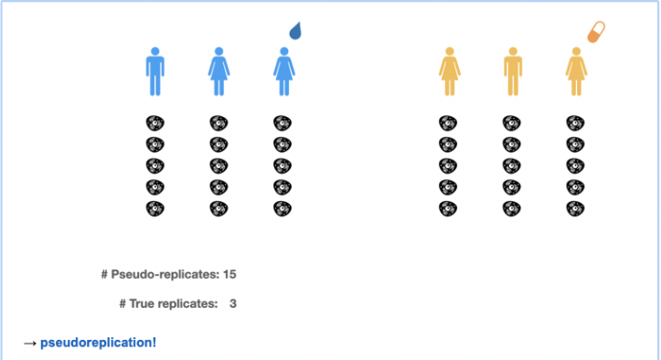
```

- The cells are nested in patients: cells of the same patient are correlated.
- The experimental unit for the comparison of conditions is the patient sample, not the cell. Treating cells as independent replicates is **pseudoreplication**, as the technical repeats of the [mixed models lecture](./mixedModels.html).
- With thousands of cells per sample, the standard errors are severely underestimated, and many false positives arise.

We illustrate this with the CD14+ monocytes of the untreated cells, which were all sequenced in the same run.
We randomly split the 8 patients in two groups of 4: there is no true difference between the groups.

```{r}
mono <- kang[, kang$celltype == "CD14+ Monocytes" & kang$stim == "ctrl"]
set.seed(1234)
groupA <- sample(levels(mono$patient), 4)
mono$group <- factor(ifelse(mono$patient %in% groupA, "A", "B"))
table(mono$patient, mono$group)
```

**Cells as replicates**: a limma analysis of the log-normalised counts of all cells.

```{r}
mono <- normalizeRnaCounts.se(mono)
keepGenes <- rowMeans(counts(mono) > 0) > 0.1
fitCells <- lmFit(as.matrix(logcounts(mono)[keepGenes, ]), model.matrix(~ group, data = colData(mono)))
fitCells <- eBayes(fitCells)
sum(p.adjust(fitCells$p.value[, "groupB"], "BH") < 0.05)
```

**Pseudobulk**: the counts of all cells of a patient are summed, and the pseudobulk samples are analysed with the edgeR QL pipeline.

```{r}
pbMono <- aggregateAcrossCells.se(mono, factors = list(patient = mono$patient))
yMono <- DGEList(assay(pbMono, "sums"),
                 samples = data.frame(group = mono$group[match(pbMono$patient, mono$patient)]))
yMono <- yMono[filterByExpr(yMono, group = yMono$samples$group), , keep.lib.sizes = FALSE]
yMono <- normLibSizes(yMono)
fitMono <- glmQLFit(yMono, model.matrix(~ group, data = yMono$samples))
summary(decideTests(glmQLFTest(fitMono, coef = "groupB")))
```

- When cells are treated as replicates, `r sum(p.adjust(fitCells$p.value[, "groupB"], "BH") < 0.05)` genes are "differentially expressed" between two random groups of patients: the differences between patients are mistaken for differences between the groups.
- The pseudobulk analysis correctly finds no or hardly any DE genes.

```{r, echo = FALSE, out.width = "80%", fig.cap = "Crowell et al., 2020, doi: 10.1038/s41467-020-19894-4"}
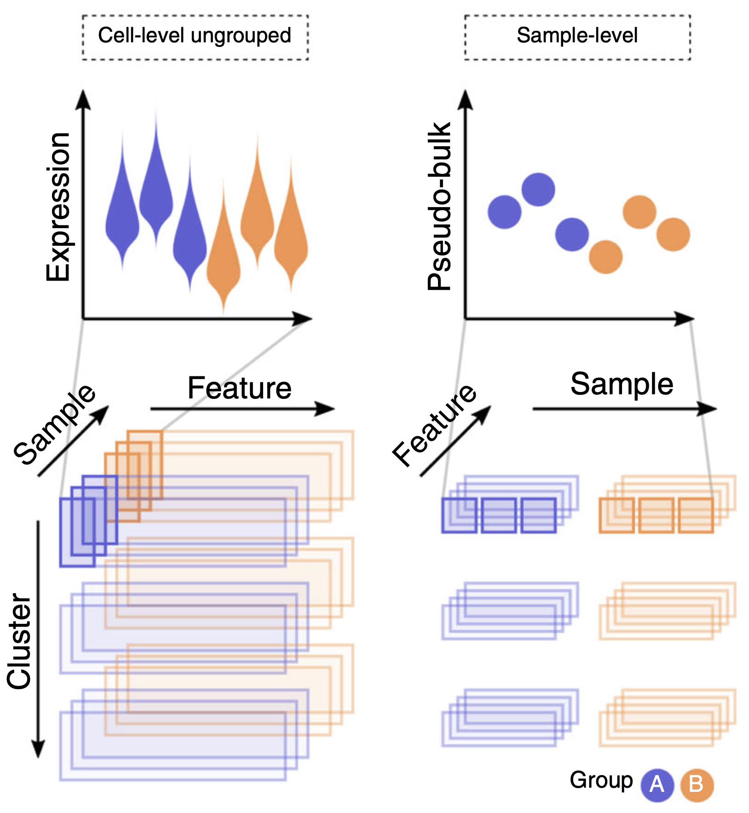
```

```{r, echo = FALSE, out.width = "100%", fig.cap = "Squair et al., 2021, doi: 10.1038/s41467-021-25960-2"}
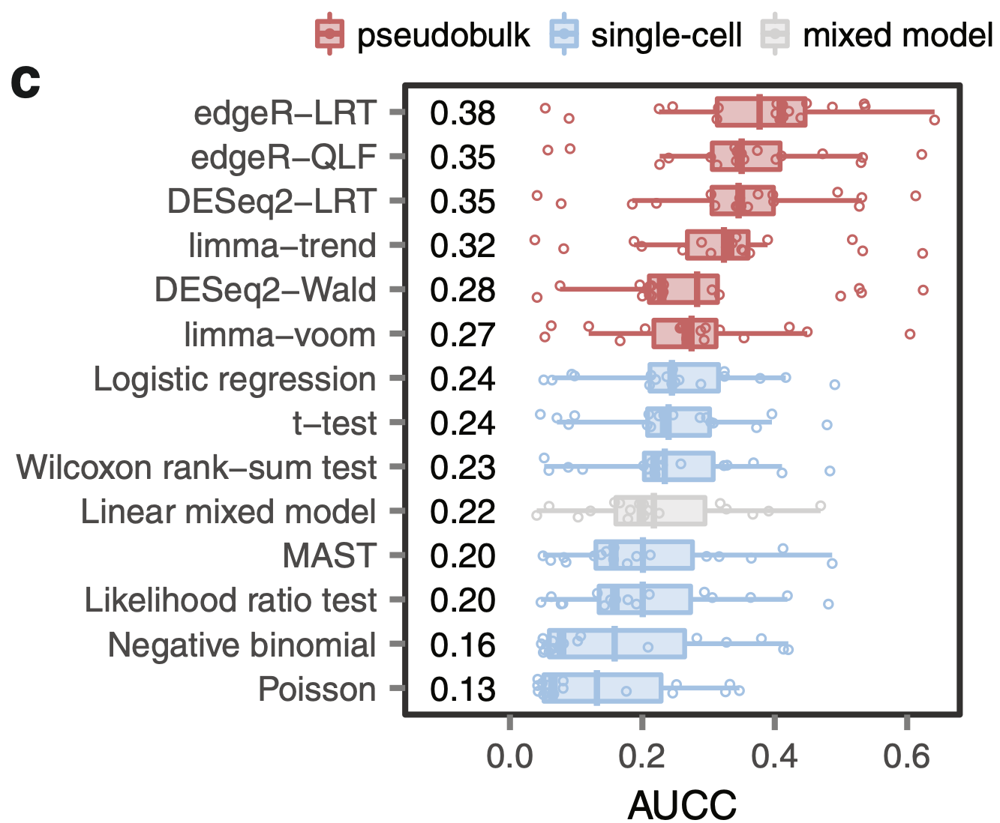
```

Benchmarks confirm that pseudobulk methods control the false discovery rate and are among the most powerful methods [@Crowell2020-muscat; @Squair2021-pseudobulk; @Junttila2022-benchmark].
Mixed models with a random effect for the patient are an alternative, but they are computationally much more demanding and not more powerful.

## Differential expression between conditions

For each cell type, we sum the counts of the cells per patient and condition, and analyse the pseudobulk samples with the edgeR QL pipeline.

```{r}
pb <- aggregateAcrossCells.se(kang, factors = list(celltype = kang$celltype,
                                                   patient = kang$patient,
                                                   stim = kang$stim))
pb
summary(pb$counts)
```

Every pseudobulk sample consists of `r min(pb$counts)` to `r max(pb$counts)` cells.
As in the airway data, we block for the patient:

$$
\log \mu_{gpc} = \log(s_{pc} N_{pc}) + \beta_{g0} + \beta_{g,p} + \beta_{g,\text{stim}}\, x_{c},
$$

with $p$ the patient, $c$ the condition and $x_c$ an indicator for the stimulated cells.
Because of the confounding, $\beta_{g,\text{stim}}$ estimates the sum of the effect of IFN-$\beta$ and the effect of the run.

```{r}
pseudobulkDE <- function(celltype) {
  sel <- pb$celltype == celltype
  y <- DGEList(assay(pb, "sums")[, sel],
               samples = as.data.frame(colData(pb)[sel, c("patient", "stim", "counts")]))
  y <- y[filterByExpr(y, group = y$samples$stim), , keep.lib.sizes = FALSE]
  y <- normLibSizes(y)
  design <- model.matrix(~ patient + stim, data = y$samples)
  fit <- glmQLFit(y, design)
  glmQLFTest(fit, coef = "stimstim")
}
deResults <- lapply(setNames(levels(kang$celltype), levels(kang$celltype)), pseudobulkDE)
sapply(deResults, function(res) summary(decideTests(res))[, 1]) |>
  t() |>
  knitr::kable(caption = "Number of DE genes (FDR 5%) per cell type")
```

```{r}
topTags(deResults[["CD14+ Monocytes"]], n = 10)$table |>
  dplyr::select(logFC, logCPM, F, FDR) |>
  knitr::kable(digits = 3, caption = "CD14+ Monocytes")
```

- Many genes differ between the conditions in most cell types. The number of DE genes is much smaller for cell types with few cells, e.g. the megakaryocytes: their pseudobulk samples have low counts, so that fewer genes pass the filter and the power is lower.
- The top genes of the CD14+ monocytes include interferon-stimulated genes such as *IFITM1*, *CD38* and *SOCS1*. This is prior knowledge that supports a genuine response to IFN-$\beta$.
- The design, however, does not allow to attribute the individual DE genes, or the number of DE genes, to the stimulation: each of them can equally well be a run effect. The analysis is valid for the comparison of the two runs, not for the comparison of the two treatments.
- With many DE genes, TREAT (`glmTreat`) can be used to focus on large fold changes.
- The analysis per cell type allows to find cell-type-specific responses. A formal test of whether the response differs between cell types would require a model with a cell type $\times$ condition interaction on the pseudobulk samples of all cell types. Such a model assumes that the variability between patients is the same in all cell types, which is often not the case, e.g. because the pseudobulk samples of different cell types consist of very different numbers of cells. Pseudobulk workflows such as muscat [@Crowell2020-muscat] therefore analyse each cell type separately.

## Differential detection

Pseudobulk DE analyses test for changes in the mean expression.
With the low counts of scRNA-seq data, whether a gene is detected in a cell at all is also informative.
@Gilis2025-dd show that changes in the average fraction of cells in which a gene is detected (**differential detection**, DD) provide information that is complementary to DE.

**Data**: we binarise the counts ($z_{gi} = 1$ if $y_{gi} > 0$) and sum them per sample: $Z_{gs} = \sum_{i \in s} z_{gi}$ is the number of cells of sample $s$ in which gene $g$ is detected, out of $n_s$ cells.

**Model**: the same NB GLM with the edgeR QL pipeline,

$$
\log \text{E}[Z_{gs}] = \log(n_s \, \text{CDR}_s) + \mathbf{x}_s^\top \boldsymbol\beta_g,
$$

- The offset contains the number of cells $n_s$: we model the fraction of cells in which the gene is detected, as the library size in the DE analysis.
- $\text{CDR}_s$ is the cellular detection rate of the sample: the average fraction of cells in which a gene is detected. It corrects for global differences in detection, e.g. due to the sequencing depth, as the normalisation factors in the DE analysis.
- Genes detected in (almost) all cells carry no information on detection: genes with a median detection fraction of 0.9 or more over the samples are removed.
- The binarised counts are bounded by $n_s$, so they can be underdispersed with respect to the Poisson distribution: the QL test is performed with `poisson.bound = FALSE`.

This is the workflow `edgeR_NB_optim` of @Gilis2025-dd, which performed best in their benchmarks.
We use it for the CD14+ monocytes, on the genes of the DE analysis.

```{r}
mono <- kang[, kang$celltype == "CD14+ Monocytes"]
detected <- Matrix::drop0(counts(mono))
detected@x[] <- 1
binMono <- SingleCellExperiment(list(counts = detected), colData = colData(mono))
pbBin <- aggregateAcrossCells.se(binMono, factors = list(patient = binMono$patient,
                                                         stim = binMono$stim))

deMono <- deResults[["CD14+ Monocytes"]]
detection <- sweep(assay(pbBin, "sums"), 2, pbBin$counts, "/")
medDetection <- matrixStats::rowMedians(as.matrix(detection[rownames(deMono), ]))
keepDD <- rownames(deMono)[medDetection < 0.9]
cdr <- colMeans(detection[keepDD, ])

yDD <- DGEList(assay(pbBin, "sums")[keepDD, ],
               samples = as.data.frame(colData(pbBin)[, c("patient", "stim", "counts")]))
yDD$offset <- log(pbBin$counts * cdr)
designDD <- model.matrix(~ patient + stim, data = yDD$samples)
yDD <- estimateDisp(yDD, designDD)
fitDD <- glmQLFit(yDD, designDD, robust = TRUE)
ddMono <- glmQLFTest(fitDD, coef = "stimstim", poisson.bound = FALSE)
summary(decideTests(ddMono))
```

**Stage-wise testing of DE and DD**

With two hypotheses per gene, we control the FDR at the gene level with [stage-wise testing](./05-rnaseq-technical.html#stage-wise-testing):

1. *Screening*: the null hypothesis that neither the mean expression nor the detection changes. We combine the DE and DD p-values with the harmonic mean, $p_g = 2 / (1/p_g^{DE} + 1/p_g^{DD})$, which is also valid for dependent tests [@Wilson2019-hmp]. Genes that were removed from the DD analysis get their DE p-value.
2. *Confirmation*: the DE and DD hypotheses of the genes that pass the screening. Once the screening null hypothesis is rejected, at most one of the two hypotheses can be true, so Shaffer's method requires no further correction (`shafferS1(diag(2))` returns `1 1`, `method = "none"`).

```{r}
pDE <- setNames(deMono$table$PValue, rownames(deMono))
pDD <- setNames(rep(NA, length(pDE)), names(pDE))
pDD[rownames(ddMono)] <- ddMono$table$PValue
pScreen <- ifelse(is.na(pDD), pDE, 2 / (1 / pDE + 1 / pDD))

stageRObj <- stageR(pScreen = pScreen, pConfirmation = cbind(DD = pDD, DE = pDE),
                    pScreenAdjusted = FALSE)
stageRObj <- stageWiseAdjustment(stageRObj, method = "none", alpha = 0.05, allowNA = TRUE)
ddDe <- getResults(stageRObj)
table(DD = ddDe[, "DD"], DE = ddDe[, "DE"])
```

```{r, fig.width = 6, fig.height = 5}
tibble(gene = rownames(ddMono),
       logFC_DE = deMono$table[rownames(ddMono), "logFC"],
       logFC_DD = ddMono$table$logFC,
       DE = ddDe[rownames(ddMono), "DE"] == 1,
       DD = ddDe[rownames(ddMono), "DD"] == 1) |>
  mutate(significant = case_when(DE & DD ~ "DE and DD", DE ~ "DE only",
                                 DD ~ "DD only", TRUE ~ "none")) |>
  ggplot(aes(logFC_DE, logFC_DD, color = significant)) +
  geom_point(size = 0.5) +
  geom_abline(linetype = 2) +
  labs(x = "log fold change DE", y = "log fold change DD", color = "") +
  theme_bw()
```

- The log fold changes of DE and DD are strongly correlated: for most genes, a change in mean expression goes together with a change in detection.
- Still, `r sum(ddDe[, "DD"] == 1 & ddDe[, "DE"] == 0, na.rm = TRUE)` genes are only found in the DD analysis, and `r sum(ddDe[, "DE"] == 1 & ddDe[, "DD"] == 0, na.rm = TRUE)` only in the DE analysis: both analyses provide complementary information, and @Gilis2025-dd recommend to perform both.
- The DD log fold changes are relative to the CDR of the sample, and are interpreted as the change in the detection fraction compared to an average gene.
- The confounding with the run also applies here: e.g. differences in capture efficiency between the runs affect the detection of genes. The CDR offset only corrects for the global part of such differences.

## Differential abundance

Does the composition of the PBMCs change upon stimulation?
We count the cells per cell type and sample, and model these counts with the same NB GLM.

```{r}
abundances <- table(kang$celltype, interaction(kang$patient, kang$stim, sep = "_"))
abundanceSamples <- tibble(sample = colnames(abundances)) |>
  separate(sample, c("patient", "stim"), sep = "_", remove = FALSE) |>
  mutate(patient = factor(patient), stim = factor(stim, levels = c("ctrl", "stim")))
yDA <- DGEList(unclass(abundances), samples = as.data.frame(abundanceSamples))
designDA <- model.matrix(~ patient + stim, data = yDA$samples)
fitDA <- glmQLFit(yDA, designDA)
topTags(glmQLFTest(fitDA, coef = "stimstim"))$table |>
  knitr::kable(digits = 3)
```

- Only the proportion of NK cells changes significantly, and the fold change is small. The composition of the PBMCs hardly changes between the conditions, as expected after only 6 hours.
- Again, the change in NK cells cannot be attributed to the stimulation: the cell type proportions can also differ between runs, e.g. because cell types differ in how well they survive the sample preparation or are captured in the droplets.
- The library size is the total number of cells of a sample: the model describes the **proportion** of each cell type.
- The proportions are **compositional**: if one cell type increases, the proportions of all other cell types decrease. A change in one cell type therefore shows up as a change in the opposite direction in all other cell types.
- TMM normalisation assumes that most cell types do not change. With only a few cell types this is a strong assumption. Alternatively, TREAT can be used to focus on large changes, which are unlikely to be due to a compositional effect of another cell type.
- Here, the cell types were annotated after the stimulation: the stimulation can change the expression of the marker genes, and thus the labels.

# Summary

- Droplet-based scRNA-seq data are low counts with many zeros. After removal of empty droplets, low-quality cells and doublets, they are well described by Poisson and NB models: no zero inflation is needed.
- The concepts of the bulk RNA-seq lectures carry over: offsets for the library size, deviances for feature selection, and GLMs with a low-rank term for dimension reduction (GMF).
- Clustering and marker gene detection are exploratory: the p-values of tests between clusters are not valid, because the data are used twice.
- In multi-sample experiments, the experimental unit is the sample, not the cell. Pseudobulk analyses with the edgeR QL pipeline control the FDR for differential expression between conditions, and allow to block for the individual.
- Differential detection, a pseudobulk analysis of the binarised counts, provides information that is complementary to DE; both can be combined with stage-wise testing.
- The cell counts per cell type and sample can be analysed with the same NB GLMs for differential abundance, keeping their compositional nature in mind.
- Batch effects are removed for exploration (GMF with a batch covariate, or integration methods such as MNN for batch effects that differ between cell types), but modelled for inference (the batch in the pseudobulk design).
- Experimental design remains crucial: multiplexing removes batch effects between individuals, but conditions that are processed in separate runs are confounded with the run. Neither batch correction nor modelling can repair this afterwards.

# References {-}
